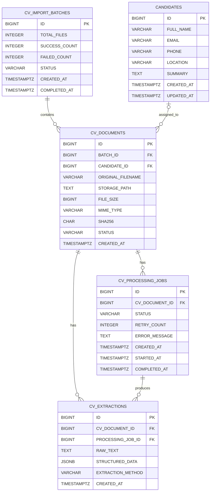

# CV Compass — POC CV Ingestion: Database Foundation

**Document status:** Historical database-foundation draft; not the current schema or task authorization
**Scope:** POC (before Phase 1)
**Branch:** `feature/poc-cv-ingestion`
**Suggested repository path:** `docs/POC_CV_INGESTION_DATABASE_FOUNDATION.md`
**Last updated:** 2026-10-13

## 1. Purpose and scope

Build a small proof of concept to validate ingestion and extraction of approximately **100 PDF CVs**, with a maximum of **10 files per upload batch** (approximately 10 batches). The POC should demonstrate that the system can:

1. Accept and track a batch of CVs.
2. Store original PDF files outside PostgreSQL and record their metadata.
3. Create and track asynchronous text extraction / OCR jobs.
4. Preserve raw extracted text and structured results for future reprocessing.
5. Store a minimal Candidate profile and optionally link multiple CVs to one Candidate.
6. Record failures and retry processing without losing the original document.

**Out of scope:** production-scale ingestion of 100,000 CVs; search, ranking and search indexing; normalized experiences, skills, education, job titles, industries or companies; automatic candidate merging; a complete review workflow; frontend and Upload API implementation as part of the *database-foundation task*.

> POC scale is not the production scale. The schema should remain evolvable through Flyway rather than attempt to anticipate every client requirement now.

## 2. Technology and conventions

| Item | Decision |
|---|---|
| Backend | Java 25, Spring Boot 4.1.1, Gradle, Spring Modulith |
| Database | PostgreSQL 17 |
| Migration | Flyway |
| OCR | Separate Python worker (integration follows database foundation) |
| ID type | `BIGINT GENERATED BY DEFAULT AS IDENTITY` (or consistent identity strategy) |
| Time type | `TIMESTAMPTZ` |
| Table and column names | **UPPERCASE_SNAKE_CASE** |
| JSON result | `JSONB` |
| Original PDF storage | File system/object storage; database stores location and metadata only |

**PostgreSQL naming caveat:** To preserve uppercase identifiers, migrations must quote them (e.g. `"CV_DOCUMENTS"`, `"ORIGINAL_FILENAME"`). All later SQL and JPA mappings must consistently respect that choice. PostgreSQL folds unquoted identifiers to lowercase.

## 3. POC database — five CORE tables

### 3.1 `CV_IMPORT_BATCHES` — Upload batch tracking

| Field | PostgreSQL type | Null? | Constraints / description |
|---|---|---|---|
| `ID` | BIGINT | No | PK, identity |
| `TOTAL_FILES` | INTEGER | No | Number of submitted files, `1..10` for the POC |
| `SUCCESS_COUNT` | INTEGER | No | Default `0`, nonnegative |
| `FAILED_COUNT` | INTEGER | No | Default `0`, nonnegative |
| `STATUS` | VARCHAR(20) | No | `PENDING`, `PROCESSING`, `COMPLETED`, `PARTIAL_FAILED`, `FAILED` |
| `CREATED_AT` | TIMESTAMPTZ | No | Default `CURRENT_TIMESTAMP` |
| `COMPLETED_AT` | TIMESTAMPTZ | Yes | Batch completion time |

**Rules:** Counters must never be negative or exceed `TOTAL_FILES` in aggregate. A batch can be partially successful. For approved M5 Batch Management, `SUCCESS_COUNT` means file storage and metadata commit succeeded, while `FAILED_COUNT` means file ingestion failed. These are not OCR counters; see the historical context and current roadmap links in section 7. Any future processing counters require separate requirements.

### 3.2 `CANDIDATES` — Minimal candidate profile

| Field | PostgreSQL type | Null? | Constraints / description |
|---|---|---|---|
| `ID` | BIGINT | No | PK, identity |
| `FULL_NAME` | VARCHAR(255) | Yes | Name extracted or verified; do not invent missing names |
| `EMAIL` | VARCHAR(255) | Yes | Contact email if present |
| `PHONE` | VARCHAR(50) | Yes | Phone number if present |
| `LOCATION` | VARCHAR(255) | Yes | Location as extracted / minimally cleaned |
| `SUMMARY` | TEXT | Yes | Extracted summary, if available |
| `CREATED_AT` | TIMESTAMPTZ | No | Default `CURRENT_TIMESTAMP` |
| `UPDATED_AT` | TIMESTAMPTZ | No | Default `CURRENT_TIMESTAMP`; application maintains updates |

**Rules:** Do not create unique constraints on `FULL_NAME`, `EMAIL` or `PHONE`. Candidate identity is not guaranteed by one matching attribute. A CV may remain unassigned until a human reviews it. No automatic merge of suspected duplicates.

### 3.3 `CV_DOCUMENTS` — Logical CV and file metadata

| Field | PostgreSQL type | Null? | Constraints / description |
|---|---|---|---|
| `ID` | BIGINT | No | PK, identity |
| `BATCH_ID` | BIGINT | No | FK → `CV_IMPORT_BATCHES.ID` |
| `CANDIDATE_ID` | BIGINT | Yes | FK → `CANDIDATES.ID`, nullable until verified/assigned |
| `ORIGINAL_FILENAME` | VARCHAR(255) | No | User-supplied filename (sanitize for display/storage) |
| `STORAGE_PATH` | TEXT | No | Server-controlled path/key; never trust a client-supplied path |
| `FILE_SIZE` | BIGINT | No | Size in bytes, nonnegative |
| `MIME_TYPE` | VARCHAR(100) | No | Detected/validated MIME type |
| `SHA256` | CHAR(64) | No | Lowercase hexadecimal content digest for duplicate detection |
| `STATUS` | VARCHAR(20) | No | `PENDING`, `PROCESSING`, `COMPLETED`, `FAILED` |
| `CREATED_AT` | TIMESTAMPTZ | No | Default `CURRENT_TIMESTAMP` |

**Rules:** A Candidate may have many CVs; a CV links to zero or one Candidate. `SHA256` should be indexed but **not UNIQUE** until duplicate-file policy is confirmed. PDF binary content must not be stored in PostgreSQL. Use a server-generated unique storage key to prevent filename collisions.

### 3.4 `CV_PROCESSING_JOBS` — Extraction/OCR job tracking

| Field | PostgreSQL type | Null? | Constraints / description |
|---|---|---|---|
| `ID` | BIGINT | No | PK, identity |
| `CV_DOCUMENT_ID` | BIGINT | No | FK → `CV_DOCUMENTS.ID` |
| `STATUS` | VARCHAR(20) | No | `PENDING`, `PROCESSING`, `COMPLETED`, `FAILED` |
| `RETRY_COUNT` | INTEGER | No | Default `0`, nonnegative |
| `ERROR_MESSAGE` | TEXT | Yes | Failure details, sanitized to avoid exposing sensitive data |
| `CREATED_AT` | TIMESTAMPTZ | No | Default `CURRENT_TIMESTAMP` |
| `STARTED_AT` | TIMESTAMPTZ | Yes | Processing start |
| `COMPLETED_AT` | TIMESTAMPTZ | Yes | Processing end |

**Rules:** A CV may have multiple jobs (manual rerun or new extraction attempt). Upload acceptance and OCR completion are separate events. A failed job must not delete its PDF. Do not hold the HTTP upload request open until all OCR jobs finish.

### 3.5 `CV_EXTRACTIONS` — Raw and structured extraction results

| Field | PostgreSQL type | Null? | Constraints / description |
|---|---|---|---|
| `ID` | BIGINT | No | PK, identity |
| `CV_DOCUMENT_ID` | BIGINT | No | FK → `CV_DOCUMENTS.ID` |
| `PROCESSING_JOB_ID` | BIGINT | No | FK → `CV_PROCESSING_JOBS.ID` |
| `RAW_TEXT` | TEXT | Yes | Extracted PDF text or OCR text |
| `STRUCTURED_DATA` | JSONB | Yes | Parser output; may contain names, contacts, work history, skills, etc. |
| `EXTRACTION_METHOD` | VARCHAR(30) | No | `TEXT_EXTRACTION` or `OCR` |
| `CREATED_AT` | TIMESTAMPTZ | No | Default `CURRENT_TIMESTAMP` |

**Rules:** Preserve original extraction outputs so parser behavior can be reviewed and improved. Do not overwrite older extractions when rerunning. `CV_EXTRACTIONS.CV_DOCUMENT_ID` must match the document linked by `PROCESSING_JOB_ID`; enforce with a composite FK where practical or explicitly validate at the application layer. A `STRUCTURED_DATA` field does **not** mean the corresponding normalized profile tables already exist.

**Illustrative JSONB payload** (not a final client-approved schema):

```json
{
  "fullName": "Nguyen Van A",
  "email": "example@example.com",
  "phone": "0900000000",
  "location": "Ho Chi Minh City",
  "experiences": [
    {
      "jobTitle": "Backend Developer",
      "company": "ABC Company",
      "startDate": "2022",
      "endDate": "2025"
    }
  ],
  "skills": ["Java", "Spring Boot", "PostgreSQL"]
}
```

## 4. Relationships (ERD)



## 5. Indexes and constraints to implement

- Primary key on `ID` for all five tables.
- Foreign key indexes: `CV_DOCUMENTS.BATCH_ID`, `CV_DOCUMENTS.CANDIDATE_ID`, `CV_PROCESSING_JOBS.CV_DOCUMENT_ID`, `CV_EXTRACTIONS.CV_DOCUMENT_ID`, `CV_EXTRACTIONS.PROCESSING_JOB_ID`.
- Non-unique index on `CV_DOCUMENTS.SHA256`.
- Consider indexes on job/document `STATUS` only when actual queue polling patterns are known; avoid speculative indexes.
- Check valid status values and extraction methods.
- Check `TOTAL_FILES BETWEEN 1 AND 10` for this POC **only if** the migration is explicitly POC-specific; preferably enforce upload-batch limit in application validation to avoid a production migration for larger batches.
- Check `FILE_SIZE >= 0`, `RETRY_COUNT >= 0`, `SUCCESS_COUNT >= 0`, `FAILED_COUNT >= 0`, and `SUCCESS_COUNT + FAILED_COUNT <= TOTAL_FILES`.
- Consider a check for lowercase 64-character hexadecimal `SHA256`.
- Avoid cascading deletion of CV files/extraction records without a defined retention and audit policy.

## 6. End-to-end POC processing flow

1. **Upload batch request** — validate a maximum of 10 PDF files, allowed MIME/signature, size limits and safe filenames.
2. **Create batch** — insert `CV_IMPORT_BATCHES` with `PENDING` status.
3. **Persist files** — save each PDF outside PostgreSQL, calculate SHA-256, insert `CV_DOCUMENTS` records. Design compensation/cleanup for partial failures between file storage and DB commit.
4. **Enqueue processing** — insert one `CV_PROCESSING_JOBS` row per accepted CV. POC implementation may use DB polling; no message broker is required initially.
5. **Extract text** — try native PDF text extraction; use OCR for scanned/image-only PDFs. Preserve processing failures.
6. **Store result** — insert `CV_EXTRACTIONS.RAW_TEXT`, `STRUCTURED_DATA` and `EXTRACTION_METHOD`.
7. **Candidate handling** — optionally create/link a `CANDIDATES` record when identity is sufficiently clear; otherwise leave `CANDIDATE_ID` null. Never auto-merge suspected duplicates.
8. **Finalize statuses** — update job, document and batch statuses/counters consistently.

**Security baseline:** CVs contain personal data. Restrict access to stored PDFs and extraction text, keep storage outside publicly served paths, avoid logging raw CV content, and do not send CVs to external services without client authorization.

## 7. Roadmap reference

The former milestone table and A–D proposal were split into
[historical foundation planning](history/poc-foundation-plan.md).
Use the [current roadmap](roadmap.md) and an explicitly approved task spec;
no Active/complete/next milestone is inferred from this database draft.

## 8. Acceptance criteria for the POC

- Can upload ~100 sample CVs in batches of no more than 10.
- Every accepted PDF has an associated `CV_DOCUMENTS` record and a recoverable storage location.
- OCR/text-extraction attempts are tracked independently of the upload request.
- Raw text is persisted when extraction succeeds; structured JSONB can be stored when parser output is available.
- Failures are visible and can be retried without losing the original PDF.
- One Candidate can link to multiple CVs; unknown candidates can remain unassigned.
- Database migration succeeds on a clean PostgreSQL 17 instance.
- No search/ranking implementation is required for POC acceptance.

## 9. Open decisions / not finalized

1. **Duplicate-file policy:** reject duplicate SHA-256, retain each upload as a separate logical document, or reuse a physical file object later?
2. **Candidate creation rule:** when should the system create a Candidate automatically versus leave a CV unassigned?
3. **OCR parser choice:** native text extractor, OCR engine, language packs and thresholds are to be benchmarked using real samples.
4. **Storage policy:** local disk path vs object storage; retention, backup and access controls.
5. **Retry strategy:** maximum attempts, backoff and recovery of jobs stuck in `PROCESSING`.
6. **Batch success semantics (resolved for M5):** counters represent file ingestion success/failure; OCR success is separate and requires its own approved requirements.
7. **Extraction schema:** which fields the POC parser can reliably extract; JSONB shape is provisional.

## 10. Future evolution (not in the POC migration)

- Production ingestion at ~100,000 CVs, robust deduplication (`CV_FILE_OBJECTS`), import audit and reconciliation.
- Candidate matching review and candidate-name aliases.
- Normalized `CANDIDATE_EXPERIENCES`, `CANDIDATE_SKILLS`, `CANDIDATE_EDUCATIONS`, `CANDIDATE_LANGUAGES`, `CANDIDATE_CERTIFICATIONS`.
- Job-title, industry and company taxonomy/aliases/relations.
- Search projection, search filters, ranking and explanations.

**Historical foundation-task boundary:** The original assignment stopped after Milestone A. Later task boundaries are recorded only as historical context in section 7. Current milestone status and next scope require explicit confirmation in the roadmap.
