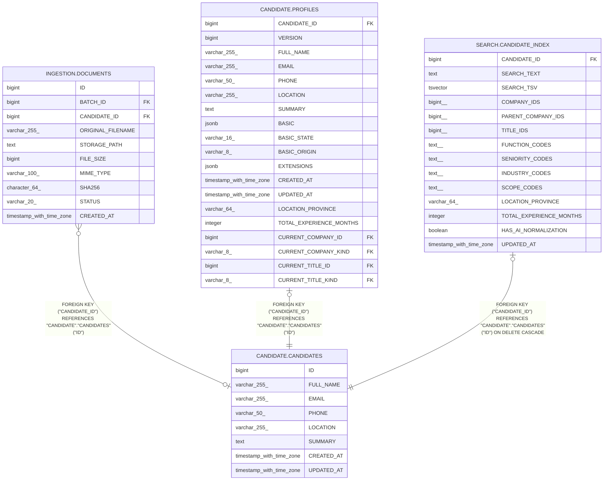

# CANDIDATE.CANDIDATES

## Description

Định danh ứng viên và thông tin cơ bản ban đầu.

## Columns

| Name | Type | Default | Nullable | Children | Parents | Comment |
| ---- | ---- | ------- | -------- | -------- | ------- | ------- |
| ID | bigint |  | false | [INGESTION.DOCUMENTS](INGESTION.DOCUMENTS.md) [CANDIDATE.PROFILES](CANDIDATE.PROFILES.md) [SEARCH.CANDIDATE_INDEX](SEARCH.CANDIDATE_INDEX.md) |  | Khóa chính định danh ứng viên. |
| FULL_NAME | varchar(255) |  | true |  |  |  |
| EMAIL | varchar(255) |  | true |  |  |  |
| PHONE | varchar(50) |  | true |  |  |  |
| LOCATION | varchar(255) |  | true |  |  |  |
| SUMMARY | text |  | true |  |  |  |
| CREATED_AT | timestamp with time zone | CURRENT_TIMESTAMP | false |  |  |  |
| UPDATED_AT | timestamp with time zone | CURRENT_TIMESTAMP | false |  |  |  |

## Constraints

| Name | Type | Definition |
| ---- | ---- | ---------- |
| PK_CANDIDATES | PRIMARY KEY | PRIMARY KEY ("ID") |

## Indexes

| Name | Definition |
| ---- | ---------- |
| PK_CANDIDATES | CREATE UNIQUE INDEX "PK_CANDIDATES" ON "CANDIDATE"."CANDIDATES" USING btree ("ID") |

## Relations

---

> Generated by [tbls](https://github.com/k1LoW/tbls)
