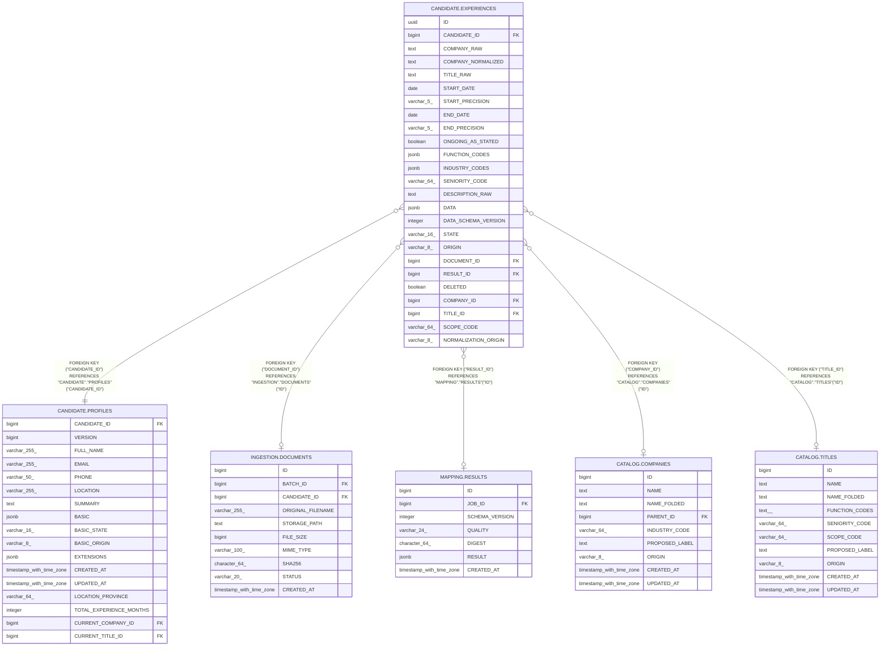

# CANDIDATE.EXPERIENCES

## Description

Kinh nghiệm ứng viên cùng nguồn bằng chứng và trạng thái xác nhận.

## Columns

| Name | Type | Default | Nullable | Children | Parents | Comment |
| ---- | ---- | ------- | -------- | -------- | ------- | ------- |
| ID | uuid |  | false |  |  | Khóa chính của kinh nghiệm ứng viên. |
| CANDIDATE_ID | bigint |  | false |  | [CANDIDATE.PROFILES](CANDIDATE.PROFILES.md) | Khóa ngoại tới hồ sơ ứng viên. |
| COMPANY_RAW | text |  | true |  |  |  |
| COMPANY_NORMALIZED | text |  | true |  |  |  |
| TITLE_RAW | text |  | true |  |  |  |
| START_DATE | date |  | true |  |  |  |
| START_PRECISION | varchar(5) |  | true |  |  |  |
| END_DATE | date |  | true |  |  |  |
| END_PRECISION | varchar(5) |  | true |  |  |  |
| ONGOING_AS_STATED | boolean | false | false |  |  | Dấu hiệu công việc còn tiếp diễn theo thông tin nguồn. |
| FUNCTION_CODES | jsonb | '[]'::jsonb | false |  |  |  |
| INDUSTRY_CODES | jsonb | '[]'::jsonb | false |  |  |  |
| SENIORITY_CODE | varchar(64) |  | true |  |  |  |
| DESCRIPTION_RAW | text |  | true |  |  |  |
| DATA | jsonb |  | false |  |  |  |
| DATA_SCHEMA_VERSION | integer | 1 | false |  |  |  |
| STATE | varchar(16) |  | false |  |  | Trạng thái xác nhận kinh nghiệm ứng viên. |
| ORIGIN | varchar(8) |  | false |  |  |  |
| DOCUMENT_ID | bigint |  | true |  | [INGESTION.DOCUMENTS](INGESTION.DOCUMENTS.md) | Khóa ngoại tới tài liệu làm bằng chứng. |
| RESULT_ID | bigint |  | true |  | [MAPPING.RESULTS](MAPPING.RESULTS.md) | Khóa ngoại tới kết quả ánh xạ nguồn. |
| DELETED | boolean | false | false |  |  | Trạng thái xóa mềm của kinh nghiệm ứng viên. |
| COMPANY_ID | bigint |  | true |  | [CATALOG.COMPANIES](CATALOG.COMPANIES.md) | Khóa ngoại tới công ty chuẩn hóa, không thay đổi giá trị gốc. |
| TITLE_ID | bigint |  | true |  | [CATALOG.TITLES](CATALOG.TITLES.md) | Khóa ngoại tới chức danh chuẩn hóa, không thay đổi giá trị gốc. |
| SCOPE_CODE | varchar(64) |  | true |  |  | Mã phạm vi công việc đã chuẩn hóa. |
| NORMALIZATION_ORIGIN | varchar(8) |  | true |  |  | Nguồn chuẩn hóa AI hoặc người dùng. |

## Constraints

| Name | Type | Definition |
| ---- | ---- | ---------- |
| CANDIDATE_EXPERIENCES_DATA_SCHEMA_VERSION_check | CHECK | CHECK (("DATA_SCHEMA_VERSION" = 1)) |
| CANDIDATE_EXPERIENCES_DATA_check | CHECK | CHECK ((jsonb_typeof("DATA") = 'object'::text)) |
| CANDIDATE_EXPERIENCES_END_PRECISION_check | CHECK | CHECK ((("END_PRECISION" IS NULL) OR (("END_PRECISION")::text = ANY ((ARRAY['YEAR'::character varying, 'MONTH'::character varying, 'DAY'::character varying])::text[])))) |
| CANDIDATE_EXPERIENCES_ORIGIN_check | CHECK | CHECK ((("ORIGIN")::text = ANY ((ARRAY['MAPPING'::character varying, 'USER'::character varying])::text[]))) |
| CANDIDATE_EXPERIENCES_START_PRECISION_check | CHECK | CHECK ((("START_PRECISION" IS NULL) OR (("START_PRECISION")::text = ANY ((ARRAY['YEAR'::character varying, 'MONTH'::character varying, 'DAY'::character varying])::text[])))) |
| CANDIDATE_EXPERIENCES_STATE_check | CHECK | CHECK ((("STATE")::text = ANY ((ARRAY['UNVERIFIED'::character varying, 'CONFIRMED'::character varying, 'EDITED'::character varying])::text[]))) |
| EXPERIENCES_NORMALIZATION_ORIGIN_check | CHECK | CHECK ((("NORMALIZATION_ORIGIN")::text = ANY ((ARRAY['AI'::character varying, 'USER'::character varying])::text[]))) |
| CANDIDATE_EXPERIENCES_DOCUMENT_ID_fkey | FOREIGN KEY | FOREIGN KEY ("DOCUMENT_ID") REFERENCES "INGESTION"."DOCUMENTS"("ID") |
| CANDIDATE_EXPERIENCES_RESULT_ID_fkey | FOREIGN KEY | FOREIGN KEY ("RESULT_ID") REFERENCES "MAPPING"."RESULTS"("ID") |
| CANDIDATE_EXPERIENCES_CANDIDATE_ID_fkey | FOREIGN KEY | FOREIGN KEY ("CANDIDATE_ID") REFERENCES "CANDIDATE"."PROFILES"("CANDIDATE_ID") |
| CANDIDATE_EXPERIENCES_pkey | PRIMARY KEY | PRIMARY KEY ("ID") |
| EXPERIENCES_COMPANY_ID_fkey | FOREIGN KEY | FOREIGN KEY ("COMPANY_ID") REFERENCES "CATALOG"."COMPANIES"("ID") |
| EXPERIENCES_TITLE_ID_fkey | FOREIGN KEY | FOREIGN KEY ("TITLE_ID") REFERENCES "CATALOG"."TITLES"("ID") |

## Indexes

| Name | Definition |
| ---- | ---------- |
| CANDIDATE_EXPERIENCES_pkey | CREATE UNIQUE INDEX "CANDIDATE_EXPERIENCES_pkey" ON "CANDIDATE"."EXPERIENCES" USING btree ("ID") |
| IX_CANDIDATE_EXPERIENCES | CREATE INDEX "IX_CANDIDATE_EXPERIENCES" ON "CANDIDATE"."EXPERIENCES" USING btree ("CANDIDATE_ID") |
| IDX_EXPERIENCES_COMPANY_ID | CREATE INDEX "IDX_EXPERIENCES_COMPANY_ID" ON "CANDIDATE"."EXPERIENCES" USING btree ("COMPANY_ID") |
| IDX_EXPERIENCES_TITLE_ID | CREATE INDEX "IDX_EXPERIENCES_TITLE_ID" ON "CANDIDATE"."EXPERIENCES" USING btree ("TITLE_ID") |

## Relations

---

> Generated by [tbls](https://github.com/k1LoW/tbls)
