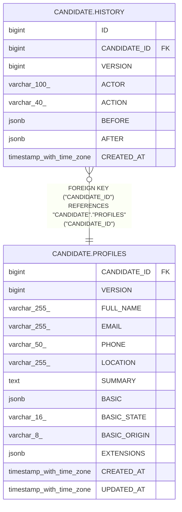

# CANDIDATE.HISTORY

## Description

Lịch sử thay đổi hồ sơ ứng viên theo phiên bản.

## Columns

| Name | Type | Default | Nullable | Children | Parents | Comment |
| ---- | ---- | ------- | -------- | -------- | ------- | ------- |
| ID | bigint |  | false |  |  | Khóa chính của bản ghi lịch sử thay đổi. |
| CANDIDATE_ID | bigint |  | false |  | [CANDIDATE.PROFILES](CANDIDATE.PROFILES.md) | Khóa ngoại tới hồ sơ ứng viên. |
| VERSION | bigint |  | false |  |  |  |
| ACTOR | varchar(100) |  | false |  |  |  |
| ACTION | varchar(40) |  | false |  |  |  |
| BEFORE | jsonb |  | true |  |  |  |
| AFTER | jsonb |  | true |  |  |  |
| CREATED_AT | timestamp with time zone | CURRENT_TIMESTAMP | false |  |  |  |

## Constraints

| Name | Type | Definition |
| ---- | ---- | ---------- |
| CANDIDATE_HISTORY_CANDIDATE_ID_fkey | FOREIGN KEY | FOREIGN KEY ("CANDIDATE_ID") REFERENCES "CANDIDATE"."PROFILES"("CANDIDATE_ID") |
| CANDIDATE_HISTORY_pkey | PRIMARY KEY | PRIMARY KEY ("ID") |
| CANDIDATE_HISTORY_CANDIDATE_ID_VERSION_key | UNIQUE | UNIQUE ("CANDIDATE_ID", "VERSION") |

## Indexes

| Name | Definition |
| ---- | ---------- |
| CANDIDATE_HISTORY_pkey | CREATE UNIQUE INDEX "CANDIDATE_HISTORY_pkey" ON "CANDIDATE"."HISTORY" USING btree ("ID") |
| CANDIDATE_HISTORY_CANDIDATE_ID_VERSION_key | CREATE UNIQUE INDEX "CANDIDATE_HISTORY_CANDIDATE_ID_VERSION_key" ON "CANDIDATE"."HISTORY" USING btree ("CANDIDATE_ID", "VERSION") |

## Relations

---

> Generated by [tbls](https://github.com/k1LoW/tbls)
