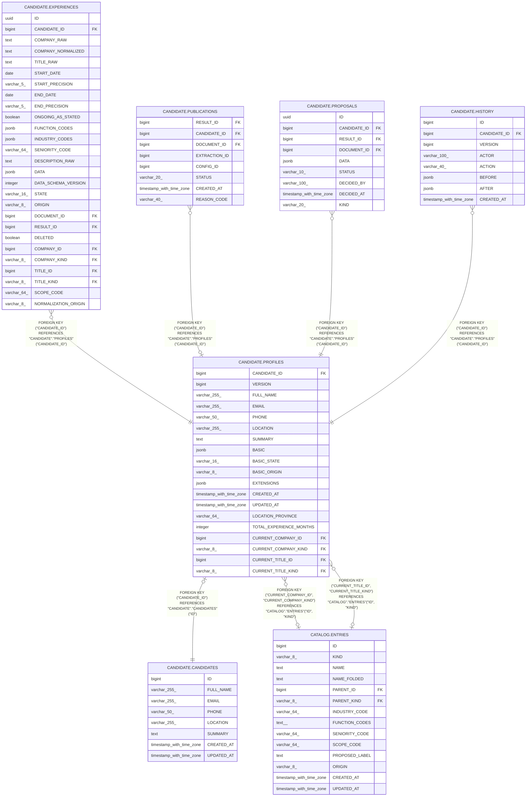

# CANDIDATE.PROFILES

## Description

Hồ sơ ứng viên có phiên bản và trạng thái xác nhận thông tin.

## Columns

| Name | Type | Default | Nullable | Extra Definition | Children | Parents | Comment |
| ---- | ---- | ------- | -------- | ---------------- | -------- | ------- | ------- |
| CANDIDATE_ID | bigint |  | false |  | [CANDIDATE.EXPERIENCES](CANDIDATE.EXPERIENCES.md) [CANDIDATE.PUBLICATIONS](CANDIDATE.PUBLICATIONS.md) [CANDIDATE.PROPOSALS](CANDIDATE.PROPOSALS.md) [CANDIDATE.HISTORY](CANDIDATE.HISTORY.md) | [CANDIDATE.CANDIDATES](CANDIDATE.CANDIDATES.md) | Khóa chính hồ sơ và khóa ngoại tới định danh ứng viên. |
| VERSION | bigint | 0 | false |  |  |  |  |
| FULL_NAME | varchar(255) |  | true |  |  |  |  |
| EMAIL | varchar(255) |  | true |  |  |  |  |
| PHONE | varchar(50) |  | true |  |  |  |  |
| LOCATION | varchar(255) |  | true |  |  |  |  |
| SUMMARY | text |  | true |  |  |  |  |
| BASIC | jsonb | '{}'::jsonb | false |  |  |  |  |
| BASIC_STATE | varchar(16) | 'UNVERIFIED'::character varying | false |  |  |  | Trạng thái xác nhận thông tin cơ bản của ứng viên. |
| BASIC_ORIGIN | varchar(8) | 'MAPPING'::character varying | false |  |  |  |  |
| EXTENSIONS | jsonb | '{"issues": [], "schemaVersion": 1}'::jsonb | false |  |  |  |  |
| CREATED_AT | timestamp with time zone | CURRENT_TIMESTAMP | false |  |  |  |  |
| UPDATED_AT | timestamp with time zone | CURRENT_TIMESTAMP | false |  |  |  |  |
| LOCATION_PROVINCE | varchar(64) |  | true |  |  |  | Tên tỉnh/thành chuẩn theo danh sách 63 tỉnh cũ |
| TOTAL_EXPERIENCE_MONTHS | integer |  | true |  |  |  | Tổng số tháng kinh nghiệm không âm khi đã tính được. |
| CURRENT_COMPANY_ID | bigint |  | true |  |  | [CATALOG.ENTRIES](CATALOG.ENTRIES.md) | Khóa ngoại tới công ty hiện tại khi đã xác định. |
| CURRENT_COMPANY_KIND | varchar(8) |  | true | GENERATED ALWAYS AS  CASE     WHEN ("CURRENT_COMPANY_ID" IS NULL) THEN NULL::text     ELSE 'COMPANY'::text END STORED |  | [CATALOG.ENTRIES](CATALOG.ENTRIES.md) | Loại công ty tự sinh để ràng buộc liên kết công ty hiện tại. |
| CURRENT_TITLE_ID | bigint |  | true |  |  | [CATALOG.ENTRIES](CATALOG.ENTRIES.md) | Khóa ngoại tới chức danh hiện tại khi đã xác định. |
| CURRENT_TITLE_KIND | varchar(8) |  | true | GENERATED ALWAYS AS  CASE     WHEN ("CURRENT_TITLE_ID" IS NULL) THEN NULL::text     ELSE 'TITLE'::text END STORED |  | [CATALOG.ENTRIES](CATALOG.ENTRIES.md) | Loại chức danh tự sinh để ràng buộc liên kết chức danh hiện tại. |

## Constraints

| Name | Type | Definition |
| ---- | ---- | ---------- |
| CANDIDATE_PROFILES_BASIC_ORIGIN_check | CHECK | CHECK ((("BASIC_ORIGIN")::text = ANY ((ARRAY['MAPPING'::character varying, 'USER'::character varying])::text[]))) |
| CANDIDATE_PROFILES_BASIC_STATE_check | CHECK | CHECK ((("BASIC_STATE")::text = ANY ((ARRAY['UNVERIFIED'::character varying, 'CONFIRMED'::character varying, 'EDITED'::character varying])::text[]))) |
| CANDIDATE_PROFILES_BASIC_check | CHECK | CHECK ((jsonb_typeof("BASIC") = 'object'::text)) |
| CANDIDATE_PROFILES_VERSION_check | CHECK | CHECK (("VERSION" >= 0)) |
| PROFILES_TOTAL_EXPERIENCE_MONTHS_check | CHECK | CHECK (("TOTAL_EXPERIENCE_MONTHS" >= 0)) |
| CANDIDATE_PROFILES_CANDIDATE_ID_fkey | FOREIGN KEY | FOREIGN KEY ("CANDIDATE_ID") REFERENCES "CANDIDATE"."CANDIDATES"("ID") |
| CANDIDATE_PROFILES_pkey | PRIMARY KEY | PRIMARY KEY ("CANDIDATE_ID") |
| PROFILES_CURRENT_COMPANY_ID_CURRENT_COMPANY_KIND_fkey | FOREIGN KEY | FOREIGN KEY ("CURRENT_COMPANY_ID", "CURRENT_COMPANY_KIND") REFERENCES "CATALOG"."ENTRIES"("ID", "KIND") |
| PROFILES_CURRENT_TITLE_ID_CURRENT_TITLE_KIND_fkey | FOREIGN KEY | FOREIGN KEY ("CURRENT_TITLE_ID", "CURRENT_TITLE_KIND") REFERENCES "CATALOG"."ENTRIES"("ID", "KIND") |

## Indexes

| Name | Definition |
| ---- | ---------- |
| CANDIDATE_PROFILES_pkey | CREATE UNIQUE INDEX "CANDIDATE_PROFILES_pkey" ON "CANDIDATE"."PROFILES" USING btree ("CANDIDATE_ID") |

## Relations

---

> Generated by [tbls](https://github.com/k1LoW/tbls)
