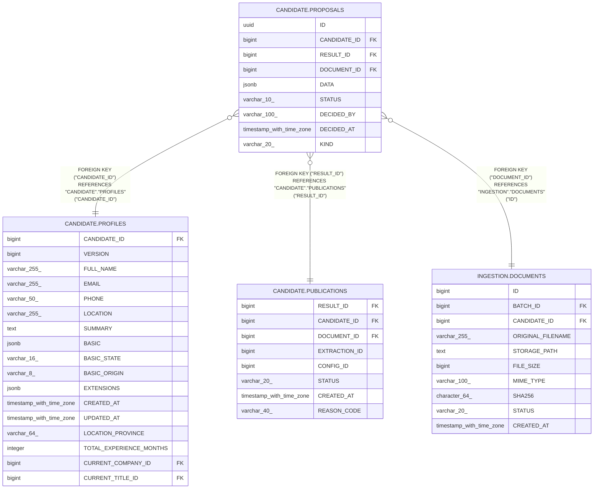

# CANDIDATE.PROPOSALS

## Description

Đề xuất cập nhật hồ sơ từ kết quả ánh xạ và quyết định xử lý.

## Columns

| Name | Type | Default | Nullable | Children | Parents | Comment |
| ---- | ---- | ------- | -------- | -------- | ------- | ------- |
| ID | uuid |  | false |  |  | Khóa chính của đề xuất cập nhật hồ sơ. |
| CANDIDATE_ID | bigint |  | false |  | [CANDIDATE.PROFILES](CANDIDATE.PROFILES.md) | Khóa ngoại tới hồ sơ ứng viên. |
| RESULT_ID | bigint |  | false |  | [CANDIDATE.PUBLICATIONS](CANDIDATE.PUBLICATIONS.md) | Khóa ngoại tới bản ghi công bố kết quả ánh xạ. |
| DOCUMENT_ID | bigint |  | false |  | [INGESTION.DOCUMENTS](INGESTION.DOCUMENTS.md) | Khóa ngoại tới tài liệu làm bằng chứng. |
| DATA | jsonb |  | false |  |  |  |
| STATUS | varchar(10) | 'OPEN'::character varying | false |  |  | Trạng thái quyết định xử lý đề xuất. |
| DECIDED_BY | varchar(100) |  | true |  |  |  |
| DECIDED_AT | timestamp with time zone |  | true |  |  |  |
| KIND | varchar(20) | 'EXPERIENCE'::character varying | false |  |  |  |

## Constraints

| Name | Type | Definition |
| ---- | ---- | ---------- |
| CANDIDATE_PROPOSALS_KIND_check | CHECK | CHECK ((("KIND")::text = ANY ((ARRAY['EXPERIENCE'::character varying, 'PERSONAL_INFO'::character varying])::text[]))) |
| CANDIDATE_PROPOSALS_STATUS_check | CHECK | CHECK ((("STATUS")::text = ANY ((ARRAY['OPEN'::character varying, 'ACCEPTED'::character varying, 'REJECTED'::character varying])::text[]))) |
| CANDIDATE_PROPOSALS_DOCUMENT_ID_fkey | FOREIGN KEY | FOREIGN KEY ("DOCUMENT_ID") REFERENCES "INGESTION"."DOCUMENTS"("ID") |
| CANDIDATE_PROPOSALS_CANDIDATE_ID_fkey | FOREIGN KEY | FOREIGN KEY ("CANDIDATE_ID") REFERENCES "CANDIDATE"."PROFILES"("CANDIDATE_ID") |
| CANDIDATE_PROPOSALS_RESULT_ID_fkey | FOREIGN KEY | FOREIGN KEY ("RESULT_ID") REFERENCES "CANDIDATE"."PUBLICATIONS"("RESULT_ID") |
| CANDIDATE_PROPOSALS_pkey | PRIMARY KEY | PRIMARY KEY ("ID") |

## Indexes

| Name | Definition |
| ---- | ---------- |
| CANDIDATE_PROPOSALS_pkey | CREATE UNIQUE INDEX "CANDIDATE_PROPOSALS_pkey" ON "CANDIDATE"."PROPOSALS" USING btree ("ID") |
| IX_CANDIDATE_PROPOSALS | CREATE INDEX "IX_CANDIDATE_PROPOSALS" ON "CANDIDATE"."PROPOSALS" USING btree ("CANDIDATE_ID", "STATUS") |

## Relations

---

> Generated by [tbls](https://github.com/k1LoW/tbls)
