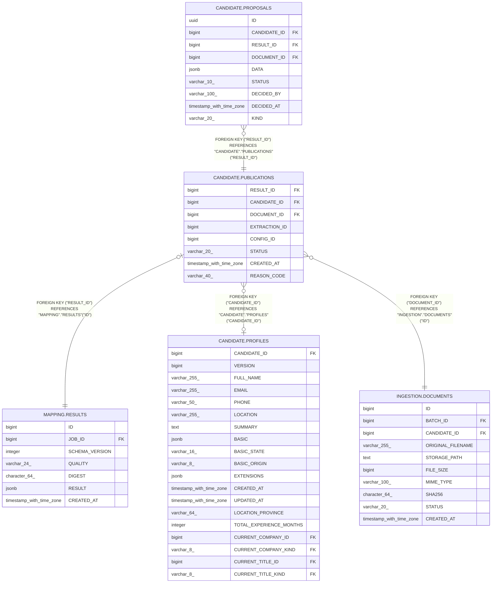

# CANDIDATE.PUBLICATIONS

## Description

Sổ công bố kết quả ánh xạ vào hồ sơ ứng viên.

## Columns

| Name | Type | Default | Nullable | Children | Parents | Comment |
| ---- | ---- | ------- | -------- | -------- | ------- | ------- |
| RESULT_ID | bigint |  | false | [CANDIDATE.PROPOSALS](CANDIDATE.PROPOSALS.md) | [MAPPING.RESULTS](MAPPING.RESULTS.md) | Khóa chính bản ghi công bố và khóa ngoại tới kết quả ánh xạ. |
| CANDIDATE_ID | bigint |  | true |  | [CANDIDATE.PROFILES](CANDIDATE.PROFILES.md) | Khóa ngoại tới hồ sơ ứng viên được công bố. |
| DOCUMENT_ID | bigint |  | false |  | [INGESTION.DOCUMENTS](INGESTION.DOCUMENTS.md) | Khóa ngoại tới tài liệu nguồn. |
| EXTRACTION_ID | bigint |  | false |  |  |  |
| CONFIG_ID | bigint |  | false |  |  |  |
| STATUS | varchar(20) |  | false |  |  | Trạng thái công bố kết quả ánh xạ. |
| CREATED_AT | timestamp with time zone | CURRENT_TIMESTAMP | false |  |  |  |
| REASON_CODE | varchar(40) |  | true |  |  |  |

## Constraints

| Name | Type | Definition |
| ---- | ---- | ---------- |
| CANDIDATE_PUBLICATIONS_STATUS_check | CHECK | CHECK ((("STATUS")::text = ANY ((ARRAY['PUBLISHED'::character varying, 'PROPOSED'::character varying, 'SUPERSEDED'::character varying, 'SKIPPED'::character varying])::text[]))) |
| CK_CANDIDATE_PUBLICATION_REASON | CHECK | CHECK ((("REASON_CODE" IS NULL) OR ((("STATUS")::text = 'SKIPPED'::text) AND (("REASON_CODE")::text = ANY ((ARRAY['UNSUPPORTED_MAPPING_VERSION'::character varying, 'UNSUPPORTED_MAPPING_QUALITY'::character varying, 'MAPPING_SOURCE_MISMATCH'::character varying, 'INVALID_MAPPING_ENVELOPE'::character varying, 'NO_USABLE_FIELDS'::character varying])::text[]))))) |
| CANDIDATE_PUBLICATIONS_DOCUMENT_ID_fkey | FOREIGN KEY | FOREIGN KEY ("DOCUMENT_ID") REFERENCES "INGESTION"."DOCUMENTS"("ID") |
| CANDIDATE_PUBLICATIONS_RESULT_ID_fkey | FOREIGN KEY | FOREIGN KEY ("RESULT_ID") REFERENCES "MAPPING"."RESULTS"("ID") |
| CANDIDATE_PUBLICATIONS_CANDIDATE_ID_fkey | FOREIGN KEY | FOREIGN KEY ("CANDIDATE_ID") REFERENCES "CANDIDATE"."PROFILES"("CANDIDATE_ID") |
| CANDIDATE_PUBLICATIONS_pkey | PRIMARY KEY | PRIMARY KEY ("RESULT_ID") |

## Indexes

| Name | Definition |
| ---- | ---------- |
| CANDIDATE_PUBLICATIONS_pkey | CREATE UNIQUE INDEX "CANDIDATE_PUBLICATIONS_pkey" ON "CANDIDATE"."PUBLICATIONS" USING btree ("RESULT_ID") |
| IX_CANDIDATE_PUBLICATION_DOCUMENT | CREATE INDEX "IX_CANDIDATE_PUBLICATION_DOCUMENT" ON "CANDIDATE"."PUBLICATIONS" USING btree ("DOCUMENT_ID", "EXTRACTION_ID" DESC, "CONFIG_ID" DESC, "RESULT_ID" DESC) |

## Relations

---

> Generated by [tbls](https://github.com/k1LoW/tbls)
