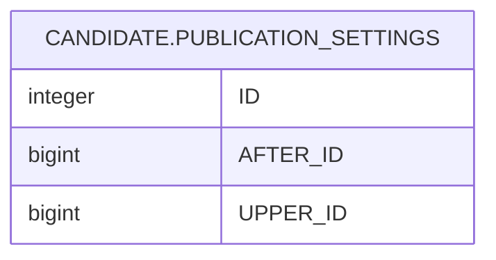

# CANDIDATE.PUBLICATION_SETTINGS

## Description

Con trỏ quét bền vững phục vụ công bố hồ sơ.

## Columns

| Name | Type | Default | Nullable | Children | Parents | Comment |
| ---- | ---- | ------- | -------- | -------- | ------- | ------- |
| ID | integer |  | false |  |  | Khóa chính cố định của thiết lập công bố hồ sơ. |
| AFTER_ID | bigint | 0 | false |  |  |  |
| UPPER_ID | bigint |  | true |  |  |  |

## Constraints

| Name | Type | Definition |
| ---- | ---- | ---------- |
| CANDIDATE_PUBLICATION_SETTINGS_AFTER_ID_check | CHECK | CHECK (("AFTER_ID" >= 0)) |
| CANDIDATE_PUBLICATION_SETTINGS_ID_check | CHECK | CHECK (("ID" = 1)) |
| CANDIDATE_PUBLICATION_SETTINGS_UPPER_ID_check | CHECK | CHECK (("UPPER_ID" >= 0)) |
| CANDIDATE_PUBLICATION_SETTINGS_pkey | PRIMARY KEY | PRIMARY KEY ("ID") |

## Indexes

| Name | Definition |
| ---- | ---------- |
| CANDIDATE_PUBLICATION_SETTINGS_pkey | CREATE UNIQUE INDEX "CANDIDATE_PUBLICATION_SETTINGS_pkey" ON "CANDIDATE"."PUBLICATION_SETTINGS" USING btree ("ID") |

## Relations

---

> Generated by [tbls](https://github.com/k1LoW/tbls)
