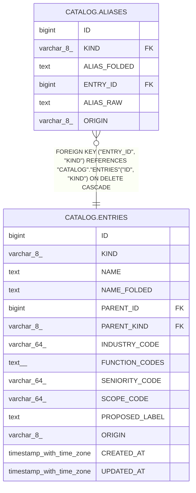

# CATALOG.ALIASES

## Description

Bí danh công ty và chức danh duy nhất theo loại và chuỗi đã bỏ dấu.

## Columns

| Name | Type | Default | Nullable | Children | Parents | Comment |
| ---- | ---- | ------- | -------- | -------- | ------- | ------- |
| ID | bigint |  | false |  |  | Khóa chính của bí danh. |
| KIND | varchar(8) |  | false |  | [CATALOG.ENTRIES](CATALOG.ENTRIES.md) | Loại bí danh phải trùng loại của mục danh mục. |
| ALIAS_FOLDED | text |  | false |  |  | Bí danh bỏ dấu dùng làm khóa đối chiếu theo loại. |
| ENTRY_ID | bigint |  | false |  | [CATALOG.ENTRIES](CATALOG.ENTRIES.md) | Khóa ngoại tới mục danh mục sở hữu bí danh. |
| ALIAS_RAW | text |  | false |  |  | Bí danh hiển thị được giữ nguyên từ dữ liệu nhập. |
| ORIGIN | varchar(8) |  | false |  |  | Nguồn tạo hoặc chỉnh sửa bí danh. |

## Constraints

| Name | Type | Definition |
| ---- | ---- | ---------- |
| ALIASES_KIND_check | CHECK | CHECK ((("KIND")::text = ANY ((ARRAY['COMPANY'::character varying, 'TITLE'::character varying])::text[]))) |
| ALIASES_ORIGIN_check | CHECK | CHECK ((("ORIGIN")::text = ANY ((ARRAY['SEED'::character varying, 'AI'::character varying, 'USER'::character varying])::text[]))) |
| ALIASES_ENTRY_ID_KIND_fkey | FOREIGN KEY | FOREIGN KEY ("ENTRY_ID", "KIND") REFERENCES "CATALOG"."ENTRIES"("ID", "KIND") ON DELETE CASCADE |
| ALIASES_pkey | PRIMARY KEY | PRIMARY KEY ("ID") |
| ALIASES_KIND_ALIAS_FOLDED_key | UNIQUE | UNIQUE ("KIND", "ALIAS_FOLDED") |

## Indexes

| Name | Definition |
| ---- | ---------- |
| ALIASES_pkey | CREATE UNIQUE INDEX "ALIASES_pkey" ON "CATALOG"."ALIASES" USING btree ("ID") |
| ALIASES_KIND_ALIAS_FOLDED_key | CREATE UNIQUE INDEX "ALIASES_KIND_ALIAS_FOLDED_key" ON "CATALOG"."ALIASES" USING btree ("KIND", "ALIAS_FOLDED") |
| IDX_ALIASES_ENTRY_ID | CREATE INDEX "IDX_ALIASES_ENTRY_ID" ON "CATALOG"."ALIASES" USING btree ("ENTRY_ID") |

## Relations

---

> Generated by [tbls](https://github.com/k1LoW/tbls)
