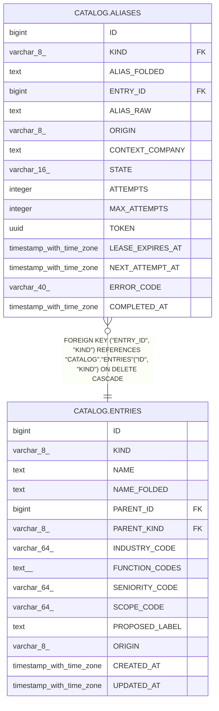

# CATALOG.ALIASES

## Description

Ánh xạ cách viết bí danh tới mục danh mục và hàng đợi chuẩn hóa; ENTRY_ID để trống khi bí danh đang chờ chuẩn hóa.

## Columns

| Name | Type | Default | Nullable | Children | Parents | Comment |
| ---- | ---- | ------- | -------- | -------- | ------- | ------- |
| ID | bigint |  | false |  |  | Khóa chính của bí danh. |
| KIND | varchar(8) |  | false |  | [CATALOG.ENTRIES](CATALOG.ENTRIES.md) | Loại bí danh phải trùng loại của mục danh mục. |
| ALIAS_FOLDED | text |  | false |  |  | Bí danh bỏ dấu dùng làm khóa đối chiếu theo loại. |
| ENTRY_ID | bigint |  | true |  | [CATALOG.ENTRIES](CATALOG.ENTRIES.md) | Khóa ngoại tới mục danh mục; để trống khi bí danh chưa được chuẩn hóa. |
| ALIAS_RAW | text |  | false |  |  | Bí danh hiển thị được giữ nguyên từ dữ liệu nhập. |
| ORIGIN | varchar(8) |  | true |  |  | Nguồn tạo hoặc chỉnh sửa bí danh; bắt buộc khi đã liên kết mục danh mục. |
| CONTEXT_COMPANY | text |  | true |  |  | Tên công ty cùng kinh nghiệm, chỉ dành cho chức danh. |
| STATE | varchar(16) | 'DONE'::character varying | false |  |  | Trạng thái chờ, đang thuê, hoàn tất hoặc thất bại; hoàn tất khi đã liên kết mục danh mục. |
| ATTEMPTS | integer | 0 | false |  |  | Số lượt thuê chuẩn hóa bí danh đã bắt đầu. |
| MAX_ATTEMPTS | integer | 3 | false |  |  | Số lượt thử tối đa trước khi thất bại. |
| TOKEN | uuid |  | true |  |  | Mã thuê dùng chung cho một lô bí danh. |
| LEASE_EXPIRES_AT | timestamp with time zone |  | true |  |  | Thời điểm hết hạn lượt thuê hiện tại. |
| NEXT_ATTEMPT_AT | timestamp with time zone | now() | false |  |  | Thời điểm sớm nhất được thử lại chuẩn hóa bí danh. |
| ERROR_CODE | varchar(40) |  | true |  |  | Mã lỗi an toàn của lượt thử gần nhất. |
| COMPLETED_AT | timestamp with time zone |  | true |  |  | Thời điểm hoàn tất hoặc thất bại vĩnh viễn của lượt chuẩn hóa. |

## Constraints

| Name | Type | Definition |
| ---- | ---- | ---------- |
| ALIASES_KIND_check | CHECK | CHECK ((("KIND")::text = ANY ((ARRAY['COMPANY'::character varying, 'TITLE'::character varying])::text[]))) |
| ALIASES_ORIGIN_check | CHECK | CHECK ((("ORIGIN")::text = ANY ((ARRAY['SEED'::character varying, 'AI'::character varying, 'USER'::character varying])::text[]))) |
| CHK_ALIASES_CONTEXT_COMPANY | CHECK | CHECK (((("KIND")::text = 'TITLE'::text) OR ("CONTEXT_COMPANY" IS NULL))) |
| CHK_ALIASES_ENTRY_STATE | CHECK | CHECK ((("ENTRY_ID" IS NOT NULL) = (("STATE")::text = 'DONE'::text))) |
| CHK_ALIASES_LINK_ORIGIN | CHECK | CHECK ((("ENTRY_ID" IS NULL) OR ("ORIGIN" IS NOT NULL))) |
| CHK_ALIASES_STATE | CHECK | CHECK ((("STATE")::text = ANY ((ARRAY['PENDING'::character varying, 'LEASED'::character varying, 'DONE'::character varying, 'FAILED'::character varying])::text[]))) |
| ALIASES_ENTRY_ID_KIND_fkey | FOREIGN KEY | FOREIGN KEY ("ENTRY_ID", "KIND") REFERENCES "CATALOG"."ENTRIES"("ID", "KIND") ON DELETE CASCADE |
| ALIASES_pkey | PRIMARY KEY | PRIMARY KEY ("ID") |
| ALIASES_KIND_ALIAS_FOLDED_key | UNIQUE | UNIQUE ("KIND", "ALIAS_FOLDED") |

## Indexes

| Name | Definition |
| ---- | ---------- |
| ALIASES_pkey | CREATE UNIQUE INDEX "ALIASES_pkey" ON "CATALOG"."ALIASES" USING btree ("ID") |
| ALIASES_KIND_ALIAS_FOLDED_key | CREATE UNIQUE INDEX "ALIASES_KIND_ALIAS_FOLDED_key" ON "CATALOG"."ALIASES" USING btree ("KIND", "ALIAS_FOLDED") |
| IDX_ALIASES_ENTRY_ID | CREATE INDEX "IDX_ALIASES_ENTRY_ID" ON "CATALOG"."ALIASES" USING btree ("ENTRY_ID") |
| IDX_ALIASES_STATE_NEXT_ATTEMPT_AT | CREATE INDEX "IDX_ALIASES_STATE_NEXT_ATTEMPT_AT" ON "CATALOG"."ALIASES" USING btree ("STATE", "NEXT_ATTEMPT_AT") WHERE (("STATE")::text = ANY ((ARRAY['PENDING'::character varying, 'LEASED'::character varying])::text[])) |

## Relations

---

> Generated by [tbls](https://github.com/k1LoW/tbls)
