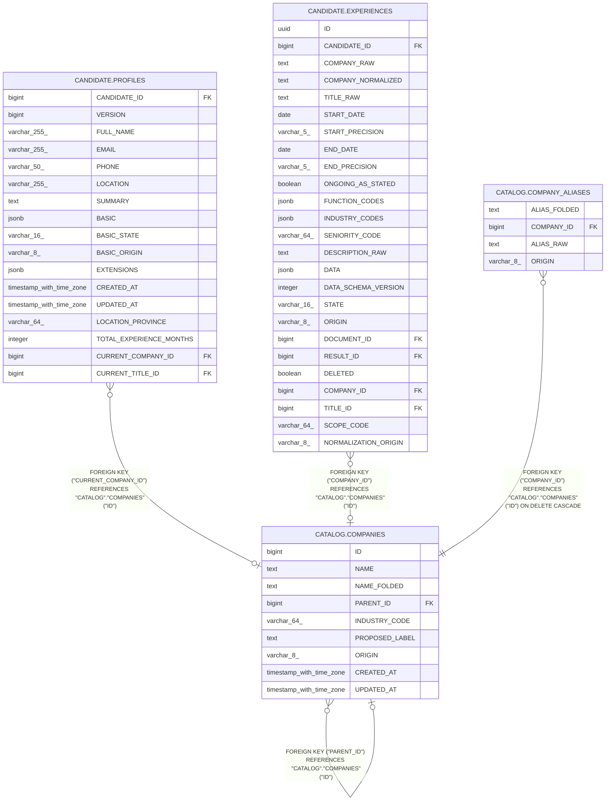

# CATALOG.COMPANIES

## Description

Danh mục công ty chuẩn hóa và liên kết tập đoàn mẹ.

## Columns

| Name | Type | Default | Nullable | Children | Parents | Comment |
| ---- | ---- | ------- | -------- | -------- | ------- | ------- |
| ID | bigint |  | false | [CANDIDATE.PROFILES](CANDIDATE.PROFILES.md) [CANDIDATE.EXPERIENCES](CANDIDATE.EXPERIENCES.md) [CATALOG.COMPANIES](CATALOG.COMPANIES.md) [CATALOG.COMPANY_ALIASES](CATALOG.COMPANY_ALIASES.md) |  | Khóa chính của công ty. |
| NAME | text |  | false |  |  | Tên chuẩn hiển thị của công ty. |
| NAME_FOLDED | text |  | false |  |  | Tên bỏ dấu, chữ thường và gộp khoảng trắng để đối chiếu. |
| PARENT_ID | bigint |  | true |  | [CATALOG.COMPANIES](CATALOG.COMPANIES.md) | Khóa ngoại tới tập đoàn mẹ khi có thông tin. |
| INDUSTRY_CODE | varchar(64) |  | true |  |  | Mã ngành chính, để trống cho mục chỉ là tập đoàn mẹ. |
| PROPOSED_LABEL | text |  | true |  |  | Nhãn đề xuất bắt buộc khi ngành là OTHER. |
| ORIGIN | varchar(8) |  | false |  |  | Nguồn tạo hoặc chỉnh sửa mục danh mục. |
| CREATED_AT | timestamp with time zone | now() | false |  |  | Thời điểm tạo công ty trong danh mục. |
| UPDATED_AT | timestamp with time zone | now() | false |  |  | Thời điểm cập nhật công ty trong danh mục. |

## Constraints

| Name | Type | Definition |
| ---- | ---- | ---------- |
| COMPANIES_NAME_check | CHECK | CHECK (("NAME" ~ '[^[:space:]]'::text)) |
| COMPANIES_ORIGIN_check | CHECK | CHECK ((("ORIGIN")::text = ANY ((ARRAY['SEED'::character varying, 'AI'::character varying, 'USER'::character varying])::text[]))) |
| COMPANIES_check | CHECK | CHECK (("PARENT_ID" <> "ID")) |
| COMPANIES_check1 | CHECK | CHECK (((("INDUSTRY_CODE")::text <> 'OTHER'::text) OR COALESCE(("PROPOSED_LABEL" ~ '[^[:space:]]'::text), false))) |
| COMPANIES_PARENT_ID_fkey | FOREIGN KEY | FOREIGN KEY ("PARENT_ID") REFERENCES "CATALOG"."COMPANIES"("ID") |
| COMPANIES_pkey | PRIMARY KEY | PRIMARY KEY ("ID") |
| COMPANIES_NAME_FOLDED_key | UNIQUE | UNIQUE ("NAME_FOLDED") |

## Indexes

| Name | Definition |
| ---- | ---------- |
| COMPANIES_pkey | CREATE UNIQUE INDEX "COMPANIES_pkey" ON "CATALOG"."COMPANIES" USING btree ("ID") |
| COMPANIES_NAME_FOLDED_key | CREATE UNIQUE INDEX "COMPANIES_NAME_FOLDED_key" ON "CATALOG"."COMPANIES" USING btree ("NAME_FOLDED") |
| IDX_COMPANIES_PARENT_ID | CREATE INDEX "IDX_COMPANIES_PARENT_ID" ON "CATALOG"."COMPANIES" USING btree ("PARENT_ID") |

## Relations

---

> Generated by [tbls](https://github.com/k1LoW/tbls)
