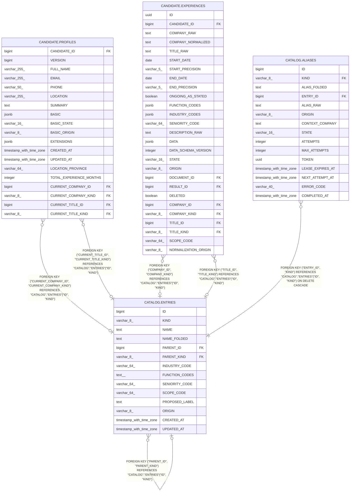

# CATALOG.ENTRIES

## Description

Danh mục công ty và chức danh chuẩn hóa theo loại.

## Columns

| Name | Type | Default | Nullable | Extra Definition | Children | Parents | Comment |
| ---- | ---- | ------- | -------- | ---------------- | -------- | ------- | ------- |
| ID | bigint |  | false |  | [CANDIDATE.PROFILES](CANDIDATE.PROFILES.md) [CANDIDATE.EXPERIENCES](CANDIDATE.EXPERIENCES.md) [CATALOG.ENTRIES](CATALOG.ENTRIES.md) [CATALOG.ALIASES](CATALOG.ALIASES.md) |  | Khóa chính của mục danh mục. |
| KIND | varchar(8) |  | false |  | [CANDIDATE.PROFILES](CANDIDATE.PROFILES.md) [CANDIDATE.EXPERIENCES](CANDIDATE.EXPERIENCES.md) [CATALOG.ENTRIES](CATALOG.ENTRIES.md) [CATALOG.ALIASES](CATALOG.ALIASES.md) |  | Loại mục danh mục công ty hoặc chức danh. |
| NAME | text |  | false |  |  |  | Tên chuẩn hiển thị của mục danh mục. |
| NAME_FOLDED | text |  | false |  |  |  | Tên bỏ dấu, chữ thường và gộp khoảng trắng để đối chiếu theo loại. |
| PARENT_ID | bigint |  | true |  |  | [CATALOG.ENTRIES](CATALOG.ENTRIES.md) | Khóa ngoại tới tập đoàn mẹ của công ty khi có thông tin. |
| PARENT_KIND | varchar(8) |  | true | GENERATED ALWAYS AS  CASE     WHEN ("PARENT_ID" IS NULL) THEN NULL::text     ELSE 'COMPANY'::text END STORED |  | [CATALOG.ENTRIES](CATALOG.ENTRIES.md) | Loại công ty tự sinh để ràng buộc tập đoàn mẹ. |
| INDUSTRY_CODE | varchar(64) |  | true |  |  |  | Mã ngành chính của công ty, để trống cho mục chỉ là tập đoàn mẹ. |
| FUNCTION_CODES | text[] |  | true |  |  |  | Một hoặc hai mã nhóm nghề của chức danh, để trống cho công ty. |
| SENIORITY_CODE | varchar(64) |  | true |  |  |  | Mã cấp bậc duy nhất của chức danh, để trống cho công ty. |
| SCOPE_CODE | varchar(64) |  | true |  |  |  | Mã phạm vi công việc của chức danh khi xác định được. |
| PROPOSED_LABEL | text |  | true |  |  |  | Nhãn đề xuất bắt buộc khi ngành hoặc nhóm nghề là OTHER. |
| ORIGIN | varchar(8) |  | false |  |  |  | Nguồn tạo hoặc chỉnh sửa mục danh mục. |
| CREATED_AT | timestamp with time zone | now() | false |  |  |  | Thời điểm tạo mục danh mục. |
| UPDATED_AT | timestamp with time zone | now() | false |  |  |  | Thời điểm cập nhật mục danh mục. |

## Constraints

| Name | Type | Definition |
| ---- | ---- | ---------- |
| ENTRIES_KIND_check | CHECK | CHECK ((("KIND")::text = ANY ((ARRAY['COMPANY'::character varying, 'TITLE'::character varying])::text[]))) |
| ENTRIES_NAME_check | CHECK | CHECK (("NAME" ~ '[^[:space:]]'::text)) |
| ENTRIES_ORIGIN_check | CHECK | CHECK ((("ORIGIN")::text = ANY ((ARRAY['SEED'::character varying, 'AI'::character varying, 'USER'::character varying])::text[]))) |
| ENTRIES_check | CHECK | CHECK (("PARENT_ID" <> "ID")) |
| ENTRIES_check1 | CHECK | CHECK (((("KIND")::text <> 'COMPANY'::text) OR (("FUNCTION_CODES" IS NULL) AND ("SENIORITY_CODE" IS NULL) AND ("SCOPE_CODE" IS NULL)))) |
| ENTRIES_check2 | CHECK | CHECK (((("KIND")::text <> 'TITLE'::text) OR (("PARENT_ID" IS NULL) AND ("INDUSTRY_CODE" IS NULL) AND ("FUNCTION_CODES" IS NOT NULL) AND ((cardinality("FUNCTION_CODES") >= 1) AND (cardinality("FUNCTION_CODES") <= 2)) AND ("SENIORITY_CODE" IS NOT NULL)))) |
| ENTRIES_check3 | CHECK | CHECK (((NOT COALESCE(((("INDUSTRY_CODE")::text = 'OTHER'::text) OR ('OTHER'::text = ANY ("FUNCTION_CODES"))), false)) OR COALESCE(("PROPOSED_LABEL" ~ '[^[:space:]]'::text), false))) |
| ENTRIES_pkey | PRIMARY KEY | PRIMARY KEY ("ID") |
| ENTRIES_KIND_NAME_FOLDED_key | UNIQUE | UNIQUE ("KIND", "NAME_FOLDED") |
| ENTRIES_ID_KIND_key | UNIQUE | UNIQUE ("ID", "KIND") |
| ENTRIES_PARENT_ID_PARENT_KIND_fkey | FOREIGN KEY | FOREIGN KEY ("PARENT_ID", "PARENT_KIND") REFERENCES "CATALOG"."ENTRIES"("ID", "KIND") |

## Indexes

| Name | Definition |
| ---- | ---------- |
| ENTRIES_pkey | CREATE UNIQUE INDEX "ENTRIES_pkey" ON "CATALOG"."ENTRIES" USING btree ("ID") |
| ENTRIES_KIND_NAME_FOLDED_key | CREATE UNIQUE INDEX "ENTRIES_KIND_NAME_FOLDED_key" ON "CATALOG"."ENTRIES" USING btree ("KIND", "NAME_FOLDED") |
| ENTRIES_ID_KIND_key | CREATE UNIQUE INDEX "ENTRIES_ID_KIND_key" ON "CATALOG"."ENTRIES" USING btree ("ID", "KIND") |
| IDX_ENTRIES_PARENT_ID | CREATE INDEX "IDX_ENTRIES_PARENT_ID" ON "CATALOG"."ENTRIES" USING btree ("PARENT_ID") |

## Relations

---

> Generated by [tbls](https://github.com/k1LoW/tbls)
