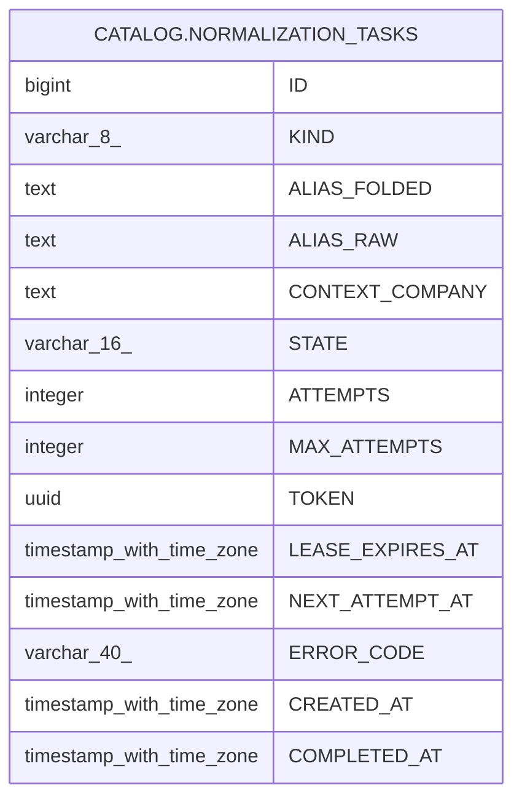

# CATALOG.NORMALIZATION_TASKS

## Description

Hàng đợi chuẩn hóa bí danh công ty và chức danh.

## Columns

| Name | Type | Default | Nullable | Children | Parents | Comment |
| ---- | ---- | ------- | -------- | -------- | ------- | ------- |
| ID | bigint |  | false |  |  | Khóa chính của tác vụ chuẩn hóa. |
| KIND | varchar(8) |  | false |  |  | Loại bí danh công ty hoặc chức danh. |
| ALIAS_FOLDED | text |  | false |  |  | Bí danh đã bỏ dấu dùng để chống trùng theo loại. |
| ALIAS_RAW | text |  | false |  |  | Tên gốc cần chuẩn hóa, không chứa các trường CV khác. |
| CONTEXT_COMPANY | text |  | true |  |  | Tên công ty cùng kinh nghiệm, chỉ dành cho chức danh. |
| STATE | varchar(16) | 'PENDING'::character varying | false |  |  | Trạng thái chờ, đang thuê, hoàn tất hoặc thất bại. |
| ATTEMPTS | integer | 0 | false |  |  | Số lượt thuê tác vụ đã bắt đầu. |
| MAX_ATTEMPTS | integer | 3 | false |  |  | Số lượt thử tối đa trước khi thất bại. |
| TOKEN | uuid |  | true |  |  | Mã thuê dùng chung cho một lô tác vụ. |
| LEASE_EXPIRES_AT | timestamp with time zone |  | true |  |  | Thời điểm hết hạn lượt thuê hiện tại. |
| NEXT_ATTEMPT_AT | timestamp with time zone | now() | false |  |  | Thời điểm sớm nhất được thử lại tác vụ. |
| ERROR_CODE | varchar(40) |  | true |  |  | Mã lỗi an toàn của lượt thử gần nhất. |
| CREATED_AT | timestamp with time zone | now() | false |  |  | Thời điểm tạo tác vụ chuẩn hóa. |
| COMPLETED_AT | timestamp with time zone |  | true |  |  | Thời điểm hoàn tất hoặc thất bại vĩnh viễn. |

## Constraints

| Name | Type | Definition |
| ---- | ---- | ---------- |
| NORMALIZATION_TASKS_KIND_check | CHECK | CHECK ((("KIND")::text = ANY ((ARRAY['COMPANY'::character varying, 'TITLE'::character varying])::text[]))) |
| NORMALIZATION_TASKS_STATE_check | CHECK | CHECK ((("STATE")::text = ANY ((ARRAY['PENDING'::character varying, 'LEASED'::character varying, 'DONE'::character varying, 'FAILED'::character varying])::text[]))) |
| NORMALIZATION_TASKS_check | CHECK | CHECK (((("KIND")::text = 'TITLE'::text) OR ("CONTEXT_COMPANY" IS NULL))) |
| NORMALIZATION_TASKS_pkey | PRIMARY KEY | PRIMARY KEY ("ID") |
| NORMALIZATION_TASKS_KIND_ALIAS_FOLDED_key | UNIQUE | UNIQUE ("KIND", "ALIAS_FOLDED") |

## Indexes

| Name | Definition |
| ---- | ---------- |
| NORMALIZATION_TASKS_pkey | CREATE UNIQUE INDEX "NORMALIZATION_TASKS_pkey" ON "CATALOG"."NORMALIZATION_TASKS" USING btree ("ID") |
| NORMALIZATION_TASKS_KIND_ALIAS_FOLDED_key | CREATE UNIQUE INDEX "NORMALIZATION_TASKS_KIND_ALIAS_FOLDED_key" ON "CATALOG"."NORMALIZATION_TASKS" USING btree ("KIND", "ALIAS_FOLDED") |
| IDX_NORMALIZATION_TASKS_STATE_NEXT_ATTEMPT_AT | CREATE INDEX "IDX_NORMALIZATION_TASKS_STATE_NEXT_ATTEMPT_AT" ON "CATALOG"."NORMALIZATION_TASKS" USING btree ("STATE", "NEXT_ATTEMPT_AT") |

## Relations

---

> Generated by [tbls](https://github.com/k1LoW/tbls)
