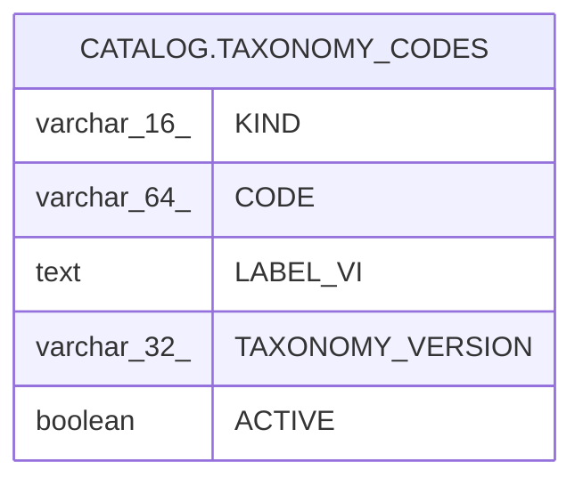

# CATALOG.TAXONOMY_CODES

## Description

Bảng mã phân loại theo phiên bản đã duyệt.

## Columns

| Name | Type | Default | Nullable | Children | Parents | Comment |
| ---- | ---- | ------- | -------- | -------- | ------- | ------- |
| KIND | varchar(16) |  | false |  |  | Loại mã nhóm nghề, cấp bậc, ngành hoặc phạm vi. |
| CODE | varchar(64) |  | false |  |  | Mã chuẩn trong từng loại phân loại. |
| LABEL_VI | text |  | false |  |  | Mô tả tiếng Việt của mã phân loại. |
| TAXONOMY_VERSION | varchar(32) |  | false |  |  | Phiên bản bảng mã được chủ dự án duyệt. |
| ACTIVE | boolean | true | false |  |  | Mã còn được phép sử dụng trong phiên bản hiện tại. |

## Constraints

| Name | Type | Definition |
| ---- | ---- | ---------- |
| TAXONOMY_CODES_KIND_check | CHECK | CHECK ((("KIND")::text = ANY ((ARRAY['FUNCTION'::character varying, 'SENIORITY'::character varying, 'INDUSTRY'::character varying, 'SCOPE'::character varying])::text[]))) |
| TAXONOMY_CODES_pkey | PRIMARY KEY | PRIMARY KEY ("KIND", "CODE") |

## Indexes

| Name | Definition |
| ---- | ---------- |
| TAXONOMY_CODES_pkey | CREATE UNIQUE INDEX "TAXONOMY_CODES_pkey" ON "CATALOG"."TAXONOMY_CODES" USING btree ("KIND", "CODE") |

## Relations

---

> Generated by [tbls](https://github.com/k1LoW/tbls)
