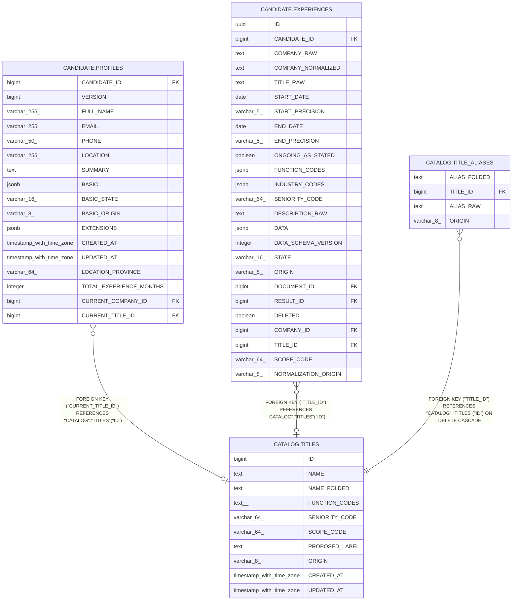

# CATALOG.TITLES

## Description

Danh mục chức danh chuẩn hóa cùng nhóm nghề và cấp bậc.

## Columns

| Name | Type | Default | Nullable | Children | Parents | Comment |
| ---- | ---- | ------- | -------- | -------- | ------- | ------- |
| ID | bigint |  | false | [CANDIDATE.PROFILES](CANDIDATE.PROFILES.md) [CANDIDATE.EXPERIENCES](CANDIDATE.EXPERIENCES.md) [CATALOG.TITLE_ALIASES](CATALOG.TITLE_ALIASES.md) |  | Khóa chính của chức danh. |
| NAME | text |  | false |  |  | Tên chuẩn hiển thị của chức danh. |
| NAME_FOLDED | text |  | false |  |  | Tên bỏ dấu, chữ thường và gộp khoảng trắng để đối chiếu. |
| FUNCTION_CODES | text[] |  | false |  |  | Một hoặc hai mã nhóm nghề của chức danh. |
| SENIORITY_CODE | varchar(64) |  | false |  |  | Mã cấp bậc duy nhất của chức danh. |
| SCOPE_CODE | varchar(64) |  | true |  |  | Mã phạm vi công việc khi xác định được. |
| PROPOSED_LABEL | text |  | true |  |  | Nhãn đề xuất bắt buộc khi có nhóm nghề OTHER. |
| ORIGIN | varchar(8) |  | false |  |  | Nguồn tạo hoặc chỉnh sửa chức danh. |
| CREATED_AT | timestamp with time zone | now() | false |  |  | Thời điểm tạo chức danh trong danh mục. |
| UPDATED_AT | timestamp with time zone | now() | false |  |  | Thời điểm cập nhật chức danh trong danh mục. |

## Constraints

| Name | Type | Definition |
| ---- | ---- | ---------- |
| TITLES_FUNCTION_CODES_check | CHECK | CHECK (((cardinality("FUNCTION_CODES") >= 1) AND (cardinality("FUNCTION_CODES") <= 2))) |
| TITLES_NAME_check | CHECK | CHECK (("NAME" ~ '[^[:space:]]'::text)) |
| TITLES_ORIGIN_check | CHECK | CHECK ((("ORIGIN")::text = ANY ((ARRAY['SEED'::character varying, 'AI'::character varying, 'USER'::character varying])::text[]))) |
| TITLES_check | CHECK | CHECK (((NOT ('OTHER'::text = ANY ("FUNCTION_CODES"))) OR COALESCE(("PROPOSED_LABEL" ~ '[^[:space:]]'::text), false))) |
| TITLES_pkey | PRIMARY KEY | PRIMARY KEY ("ID") |
| TITLES_NAME_FOLDED_key | UNIQUE | UNIQUE ("NAME_FOLDED") |

## Indexes

| Name | Definition |
| ---- | ---------- |
| TITLES_pkey | CREATE UNIQUE INDEX "TITLES_pkey" ON "CATALOG"."TITLES" USING btree ("ID") |
| TITLES_NAME_FOLDED_key | CREATE UNIQUE INDEX "TITLES_NAME_FOLDED_key" ON "CATALOG"."TITLES" USING btree ("NAME_FOLDED") |

## Relations

---

> Generated by [tbls](https://github.com/k1LoW/tbls)
