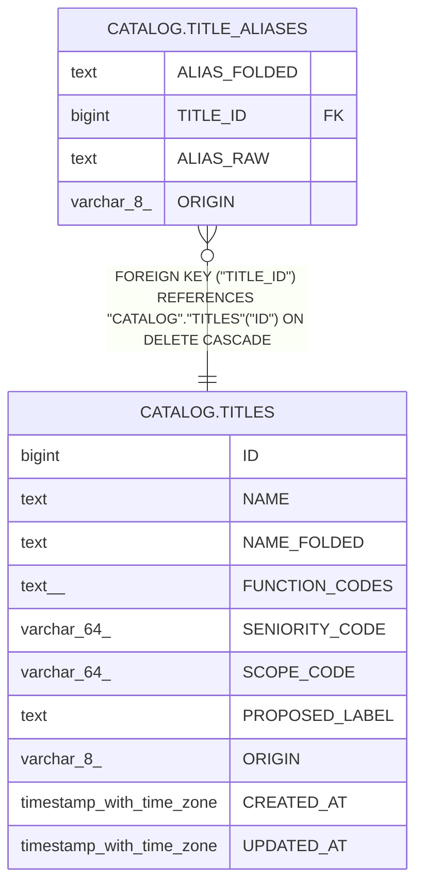

# CATALOG.TITLE_ALIASES

## Description

Bí danh chức danh duy nhất theo chuỗi đã bỏ dấu.

## Columns

| Name | Type | Default | Nullable | Children | Parents | Comment |
| ---- | ---- | ------- | -------- | -------- | ------- | ------- |
| ALIAS_FOLDED | text |  | false |  |  | Bí danh bỏ dấu dùng làm khóa đối chiếu. |
| TITLE_ID | bigint |  | false |  | [CATALOG.TITLES](CATALOG.TITLES.md) | Khóa ngoại tới chức danh của bí danh. |
| ALIAS_RAW | text |  | false |  |  | Bí danh hiển thị được giữ nguyên từ dữ liệu nhập. |
| ORIGIN | varchar(8) |  | false |  |  | Nguồn tạo hoặc chỉnh sửa bí danh chức danh. |

## Constraints

| Name | Type | Definition |
| ---- | ---- | ---------- |
| TITLE_ALIASES_ORIGIN_check | CHECK | CHECK ((("ORIGIN")::text = ANY ((ARRAY['SEED'::character varying, 'AI'::character varying, 'USER'::character varying])::text[]))) |
| TITLE_ALIASES_TITLE_ID_fkey | FOREIGN KEY | FOREIGN KEY ("TITLE_ID") REFERENCES "CATALOG"."TITLES"("ID") ON DELETE CASCADE |
| TITLE_ALIASES_pkey | PRIMARY KEY | PRIMARY KEY ("ALIAS_FOLDED") |

## Indexes

| Name | Definition |
| ---- | ---------- |
| TITLE_ALIASES_pkey | CREATE UNIQUE INDEX "TITLE_ALIASES_pkey" ON "CATALOG"."TITLE_ALIASES" USING btree ("ALIAS_FOLDED") |
| IDX_TITLE_ALIASES_TITLE_ID | CREATE INDEX "IDX_TITLE_ALIASES_TITLE_ID" ON "CATALOG"."TITLE_ALIASES" USING btree ("TITLE_ID") |

## Relations

---

> Generated by [tbls](https://github.com/k1LoW/tbls)
