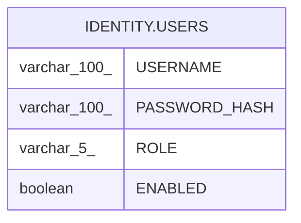

# IDENTITY.USERS

## Description

Tài khoản người dùng cùng vai trò và trạng thái hoạt động.

## Columns

| Name | Type | Default | Nullable | Children | Parents | Comment |
| ---- | ---- | ------- | -------- | -------- | ------- | ------- |
| USERNAME | varchar(100) |  | false |  |  | Khóa chính là tên đăng nhập của tài khoản. |
| PASSWORD_HASH | varchar(100) |  | false |  |  |  |
| ROLE | varchar(5) |  | false |  |  |  |
| ENABLED | boolean | true | false |  |  | Trạng thái cho phép tài khoản hoạt động. |

## Constraints

| Name | Type | Definition |
| ---- | ---- | ---------- |
| CV_USERS_ROLE_check | CHECK | CHECK ((("ROLE")::text = ANY ((ARRAY['USER'::character varying, 'ADMIN'::character varying])::text[]))) |
| CV_USERS_pkey | PRIMARY KEY | PRIMARY KEY ("USERNAME") |

## Indexes

| Name | Definition |
| ---- | ---------- |
| CV_USERS_pkey | CREATE UNIQUE INDEX "CV_USERS_pkey" ON "IDENTITY"."USERS" USING btree ("USERNAME") |

## Relations

---

> Generated by [tbls](https://github.com/k1LoW/tbls)
