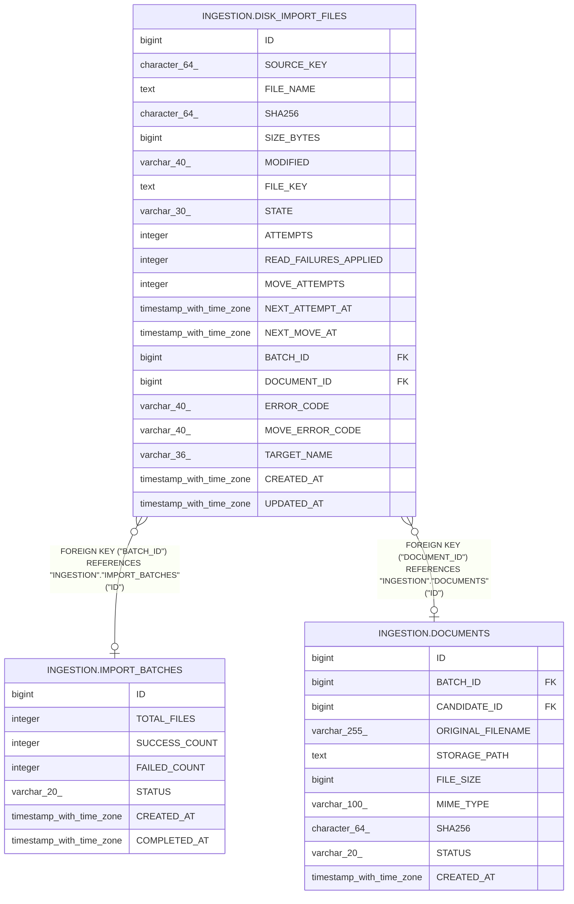

# INGESTION.DISK_IMPORT_FILES

## Description

Lịch sử nhập tệp từ thư mục và trạng thái di chuyển tệp.

## Columns

| Name | Type | Default | Nullable | Children | Parents | Comment |
| ---- | ---- | ------- | -------- | -------- | ------- | ------- |
| ID | bigint |  | false |  |  | Khóa chính của lịch sử nhập tệp. |
| SOURCE_KEY | character(64) |  | false |  |  |  |
| FILE_NAME | text |  | false |  |  |  |
| SHA256 | character(64) |  | false |  |  |  |
| SIZE_BYTES | bigint |  | false |  |  |  |
| MODIFIED | varchar(40) |  | false |  |  |  |
| FILE_KEY | text |  | false |  |  |  |
| STATE | varchar(30) |  | false |  |  | Trạng thái nhập và di chuyển tệp từ thư mục. |
| ATTEMPTS | integer | 0 | false |  |  |  |
| READ_FAILURES_APPLIED | integer | 0 | false |  |  |  |
| MOVE_ATTEMPTS | integer | 0 | false |  |  |  |
| NEXT_ATTEMPT_AT | timestamp with time zone |  | false |  |  |  |
| NEXT_MOVE_AT | timestamp with time zone |  | false |  |  |  |
| BATCH_ID | bigint |  | true |  | [INGESTION.IMPORT_BATCHES](INGESTION.IMPORT_BATCHES.md) | Khóa ngoại tới đợt nhập CV. |
| DOCUMENT_ID | bigint |  | true |  | [INGESTION.DOCUMENTS](INGESTION.DOCUMENTS.md) | Khóa ngoại tới tài liệu đã nhập. |
| ERROR_CODE | varchar(40) |  | true |  |  |  |
| MOVE_ERROR_CODE | varchar(40) |  | true |  |  |  |
| TARGET_NAME | varchar(36) |  | false |  |  |  |
| CREATED_AT | timestamp with time zone | CURRENT_TIMESTAMP | false |  |  |  |
| UPDATED_AT | timestamp with time zone | CURRENT_TIMESTAMP | false |  |  |  |

## Constraints

| Name | Type | Definition |
| ---- | ---- | ---------- |
| CV_DISK_IMPORT_FILES_ATTEMPTS_check | CHECK | CHECK (("ATTEMPTS" >= 0)) |
| CV_DISK_IMPORT_FILES_MOVE_ATTEMPTS_check | CHECK | CHECK (("MOVE_ATTEMPTS" >= 0)) |
| CV_DISK_IMPORT_FILES_READ_FAILURES_APPLIED_check | CHECK | CHECK (("READ_FAILURES_APPLIED" >= 0)) |
| CV_DISK_IMPORT_FILES_SHA256_check | CHECK | CHECK ((("SHA256")::text ~ '^[0-9a-f]{64}$'::text)) |
| CV_DISK_IMPORT_FILES_SIZE_BYTES_check | CHECK | CHECK (("SIZE_BYTES" >= 0)) |
| CV_DISK_IMPORT_FILES_STATE_check | CHECK | CHECK ((("STATE")::text = ANY ((ARRAY['PENDING'::character varying, 'QUEUED'::character varying, 'IMPORTING'::character varying, 'RETRY_WAIT'::character varying, 'SUCCEEDED_MOVE'::character varying, 'FAILED_MOVE'::character varying, 'PROCESSED'::character varying, 'FAILED'::character varying, 'NEEDS_ATTENTION'::character varying])::text[]))) |
| CV_DISK_IMPORT_FILES_check | CHECK | CHECK (((("STATE")::text <> ALL ((ARRAY['SUCCEEDED_MOVE'::character varying, 'PROCESSED'::character varying])::text[])) OR ("DOCUMENT_ID" IS NOT NULL))) |
| CV_DISK_IMPORT_FILES_BATCH_ID_fkey | FOREIGN KEY | FOREIGN KEY ("BATCH_ID") REFERENCES "INGESTION"."IMPORT_BATCHES"("ID") |
| CV_DISK_IMPORT_FILES_DOCUMENT_ID_fkey | FOREIGN KEY | FOREIGN KEY ("DOCUMENT_ID") REFERENCES "INGESTION"."DOCUMENTS"("ID") |
| CV_DISK_IMPORT_FILES_pkey | PRIMARY KEY | PRIMARY KEY ("ID") |
| CV_DISK_IMPORT_FILES_SOURCE_KEY_FILE_NAME_SHA256_key | UNIQUE | UNIQUE ("SOURCE_KEY", "FILE_NAME", "SHA256") |

## Indexes

| Name | Definition |
| ---- | ---------- |
| CV_DISK_IMPORT_FILES_pkey | CREATE UNIQUE INDEX "CV_DISK_IMPORT_FILES_pkey" ON "INGESTION"."DISK_IMPORT_FILES" USING btree ("ID") |
| CV_DISK_IMPORT_FILES_SOURCE_KEY_FILE_NAME_SHA256_key | CREATE UNIQUE INDEX "CV_DISK_IMPORT_FILES_SOURCE_KEY_FILE_NAME_SHA256_key" ON "INGESTION"."DISK_IMPORT_FILES" USING btree ("SOURCE_KEY", "FILE_NAME", "SHA256") |
| IX_DISK_IMPORT_MOVE | CREATE INDEX "IX_DISK_IMPORT_MOVE" ON "INGESTION"."DISK_IMPORT_FILES" USING btree ("SOURCE_KEY", "STATE", "NEXT_MOVE_AT", "ID") |

## Relations

---

> Generated by [tbls](https://github.com/k1LoW/tbls)
