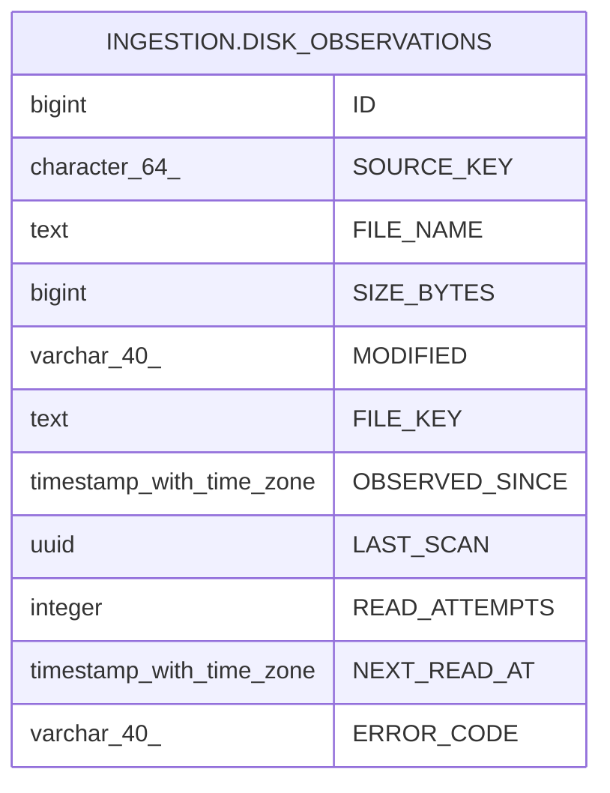

# INGESTION.DISK_OBSERVATIONS

## Description

Thông tin quan sát tệp để xác định độ ổn định trước khi nhập.

## Columns

| Name | Type | Default | Nullable | Children | Parents | Comment |
| ---- | ---- | ------- | -------- | -------- | ------- | ------- |
| ID | bigint |  | false |  |  | Khóa chính của thông tin quan sát tệp. |
| SOURCE_KEY | character(64) |  | false |  |  |  |
| FILE_NAME | text |  | false |  |  |  |
| SIZE_BYTES | bigint |  | false |  |  |  |
| MODIFIED | varchar(40) |  | false |  |  |  |
| FILE_KEY | text |  | false |  |  |  |
| OBSERVED_SINCE | timestamp with time zone |  | false |  |  |  |
| LAST_SCAN | uuid |  | false |  |  |  |
| READ_ATTEMPTS | integer | 0 | false |  |  |  |
| NEXT_READ_AT | timestamp with time zone | CURRENT_TIMESTAMP | false |  |  |  |
| ERROR_CODE | varchar(40) |  | true |  |  |  |

## Constraints

| Name | Type | Definition |
| ---- | ---- | ---------- |
| CV_DISK_OBSERVATIONS_READ_ATTEMPTS_check | CHECK | CHECK (("READ_ATTEMPTS" >= 0)) |
| CV_DISK_OBSERVATIONS_SIZE_BYTES_check | CHECK | CHECK (("SIZE_BYTES" >= 0)) |
| CV_DISK_OBSERVATIONS_pkey | PRIMARY KEY | PRIMARY KEY ("ID") |
| CV_DISK_OBSERVATIONS_SOURCE_KEY_FILE_NAME_key | UNIQUE | UNIQUE ("SOURCE_KEY", "FILE_NAME") |

## Indexes

| Name | Definition |
| ---- | ---------- |
| CV_DISK_OBSERVATIONS_pkey | CREATE UNIQUE INDEX "CV_DISK_OBSERVATIONS_pkey" ON "INGESTION"."DISK_OBSERVATIONS" USING btree ("ID") |
| CV_DISK_OBSERVATIONS_SOURCE_KEY_FILE_NAME_key | CREATE UNIQUE INDEX "CV_DISK_OBSERVATIONS_SOURCE_KEY_FILE_NAME_key" ON "INGESTION"."DISK_OBSERVATIONS" USING btree ("SOURCE_KEY", "FILE_NAME") |
| IX_DISK_OBSERVATION_SCAN | CREATE INDEX "IX_DISK_OBSERVATION_SCAN" ON "INGESTION"."DISK_OBSERVATIONS" USING btree ("SOURCE_KEY", "LAST_SCAN", "FILE_NAME" COLLATE "C") |

## Relations

---

> Generated by [tbls](https://github.com/k1LoW/tbls)
