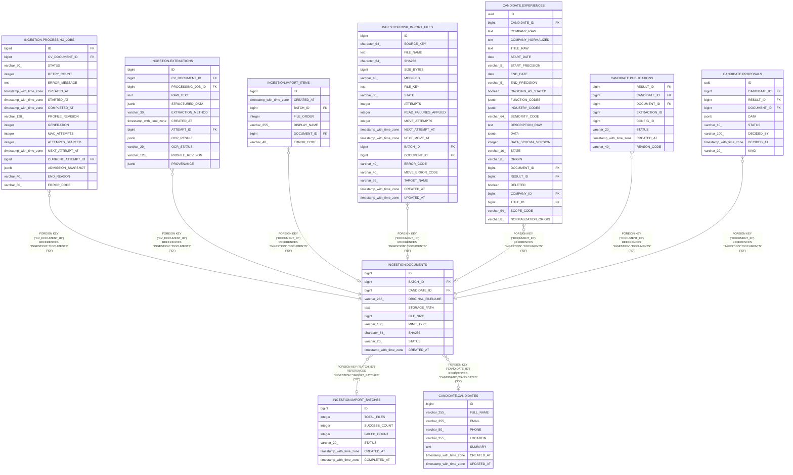

# INGESTION.DOCUMENTS

## Description

Tài liệu CV gốc cùng thông tin lưu trữ và trạng thái xử lý.

## Columns

| Name | Type | Default | Nullable | Children | Parents | Comment |
| ---- | ---- | ------- | -------- | -------- | ------- | ------- |
| ID | bigint |  | false | [INGESTION.PROCESSING_JOBS](INGESTION.PROCESSING_JOBS.md) [INGESTION.EXTRACTIONS](INGESTION.EXTRACTIONS.md) [INGESTION.IMPORT_ITEMS](INGESTION.IMPORT_ITEMS.md) [INGESTION.DISK_IMPORT_FILES](INGESTION.DISK_IMPORT_FILES.md) [CANDIDATE.EXPERIENCES](CANDIDATE.EXPERIENCES.md) [CANDIDATE.PUBLICATIONS](CANDIDATE.PUBLICATIONS.md) [CANDIDATE.PROPOSALS](CANDIDATE.PROPOSALS.md) |  | Khóa chính của tài liệu CV. |
| BATCH_ID | bigint |  | true |  | [INGESTION.IMPORT_BATCHES](INGESTION.IMPORT_BATCHES.md) | Khóa ngoại tới đợt nhập CV, có thể để trống khi tải riêng lẻ. |
| CANDIDATE_ID | bigint |  | true |  | [CANDIDATE.CANDIDATES](CANDIDATE.CANDIDATES.md) | Khóa ngoại tới ứng viên khi đã có liên kết. |
| ORIGINAL_FILENAME | varchar(255) |  | false |  |  |  |
| STORAGE_PATH | text |  | false |  |  |  |
| FILE_SIZE | bigint |  | false |  |  |  |
| MIME_TYPE | varchar(100) |  | false |  |  |  |
| SHA256 | character(64) |  | false |  |  |  |
| STATUS | varchar(20) |  | false |  |  | Trạng thái xử lý tài liệu CV. |
| CREATED_AT | timestamp with time zone | CURRENT_TIMESTAMP | false |  |  |  |

## Constraints

| Name | Type | Definition |
| ---- | ---- | ---------- |
| CK_DOCUMENT_FILE_SIZE | CHECK | CHECK (("FILE_SIZE" >= 0)) |
| CK_DOCUMENT_SHA256 | CHECK | CHECK ((("SHA256")::text ~ '^[0-9a-f]{64}$'::text)) |
| CK_DOCUMENT_STATUS | CHECK | CHECK ((("STATUS")::text = ANY ((ARRAY['PENDING'::character varying, 'PROCESSING'::character varying, 'COMPLETED'::character varying, 'PARTIAL'::character varying, 'FAILED'::character varying])::text[]))) |
| FK_DOCUMENT_BATCH | FOREIGN KEY | FOREIGN KEY ("BATCH_ID") REFERENCES "INGESTION"."IMPORT_BATCHES"("ID") |
| FK_DOCUMENT_CANDIDATE | FOREIGN KEY | FOREIGN KEY ("CANDIDATE_ID") REFERENCES "CANDIDATE"."CANDIDATES"("ID") |
| PK_CV_DOCUMENTS | PRIMARY KEY | PRIMARY KEY ("ID") |

## Indexes

| Name | Definition |
| ---- | ---------- |
| PK_CV_DOCUMENTS | CREATE UNIQUE INDEX "PK_CV_DOCUMENTS" ON "INGESTION"."DOCUMENTS" USING btree ("ID") |
| IX_DOCUMENT_BATCH | CREATE INDEX "IX_DOCUMENT_BATCH" ON "INGESTION"."DOCUMENTS" USING btree ("BATCH_ID") |
| IX_DOCUMENT_CANDIDATE | CREATE INDEX "IX_DOCUMENT_CANDIDATE" ON "INGESTION"."DOCUMENTS" USING btree ("CANDIDATE_ID") |
| IX_DOCUMENT_SHA256 | CREATE INDEX "IX_DOCUMENT_SHA256" ON "INGESTION"."DOCUMENTS" USING btree ("SHA256") |

## Relations

---

> Generated by [tbls](https://github.com/k1LoW/tbls)
