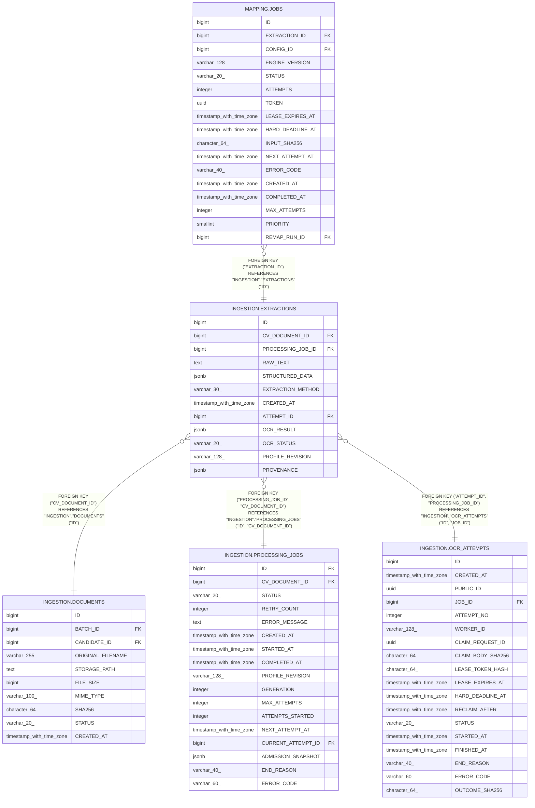

# INGESTION.EXTRACTIONS

## Description

Kết quả trích xuất văn bản và OCR được giữ nguyên từ tài liệu.

## Columns

| Name | Type | Default | Nullable | Children | Parents | Comment |
| ---- | ---- | ------- | -------- | -------- | ------- | ------- |
| ID | bigint |  | false | [MAPPING.JOBS](MAPPING.JOBS.md) |  | Khóa chính của kết quả trích xuất. |
| CV_DOCUMENT_ID | bigint |  | false |  | [INGESTION.DOCUMENTS](INGESTION.DOCUMENTS.md) [INGESTION.PROCESSING_JOBS](INGESTION.PROCESSING_JOBS.md) | Khóa ngoại tới tài liệu nguồn. |
| PROCESSING_JOB_ID | bigint |  | false |  | [INGESTION.PROCESSING_JOBS](INGESTION.PROCESSING_JOBS.md) [INGESTION.OCR_ATTEMPTS](INGESTION.OCR_ATTEMPTS.md) | Khóa ngoại tới công việc xử lý cùng tài liệu nguồn. |
| RAW_TEXT | text |  | true |  |  |  |
| STRUCTURED_DATA | jsonb |  | true |  |  |  |
| EXTRACTION_METHOD | varchar(30) |  | false |  |  |  |
| CREATED_AT | timestamp with time zone | CURRENT_TIMESTAMP | false |  |  |  |
| ATTEMPT_ID | bigint |  | true |  | [INGESTION.OCR_ATTEMPTS](INGESTION.OCR_ATTEMPTS.md) | Khóa ngoại tới lần thực hiện OCR cùng công việc xử lý. |
| OCR_RESULT | jsonb |  | true |  |  |  |
| OCR_STATUS | varchar(20) |  | true |  |  | Trạng thái kết quả OCR do worker cung cấp. |
| PROFILE_REVISION | varchar(128) |  | true |  |  |  |
| PROVENANCE | jsonb |  | true |  |  |  |

## Constraints

| Name | Type | Definition |
| ---- | ---- | ---------- |
| CK_EXTRACTION_METHOD | CHECK | CHECK ((("EXTRACTION_METHOD")::text = ANY ((ARRAY['TEXT_EXTRACTION'::character varying, 'OCR'::character varying, 'MIXED'::character varying, 'NONE'::character varying])::text[]))) |
| CK_OCR_EXTRACTION_FIELDS | CHECK | CHECK (((("OCR_RESULT" IS NULL) AND ("ATTEMPT_ID" IS NULL) AND ("OCR_STATUS" IS NULL) AND ("PROFILE_REVISION" IS NULL) AND ("PROVENANCE" IS NULL)) OR (("OCR_RESULT" IS NOT NULL) AND ("ATTEMPT_ID" IS NOT NULL) AND ("OCR_STATUS" IS NOT NULL) AND ("PROFILE_REVISION" IS NOT NULL) AND ("PROVENANCE" IS NOT NULL) AND (jsonb_typeof("OCR_RESULT") = 'object'::text) AND ("OCR_RESULT" ?& ARRAY['pages'::text, 'status'::text]) AND (jsonb_typeof(("OCR_RESULT" -> 'pages'::text)) = 'array'::text) AND (jsonb_typeof(("OCR_RESULT" -> 'status'::text)) = 'string'::text) AND (jsonb_typeof("PROVENANCE") = 'object'::text) AND (("OCR_STATUS")::text = ANY ((ARRAY['success'::character varying, 'partial'::character varying, 'failed'::character varying])::text[])) AND (("OCR_RESULT" ->> 'status'::text) = ("OCR_STATUS")::text) AND ("STRUCTURED_DATA" IS NULL) AND ("RAW_TEXT" IS NULL)))) |
| FK_EXTRACTION_DOCUMENT | FOREIGN KEY | FOREIGN KEY ("CV_DOCUMENT_ID") REFERENCES "INGESTION"."DOCUMENTS"("ID") |
| FK_EXTRACTION_JOB_DOCUMENT | FOREIGN KEY | FOREIGN KEY ("PROCESSING_JOB_ID", "CV_DOCUMENT_ID") REFERENCES "INGESTION"."PROCESSING_JOBS"("ID", "CV_DOCUMENT_ID") |
| PK_CV_EXTRACTIONS | PRIMARY KEY | PRIMARY KEY ("ID") |
| FK_EXTRACTION_ATTEMPT_JOB | FOREIGN KEY | FOREIGN KEY ("ATTEMPT_ID", "PROCESSING_JOB_ID") REFERENCES "INGESTION"."OCR_ATTEMPTS"("ID", "JOB_ID") |
| UQ_EXTRACTION_ATTEMPT | UNIQUE | UNIQUE ("ATTEMPT_ID") |

## Indexes

| Name | Definition |
| ---- | ---------- |
| PK_CV_EXTRACTIONS | CREATE UNIQUE INDEX "PK_CV_EXTRACTIONS" ON "INGESTION"."EXTRACTIONS" USING btree ("ID") |
| IX_EXTRACTION_DOCUMENT | CREATE INDEX "IX_EXTRACTION_DOCUMENT" ON "INGESTION"."EXTRACTIONS" USING btree ("CV_DOCUMENT_ID") |
| IX_EXTRACTION_JOB | CREATE INDEX "IX_EXTRACTION_JOB" ON "INGESTION"."EXTRACTIONS" USING btree ("PROCESSING_JOB_ID") |
| UQ_EXTRACTION_ATTEMPT | CREATE UNIQUE INDEX "UQ_EXTRACTION_ATTEMPT" ON "INGESTION"."EXTRACTIONS" USING btree ("ATTEMPT_ID") |
| UQ_OCR_EXTRACTION_JOB | CREATE UNIQUE INDEX "UQ_OCR_EXTRACTION_JOB" ON "INGESTION"."EXTRACTIONS" USING btree ("PROCESSING_JOB_ID") WHERE ("OCR_RESULT" IS NOT NULL) |

## Relations

---

> Generated by [tbls](https://github.com/k1LoW/tbls)
