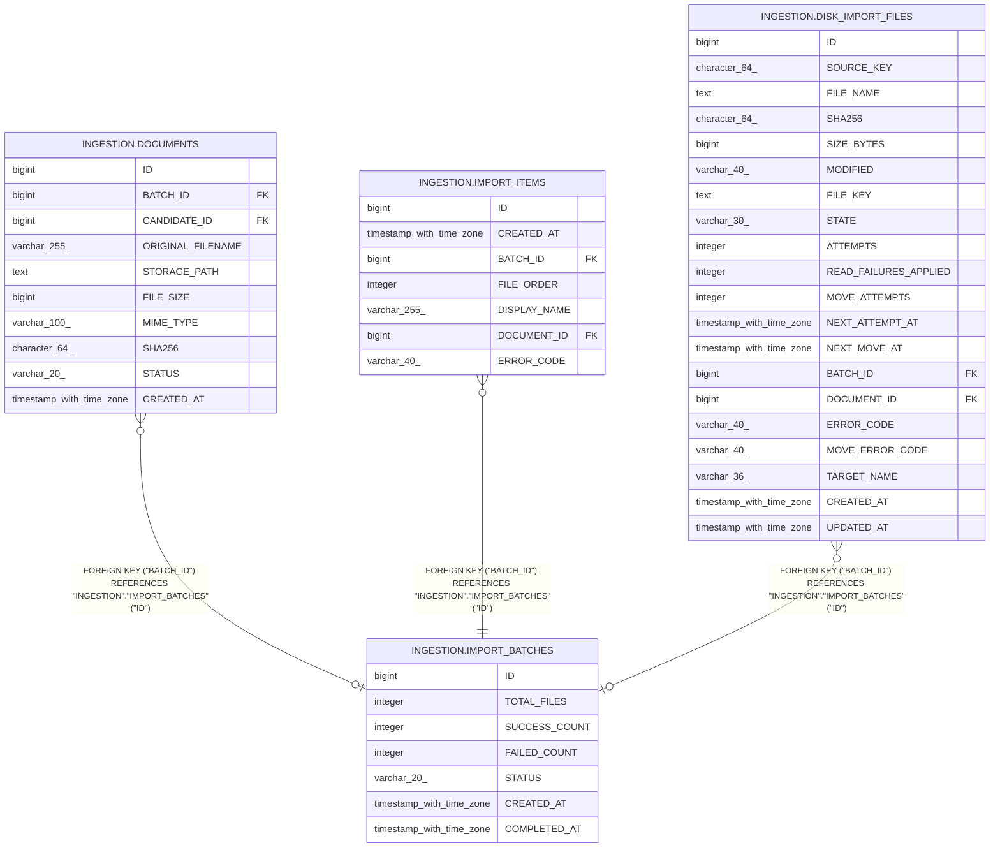

# INGESTION.IMPORT_BATCHES

## Description

Đợt nhập CV cùng số lượng và trạng thái tổng hợp.

## Columns

| Name | Type | Default | Nullable | Children | Parents | Comment |
| ---- | ---- | ------- | -------- | -------- | ------- | ------- |
| ID | bigint |  | false | [INGESTION.DOCUMENTS](INGESTION.DOCUMENTS.md) [INGESTION.IMPORT_ITEMS](INGESTION.IMPORT_ITEMS.md) [INGESTION.DISK_IMPORT_FILES](INGESTION.DISK_IMPORT_FILES.md) |  | Khóa chính của đợt nhập CV. |
| TOTAL_FILES | integer |  | false |  |  |  |
| SUCCESS_COUNT | integer | 0 | false |  |  |  |
| FAILED_COUNT | integer | 0 | false |  |  |  |
| STATUS | varchar(20) |  | false |  |  | Trạng thái tổng hợp của đợt nhập CV. |
| CREATED_AT | timestamp with time zone | CURRENT_TIMESTAMP | false |  |  |  |
| COMPLETED_AT | timestamp with time zone |  | true |  |  |  |

## Constraints

| Name | Type | Definition |
| ---- | ---- | ---------- |
| CK_BATCH_COUNTS | CHECK | CHECK (((("SUCCESS_COUNT")::bigint + ("FAILED_COUNT")::bigint) <= "TOTAL_FILES")) |
| CK_BATCH_FAILED_COUNT | CHECK | CHECK (("FAILED_COUNT" >= 0)) |
| CK_BATCH_STATUS | CHECK | CHECK ((("STATUS")::text = ANY ((ARRAY['PENDING'::character varying, 'PROCESSING'::character varying, 'COMPLETED'::character varying, 'PARTIAL_FAILED'::character varying, 'FAILED'::character varying])::text[]))) |
| CK_BATCH_SUCCESS_COUNT | CHECK | CHECK (("SUCCESS_COUNT" >= 0)) |
| CK_BATCH_TOTAL_FILES | CHECK | CHECK (("TOTAL_FILES" > 0)) |
| PK_CV_IMPORT_BATCHES | PRIMARY KEY | PRIMARY KEY ("ID") |

## Indexes

| Name | Definition |
| ---- | ---------- |
| PK_CV_IMPORT_BATCHES | CREATE UNIQUE INDEX "PK_CV_IMPORT_BATCHES" ON "INGESTION"."IMPORT_BATCHES" USING btree ("ID") |
| IX_BATCH_LIST | CREATE INDEX "IX_BATCH_LIST" ON "INGESTION"."IMPORT_BATCHES" USING btree ("CREATED_AT" DESC, "ID" DESC) |

## Relations

---

> Generated by [tbls](https://github.com/k1LoW/tbls)
