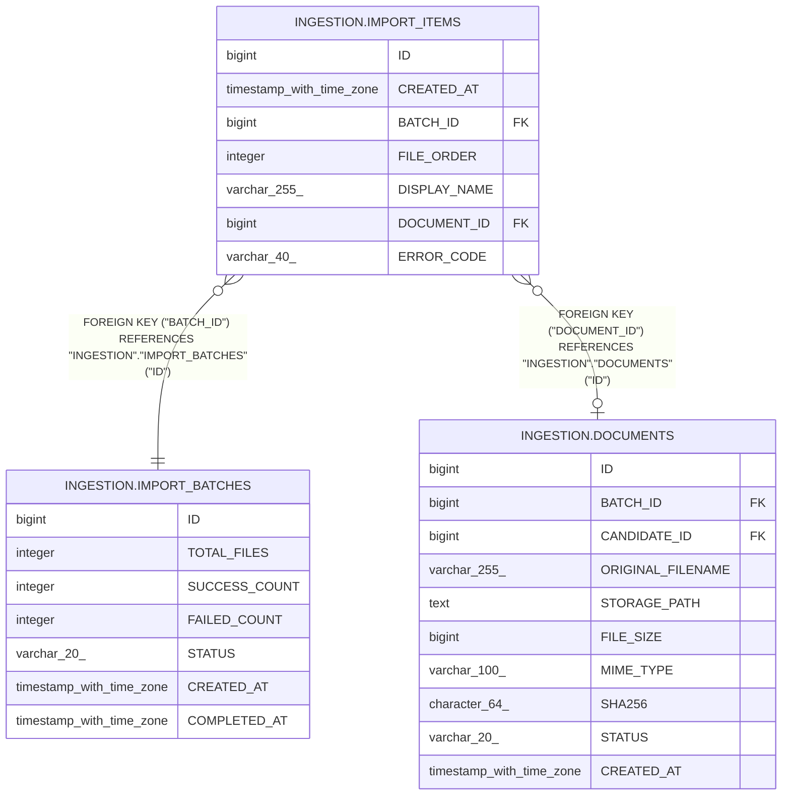

# INGESTION.IMPORT_ITEMS

## Description

Kết quả nhập từng tệp trong một đợt nhập CV.

## Columns

| Name | Type | Default | Nullable | Children | Parents | Comment |
| ---- | ---- | ------- | -------- | -------- | ------- | ------- |
| ID | bigint |  | false |  |  | Khóa chính của mục nhập tệp. |
| CREATED_AT | timestamp with time zone | CURRENT_TIMESTAMP | false |  |  |  |
| BATCH_ID | bigint |  | false |  | [INGESTION.IMPORT_BATCHES](INGESTION.IMPORT_BATCHES.md) | Khóa ngoại tới đợt nhập CV. |
| FILE_ORDER | integer |  | false |  |  |  |
| DISPLAY_NAME | varchar(255) |  | false |  |  |  |
| DOCUMENT_ID | bigint |  | true |  | [INGESTION.DOCUMENTS](INGESTION.DOCUMENTS.md) | Khóa ngoại tới tài liệu đã nhập thành công. |
| ERROR_CODE | varchar(40) |  | true |  |  |  |

## Constraints

| Name | Type | Definition |
| ---- | ---- | ---------- |
| CK_IMPORT_ITEM_RESULT | CHECK | CHECK (((("DOCUMENT_ID" IS NOT NULL) AND ("ERROR_CODE" IS NULL)) OR (("DOCUMENT_ID" IS NULL) AND ("ERROR_CODE" IS NOT NULL)))) |
| CV_IMPORT_ITEMS_FILE_ORDER_check | CHECK | CHECK (("FILE_ORDER" > 0)) |
| CV_IMPORT_ITEMS_BATCH_ID_fkey | FOREIGN KEY | FOREIGN KEY ("BATCH_ID") REFERENCES "INGESTION"."IMPORT_BATCHES"("ID") |
| CV_IMPORT_ITEMS_DOCUMENT_ID_fkey | FOREIGN KEY | FOREIGN KEY ("DOCUMENT_ID") REFERENCES "INGESTION"."DOCUMENTS"("ID") |
| CV_IMPORT_ITEMS_pkey | PRIMARY KEY | PRIMARY KEY ("ID") |
| UQ_IMPORT_ITEM_ORDER | UNIQUE | UNIQUE ("BATCH_ID", "FILE_ORDER") |

## Indexes

| Name | Definition |
| ---- | ---------- |
| CV_IMPORT_ITEMS_pkey | CREATE UNIQUE INDEX "CV_IMPORT_ITEMS_pkey" ON "INGESTION"."IMPORT_ITEMS" USING btree ("ID") |
| UQ_IMPORT_ITEM_ORDER | CREATE UNIQUE INDEX "UQ_IMPORT_ITEM_ORDER" ON "INGESTION"."IMPORT_ITEMS" USING btree ("BATCH_ID", "FILE_ORDER") |

## Relations

---

> Generated by [tbls](https://github.com/k1LoW/tbls)
