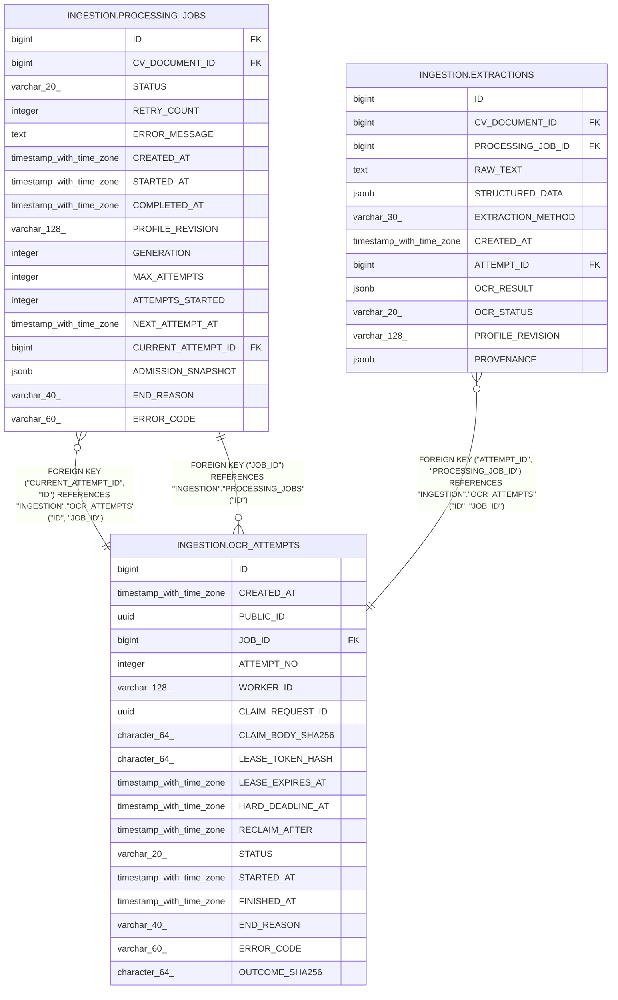

# INGESTION.OCR_ATTEMPTS

## Description

Lần thực hiện OCR cùng thời hạn thuê và kết quả kết thúc.

## Columns

| Name | Type | Default | Nullable | Children | Parents | Comment |
| ---- | ---- | ------- | -------- | -------- | ------- | ------- |
| ID | bigint |  | false | [INGESTION.PROCESSING_JOBS](INGESTION.PROCESSING_JOBS.md) [INGESTION.EXTRACTIONS](INGESTION.EXTRACTIONS.md) |  | Khóa chính của lần thực hiện OCR. |
| CREATED_AT | timestamp with time zone | CURRENT_TIMESTAMP | false |  |  |  |
| PUBLIC_ID | uuid |  | false |  |  |  |
| JOB_ID | bigint |  | false | [INGESTION.PROCESSING_JOBS](INGESTION.PROCESSING_JOBS.md) [INGESTION.EXTRACTIONS](INGESTION.EXTRACTIONS.md) | [INGESTION.PROCESSING_JOBS](INGESTION.PROCESSING_JOBS.md) | Khóa ngoại tới công việc xử lý tài liệu. |
| ATTEMPT_NO | integer |  | false |  |  |  |
| WORKER_ID | varchar(128) |  | false |  |  |  |
| CLAIM_REQUEST_ID | uuid |  | false |  |  |  |
| CLAIM_BODY_SHA256 | character(64) |  | false |  |  |  |
| LEASE_TOKEN_HASH | character(64) |  | false |  |  |  |
| LEASE_EXPIRES_AT | timestamp with time zone |  | false |  |  |  |
| HARD_DEADLINE_AT | timestamp with time zone |  | false |  |  |  |
| RECLAIM_AFTER | timestamp with time zone |  | false |  |  |  |
| STATUS | varchar(20) |  | false |  |  | Trạng thái lần thực hiện OCR. |
| STARTED_AT | timestamp with time zone |  | false |  |  |  |
| FINISHED_AT | timestamp with time zone |  | true |  |  |  |
| END_REASON | varchar(40) |  | true |  |  | Lý do kết thúc lần thực hiện OCR. |
| ERROR_CODE | varchar(60) |  | true |  |  |  |
| OUTCOME_SHA256 | character(64) |  | true |  |  |  |

## Constraints

| Name | Type | Definition |
| ---- | ---- | ---------- |
| CK_OCR_ATTEMPT_END | CHECK | CHECK ((((("STATUS")::text = 'ACTIVE'::text) AND ("FINISHED_AT" IS NULL) AND ("END_REASON" IS NULL) AND ("OUTCOME_SHA256" IS NULL)) OR ((("STATUS")::text = ANY ((ARRAY['FAILED'::character varying, 'ACCEPTED'::character varying])::text[])) AND ("FINISHED_AT" IS NOT NULL) AND ("END_REASON" IS NOT NULL) AND ("OUTCOME_SHA256" IS NOT NULL)) OR ((("STATUS")::text = 'EXPIRED'::text) AND ("FINISHED_AT" IS NOT NULL) AND ("END_REASON" IS NOT NULL) AND (("END_REASON")::text = 'LEASE_EXPIRED'::text) AND ("OUTCOME_SHA256" IS NULL)))) |
| CK_OCR_ATTEMPT_END_REASON | CHECK | CHECK ((("END_REASON" IS NULL) OR (("END_REASON")::text = ANY ((ARRAY['RESULT_SUCCESS'::character varying, 'RESULT_PARTIAL'::character varying, 'OCR_FAILED'::character varying, 'INFRA_FAILURE'::character varying, 'RETRIES_EXHAUSTED'::character varying, 'CONFIGURATION_ERROR'::character varying, 'LEASE_EXPIRED'::character varying])::text[])))) |
| CK_OCR_ATTEMPT_HASHES | CHECK | CHECK (((("CLAIM_BODY_SHA256")::text ~ '^[0-9a-f]{64}$'::text) AND (("LEASE_TOKEN_HASH")::text ~ '^[0-9a-f]{64}$'::text) AND (("OUTCOME_SHA256" IS NULL) OR (("OUTCOME_SHA256")::text ~ '^[0-9a-f]{64}$'::text)))) |
| CK_OCR_ATTEMPT_NO | CHECK | CHECK ((("ATTEMPT_NO" >= 1) AND ("ATTEMPT_NO" <= 3))) |
| CK_OCR_ATTEMPT_STATUS | CHECK | CHECK ((("STATUS")::text = ANY ((ARRAY['ACTIVE'::character varying, 'EXPIRED'::character varying, 'FAILED'::character varying, 'ACCEPTED'::character varying])::text[]))) |
| CK_OCR_ATTEMPT_TIMES | CHECK | CHECK ((("STARTED_AT" < "LEASE_EXPIRES_AT") AND ("LEASE_EXPIRES_AT" <= "HARD_DEADLINE_AT") AND ("HARD_DEADLINE_AT" < "RECLAIM_AFTER") AND (("FINISHED_AT" IS NULL) OR ("FINISHED_AT" >= "STARTED_AT")))) |
| CK_OCR_ATTEMPT_WORKER | CHECK | CHECK ((("WORKER_ID")::text ~ '^[A-Za-z0-9][A-Za-z0-9_-]{0,127}$'::text)) |
| FK_OCR_ATTEMPT_JOB | FOREIGN KEY | FOREIGN KEY ("JOB_ID") REFERENCES "INGESTION"."PROCESSING_JOBS"("ID") |
| PK_CV_OCR_ATTEMPTS | PRIMARY KEY | PRIMARY KEY ("ID") |
| UQ_OCR_ATTEMPT_PUBLIC | UNIQUE | UNIQUE ("PUBLIC_ID") |
| UQ_OCR_ATTEMPT_NUMBER | UNIQUE | UNIQUE ("JOB_ID", "ATTEMPT_NO") |
| UQ_OCR_CLAIM | UNIQUE | UNIQUE ("WORKER_ID", "CLAIM_REQUEST_ID") |
| UQ_OCR_ATTEMPT_JOB | UNIQUE | UNIQUE ("ID", "JOB_ID") |

## Indexes

| Name | Definition |
| ---- | ---------- |
| PK_CV_OCR_ATTEMPTS | CREATE UNIQUE INDEX "PK_CV_OCR_ATTEMPTS" ON "INGESTION"."OCR_ATTEMPTS" USING btree ("ID") |
| UQ_OCR_ATTEMPT_PUBLIC | CREATE UNIQUE INDEX "UQ_OCR_ATTEMPT_PUBLIC" ON "INGESTION"."OCR_ATTEMPTS" USING btree ("PUBLIC_ID") |
| UQ_OCR_ATTEMPT_NUMBER | CREATE UNIQUE INDEX "UQ_OCR_ATTEMPT_NUMBER" ON "INGESTION"."OCR_ATTEMPTS" USING btree ("JOB_ID", "ATTEMPT_NO") |
| UQ_OCR_CLAIM | CREATE UNIQUE INDEX "UQ_OCR_CLAIM" ON "INGESTION"."OCR_ATTEMPTS" USING btree ("WORKER_ID", "CLAIM_REQUEST_ID") |
| UQ_OCR_ATTEMPT_JOB | CREATE UNIQUE INDEX "UQ_OCR_ATTEMPT_JOB" ON "INGESTION"."OCR_ATTEMPTS" USING btree ("ID", "JOB_ID") |
| UQ_OCR_ACTIVE_ATTEMPT | CREATE UNIQUE INDEX "UQ_OCR_ACTIVE_ATTEMPT" ON "INGESTION"."OCR_ATTEMPTS" USING btree ("JOB_ID") WHERE (("STATUS")::text = 'ACTIVE'::text) |
| IX_OCR_ATTEMPT_EXPIRY | CREATE INDEX "IX_OCR_ATTEMPT_EXPIRY" ON "INGESTION"."OCR_ATTEMPTS" USING btree ("LEASE_EXPIRES_AT", "JOB_ID") WHERE (("STATUS")::text = 'ACTIVE'::text) |

## Relations

---

> Generated by [tbls](https://github.com/k1LoW/tbls)
