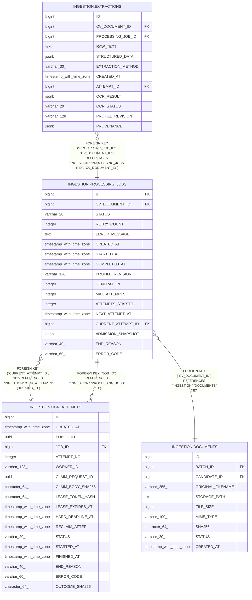

# INGESTION.PROCESSING_JOBS

## Description

Công việc xử lý tài liệu cùng trạng thái và lịch thử lại OCR.

## Columns

| Name | Type | Default | Nullable | Children | Parents | Comment |
| ---- | ---- | ------- | -------- | -------- | ------- | ------- |
| ID | bigint |  | false | [INGESTION.EXTRACTIONS](INGESTION.EXTRACTIONS.md) [INGESTION.OCR_ATTEMPTS](INGESTION.OCR_ATTEMPTS.md) | [INGESTION.OCR_ATTEMPTS](INGESTION.OCR_ATTEMPTS.md) | Khóa chính của công việc xử lý tài liệu. |
| CV_DOCUMENT_ID | bigint |  | false | [INGESTION.EXTRACTIONS](INGESTION.EXTRACTIONS.md) | [INGESTION.DOCUMENTS](INGESTION.DOCUMENTS.md) | Khóa ngoại tới tài liệu cần xử lý. |
| STATUS | varchar(20) |  | false |  |  | Trạng thái công việc xử lý tài liệu. |
| RETRY_COUNT | integer | 0 | false |  |  |  |
| ERROR_MESSAGE | text |  | true |  |  |  |
| CREATED_AT | timestamp with time zone | CURRENT_TIMESTAMP | false |  |  |  |
| STARTED_AT | timestamp with time zone |  | true |  |  |  |
| COMPLETED_AT | timestamp with time zone |  | true |  |  |  |
| PROFILE_REVISION | varchar(128) |  | true |  |  |  |
| GENERATION | integer |  | true |  |  |  |
| MAX_ATTEMPTS | integer |  | true |  |  |  |
| ATTEMPTS_STARTED | integer |  | true |  |  |  |
| NEXT_ATTEMPT_AT | timestamp with time zone |  | true |  |  |  |
| CURRENT_ATTEMPT_ID | bigint |  | true |  | [INGESTION.OCR_ATTEMPTS](INGESTION.OCR_ATTEMPTS.md) | Khóa ngoại tới lần thực hiện OCR hiện tại của công việc. |
| ADMISSION_SNAPSHOT | jsonb |  | true |  |  |  |
| END_REASON | varchar(40) |  | true |  |  | Lý do kết thúc công việc OCR. |
| ERROR_CODE | varchar(60) |  | true |  |  |  |

## Constraints

| Name | Type | Definition |
| ---- | ---- | ---------- |
| CK_JOB_RETRY_COUNT | CHECK | CHECK (("RETRY_COUNT" >= 0)) |
| CK_JOB_STATUS | CHECK | CHECK ((("STATUS")::text = ANY ((ARRAY['PENDING'::character varying, 'PROCESSING'::character varying, 'COMPLETED'::character varying, 'PARTIAL'::character varying, 'FAILED'::character varying])::text[]))) |
| CK_OCR_JOB_END_REASON | CHECK | CHECK ((("END_REASON" IS NULL) OR (("END_REASON")::text = ANY ((ARRAY['RESULT_SUCCESS'::character varying, 'RESULT_PARTIAL'::character varying, 'OCR_FAILED'::character varying, 'INFRA_FAILURE'::character varying, 'RETRIES_EXHAUSTED'::character varying, 'CONFIGURATION_ERROR'::character varying])::text[])))) |
| CK_OCR_JOB_FIELDS | CHECK | CHECK ((("PROFILE_REVISION" IS NULL) OR (((length(("PROFILE_REVISION")::text) >= 1) AND (length(("PROFILE_REVISION")::text) <= 128)) AND ("GENERATION" IS NOT NULL) AND ("GENERATION" > 0) AND ("MAX_ATTEMPTS" IS NOT NULL) AND (("MAX_ATTEMPTS" >= 1) AND ("MAX_ATTEMPTS" <= 3)) AND ("ATTEMPTS_STARTED" IS NOT NULL) AND (("ATTEMPTS_STARTED" >= 0) AND ("ATTEMPTS_STARTED" <= "MAX_ATTEMPTS")) AND ("RETRY_COUNT" = GREATEST(("ATTEMPTS_STARTED" - 1), 0)) AND ("NEXT_ATTEMPT_AT" IS NOT NULL) AND ("ADMISSION_SNAPSHOT" IS NOT NULL) AND (jsonb_typeof("ADMISSION_SNAPSHOT") = 'object'::text) AND ((("STATUS")::text <> 'PROCESSING'::text) OR ("CURRENT_ATTEMPT_ID" IS NOT NULL)) AND ((("STATUS")::text <> ALL ((ARRAY['COMPLETED'::character varying, 'PARTIAL'::character varying, 'FAILED'::character varying])::text[])) OR (("END_REASON" IS NOT NULL) AND ("COMPLETED_AT" IS NOT NULL)))))) |
| FK_JOB_DOCUMENT | FOREIGN KEY | FOREIGN KEY ("CV_DOCUMENT_ID") REFERENCES "INGESTION"."DOCUMENTS"("ID") |
| PK_CV_PROCESSING_JOBS | PRIMARY KEY | PRIMARY KEY ("ID") |
| UQ_JOB_ID_DOCUMENT | UNIQUE | UNIQUE ("ID", "CV_DOCUMENT_ID") |
| FK_OCR_CURRENT_ATTEMPT | FOREIGN KEY | FOREIGN KEY ("CURRENT_ATTEMPT_ID", "ID") REFERENCES "INGESTION"."OCR_ATTEMPTS"("ID", "JOB_ID") |

## Indexes

| Name | Definition |
| ---- | ---------- |
| PK_CV_PROCESSING_JOBS | CREATE UNIQUE INDEX "PK_CV_PROCESSING_JOBS" ON "INGESTION"."PROCESSING_JOBS" USING btree ("ID") |
| UQ_JOB_ID_DOCUMENT | CREATE UNIQUE INDEX "UQ_JOB_ID_DOCUMENT" ON "INGESTION"."PROCESSING_JOBS" USING btree ("ID", "CV_DOCUMENT_ID") |
| IX_JOB_DOCUMENT | CREATE INDEX "IX_JOB_DOCUMENT" ON "INGESTION"."PROCESSING_JOBS" USING btree ("CV_DOCUMENT_ID") |
| UQ_OCR_JOB_GENERATION | CREATE UNIQUE INDEX "UQ_OCR_JOB_GENERATION" ON "INGESTION"."PROCESSING_JOBS" USING btree ("CV_DOCUMENT_ID", "PROFILE_REVISION", "GENERATION") WHERE ("PROFILE_REVISION" IS NOT NULL) |
| UQ_OCR_ACTIVE_DOCUMENT | CREATE UNIQUE INDEX "UQ_OCR_ACTIVE_DOCUMENT" ON "INGESTION"."PROCESSING_JOBS" USING btree ("CV_DOCUMENT_ID") WHERE (("PROFILE_REVISION" IS NOT NULL) AND (("STATUS")::text = ANY ((ARRAY['PENDING'::character varying, 'PROCESSING'::character varying])::text[]))) |
| IX_OCR_JOB_READY | CREATE INDEX "IX_OCR_JOB_READY" ON "INGESTION"."PROCESSING_JOBS" USING btree ("PROFILE_REVISION", "NEXT_ATTEMPT_AT", "ID") WHERE ((("STATUS")::text = 'PENDING'::text) AND ("PROFILE_REVISION" IS NOT NULL)) |

## Relations

---

> Generated by [tbls](https://github.com/k1LoW/tbls)
