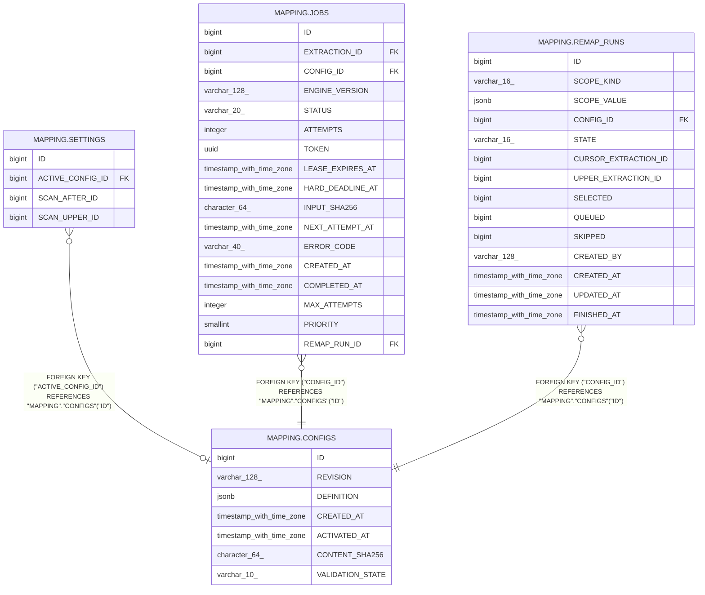

# MAPPING.CONFIGS

## Description

Phiên bản cấu hình ánh xạ và trạng thái kiểm định.

## Columns

| Name | Type | Default | Nullable | Children | Parents | Comment |
| ---- | ---- | ------- | -------- | -------- | ------- | ------- |
| ID | bigint |  | false | [MAPPING.SETTINGS](MAPPING.SETTINGS.md) [MAPPING.JOBS](MAPPING.JOBS.md) [MAPPING.REMAP_RUNS](MAPPING.REMAP_RUNS.md) |  | Khóa chính của cấu hình ánh xạ. |
| REVISION | varchar(128) |  | false |  |  |  |
| DEFINITION | jsonb |  | false |  |  |  |
| CREATED_AT | timestamp with time zone | CURRENT_TIMESTAMP | false |  |  |  |
| ACTIVATED_AT | timestamp with time zone |  | true |  |  |  |
| CONTENT_SHA256 | character(64) |  | true |  |  |  |
| VALIDATION_STATE | varchar(10) | 'DRAFT'::character varying | false |  |  | Trạng thái kiểm định và kích hoạt cấu hình ánh xạ. |

## Constraints

| Name | Type | Definition |
| ---- | ---- | ---------- |
| CK_MAPPING_CONFIG_ACTIVE | CHECK | CHECK (((("VALIDATION_STATE")::text = 'ACTIVE'::text) = ("ACTIVATED_AT" IS NOT NULL))) |
| CK_MAPPING_CONFIG_HASH | CHECK | CHECK (((("VALIDATION_STATE")::text = 'DRAFT'::text) OR (("CONTENT_SHA256" IS NOT NULL) AND (("CONTENT_SHA256")::text ~ '^[0-9a-f]{64}$'::text)))) |
| CV_MAPPING_CONFIGS_DEFINITION_check | CHECK | CHECK ((jsonb_typeof("DEFINITION") = 'object'::text)) |
| CV_MAPPING_CONFIGS_VALIDATION_STATE_check | CHECK | CHECK ((("VALIDATION_STATE")::text = ANY ((ARRAY['DRAFT'::character varying, 'TESTED'::character varying, 'ACTIVE'::character varying])::text[]))) |
| CV_MAPPING_CONFIGS_pkey | PRIMARY KEY | PRIMARY KEY ("ID") |
| CV_MAPPING_CONFIGS_REVISION_key | UNIQUE | UNIQUE ("REVISION") |

## Indexes

| Name | Definition |
| ---- | ---------- |
| CV_MAPPING_CONFIGS_pkey | CREATE UNIQUE INDEX "CV_MAPPING_CONFIGS_pkey" ON "MAPPING"."CONFIGS" USING btree ("ID") |
| CV_MAPPING_CONFIGS_REVISION_key | CREATE UNIQUE INDEX "CV_MAPPING_CONFIGS_REVISION_key" ON "MAPPING"."CONFIGS" USING btree ("REVISION") |

## Triggers

| Name | Definition |
| ---- | ---------- |
| TR_MAPPING_CONFIG_IMMUTABLE | CREATE TRIGGER "TR_MAPPING_CONFIG_IMMUTABLE" BEFORE DELETE OR UPDATE ON "MAPPING"."CONFIGS" FOR EACH ROW EXECUTE FUNCTION protect_mapping_config() |

## Relations

---

> Generated by [tbls](https://github.com/k1LoW/tbls)
