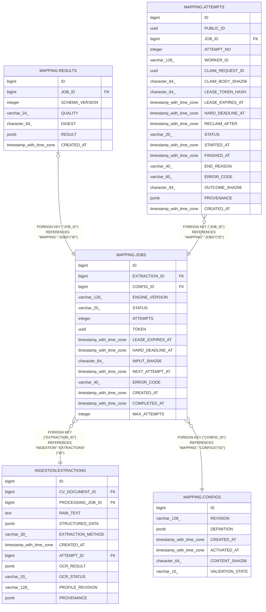

# MAPPING.JOBS

## Description

Công việc ánh xạ kết quả trích xuất theo cấu hình và phiên bản bộ máy.

## Columns

| Name | Type | Default | Nullable | Children | Parents | Comment |
| ---- | ---- | ------- | -------- | -------- | ------- | ------- |
| ID | bigint |  | false | [MAPPING.RESULTS](MAPPING.RESULTS.md) [MAPPING.ATTEMPTS](MAPPING.ATTEMPTS.md) |  | Khóa chính của công việc ánh xạ. |
| EXTRACTION_ID | bigint |  | false |  | [INGESTION.EXTRACTIONS](INGESTION.EXTRACTIONS.md) | Khóa ngoại tới kết quả trích xuất nguồn. |
| CONFIG_ID | bigint |  | false |  | [MAPPING.CONFIGS](MAPPING.CONFIGS.md) | Khóa ngoại tới phiên bản cấu hình ánh xạ. |
| ENGINE_VERSION | varchar(128) |  | false |  |  |  |
| STATUS | varchar(20) | 'PENDING'::character varying | false |  |  | Trạng thái công việc ánh xạ. |
| ATTEMPTS | integer | 0 | false |  |  |  |
| TOKEN | uuid |  | true |  |  |  |
| LEASE_EXPIRES_AT | timestamp with time zone |  | true |  |  |  |
| HARD_DEADLINE_AT | timestamp with time zone |  | true |  |  |  |
| INPUT_SHA256 | character(64) |  | true |  |  |  |
| NEXT_ATTEMPT_AT | timestamp with time zone | CURRENT_TIMESTAMP | false |  |  |  |
| ERROR_CODE | varchar(40) |  | true |  |  |  |
| CREATED_AT | timestamp with time zone | CURRENT_TIMESTAMP | false |  |  |  |
| COMPLETED_AT | timestamp with time zone |  | true |  |  |  |
| MAX_ATTEMPTS | integer | 3 | false |  |  |  |

## Constraints

| Name | Type | Definition |
| ---- | ---- | ---------- |
| CK_MAPPING_ATTEMPTS | CHECK | CHECK ((("ATTEMPTS" >= 0) AND ("ATTEMPTS" <= "MAX_ATTEMPTS"))) |
| CK_MAPPING_COMPLETED_INPUT | CHECK | CHECK (((("STATUS")::text <> 'COMPLETED'::text) OR ("INPUT_SHA256" IS NOT NULL))) |
| CK_MAPPING_LEASE | CHECK | CHECK (((("STATUS")::text <> 'PROCESSING'::text) OR (("TOKEN" IS NOT NULL) AND ("LEASE_EXPIRES_AT" IS NOT NULL) AND ("ATTEMPTS" > 0) AND ("HARD_DEADLINE_AT" IS NOT NULL) AND ("LEASE_EXPIRES_AT" <= "HARD_DEADLINE_AT")))) |
| CK_MAPPING_MAX_ATTEMPTS | CHECK | CHECK ((("MAX_ATTEMPTS" >= 1) AND ("MAX_ATTEMPTS" <= 1000))) |
| CK_MAPPING_TERMINAL | CHECK | CHECK (((("STATUS")::text = ANY ((ARRAY['COMPLETED'::character varying, 'FAILED'::character varying])::text[])) = ("COMPLETED_AT" IS NOT NULL))) |
| CV_MAPPING_JOBS_INPUT_SHA256_check | CHECK | CHECK ((("INPUT_SHA256" IS NULL) OR (("INPUT_SHA256")::text ~ '^[0-9a-f]{64}$'::text))) |
| CV_MAPPING_JOBS_STATUS_check | CHECK | CHECK ((("STATUS")::text = ANY ((ARRAY['PENDING'::character varying, 'PROCESSING'::character varying, 'COMPLETED'::character varying, 'FAILED'::character varying])::text[]))) |
| CV_MAPPING_JOBS_EXTRACTION_ID_fkey | FOREIGN KEY | FOREIGN KEY ("EXTRACTION_ID") REFERENCES "INGESTION"."EXTRACTIONS"("ID") |
| CV_MAPPING_JOBS_CONFIG_ID_fkey | FOREIGN KEY | FOREIGN KEY ("CONFIG_ID") REFERENCES "MAPPING"."CONFIGS"("ID") |
| CV_MAPPING_JOBS_pkey | PRIMARY KEY | PRIMARY KEY ("ID") |
| UQ_MAPPING_INPUT | UNIQUE | UNIQUE ("EXTRACTION_ID", "CONFIG_ID", "ENGINE_VERSION") |

## Indexes

| Name | Definition |
| ---- | ---------- |
| CV_MAPPING_JOBS_pkey | CREATE UNIQUE INDEX "CV_MAPPING_JOBS_pkey" ON "MAPPING"."JOBS" USING btree ("ID") |
| UQ_MAPPING_INPUT | CREATE UNIQUE INDEX "UQ_MAPPING_INPUT" ON "MAPPING"."JOBS" USING btree ("EXTRACTION_ID", "CONFIG_ID", "ENGINE_VERSION") |
| IX_MAPPING_READY | CREATE INDEX "IX_MAPPING_READY" ON "MAPPING"."JOBS" USING btree ("NEXT_ATTEMPT_AT", "ID") WHERE (("STATUS")::text = 'PENDING'::text) |
| IX_MAPPING_EXPIRY | CREATE INDEX "IX_MAPPING_EXPIRY" ON "MAPPING"."JOBS" USING btree ("LEASE_EXPIRES_AT", "ID") WHERE (("STATUS")::text = 'PROCESSING'::text) |

## Relations

---

> Generated by [tbls](https://github.com/k1LoW/tbls)
