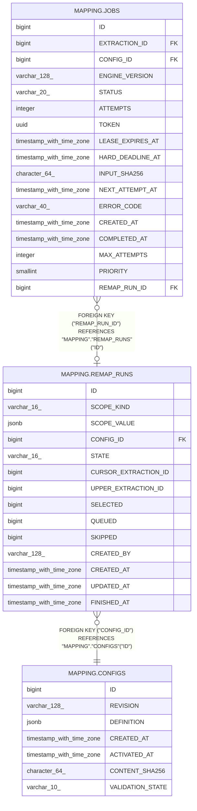

# MAPPING.REMAP_RUNS

## Description

Lượt chạy lại mapping theo phạm vi và cấu hình được chốt khi tạo.

## Columns

| Name | Type | Default | Nullable | Children | Parents | Comment |
| ---- | ---- | ------- | -------- | -------- | ------- | ------- |
| ID | bigint |  | false | [MAPPING.JOBS](MAPPING.JOBS.md) |  | Khóa chính của lượt chạy lại. |
| SCOPE_KIND | varchar(16) |  | false |  |  | Phạm vi toàn bộ, đợt nhập, khoảng ngày hoặc mã vấn đề. |
| SCOPE_VALUE | jsonb |  | false |  |  | Tham số phạm vi đã kiểm tra hợp lệ. |
| CONFIG_ID | bigint |  | false |  | [MAPPING.CONFIGS](MAPPING.CONFIGS.md) | Cấu hình hiện hành tại thời điểm tạo lượt chạy. |
| STATE | varchar(16) | 'RUNNING'::character varying | false |  |  | Trạng thái đang xếp hàng, tạm dừng hoặc đã xếp hết phạm vi. |
| CURSOR_EXTRACTION_ID | bigint | 0 | false |  |  | Extraction cuối đã xét trong giao dịch đã commit. |
| UPPER_EXTRACTION_ID | bigint |  | false |  |  | Cận extraction ban đầu, không mở rộng trong lượt chạy. |
| SELECTED | bigint | 0 | false |  |  | Số extraction đã xét trong các lô đã commit. |
| QUEUED | bigint | 0 | false |  |  | Số job mới đã xếp trong lượt chạy. |
| SKIPPED | bigint | 0 | false |  |  | Số extraction đã có job cùng cấu hình và engine. |
| CREATED_BY | varchar(128) |  | false |  |  | Tài khoản quản trị tạo lượt chạy. |
| CREATED_AT | timestamp with time zone | CURRENT_TIMESTAMP | false |  |  | Thời điểm tạo lượt chạy. |
| UPDATED_AT | timestamp with time zone | CURRENT_TIMESTAMP | false |  |  | Thời điểm cập nhật tiến độ hoặc trạng thái gần nhất. |
| FINISHED_AT | timestamp with time zone |  | true |  |  | Thời điểm xếp hết phạm vi; job có thể vẫn đang xử lý. |

## Constraints

| Name | Type | Definition |
| ---- | ---- | ---------- |
| CK_REMAP_COUNTS | CHECK | CHECK (("SELECTED" = ("QUEUED" + "SKIPPED"))) |
| CK_REMAP_CURSOR | CHECK | CHECK (("CURSOR_EXTRACTION_ID" <= "UPPER_EXTRACTION_ID")) |
| CK_REMAP_FINISHED | CHECK | CHECK (((("STATE")::text = 'DONE'::text) = ("FINISHED_AT" IS NOT NULL))) |
| REMAP_RUNS_CURSOR_EXTRACTION_ID_check | CHECK | CHECK (("CURSOR_EXTRACTION_ID" >= 0)) |
| REMAP_RUNS_QUEUED_check | CHECK | CHECK (("QUEUED" >= 0)) |
| REMAP_RUNS_SCOPE_KIND_check | CHECK | CHECK ((("SCOPE_KIND")::text = ANY ((ARRAY['ALL'::character varying, 'BATCH'::character varying, 'DATE_RANGE'::character varying, 'ISSUE'::character varying])::text[]))) |
| REMAP_RUNS_SCOPE_VALUE_check | CHECK | CHECK ((jsonb_typeof("SCOPE_VALUE") = 'object'::text)) |
| REMAP_RUNS_SELECTED_check | CHECK | CHECK (("SELECTED" >= 0)) |
| REMAP_RUNS_SKIPPED_check | CHECK | CHECK (("SKIPPED" >= 0)) |
| REMAP_RUNS_STATE_check | CHECK | CHECK ((("STATE")::text = ANY ((ARRAY['RUNNING'::character varying, 'PAUSED'::character varying, 'DONE'::character varying])::text[]))) |
| REMAP_RUNS_UPPER_EXTRACTION_ID_check | CHECK | CHECK (("UPPER_EXTRACTION_ID" >= 0)) |
| REMAP_RUNS_CONFIG_ID_fkey | FOREIGN KEY | FOREIGN KEY ("CONFIG_ID") REFERENCES "MAPPING"."CONFIGS"("ID") |
| REMAP_RUNS_pkey | PRIMARY KEY | PRIMARY KEY ("ID") |

## Indexes

| Name | Definition |
| ---- | ---------- |
| REMAP_RUNS_pkey | CREATE UNIQUE INDEX "REMAP_RUNS_pkey" ON "MAPPING"."REMAP_RUNS" USING btree ("ID") |
| IX_REMAP_RUNNING | CREATE INDEX "IX_REMAP_RUNNING" ON "MAPPING"."REMAP_RUNS" USING btree ("ID") WHERE (("STATE")::text = 'RUNNING'::text) |

## Relations

---

> Generated by [tbls](https://github.com/k1LoW/tbls)
