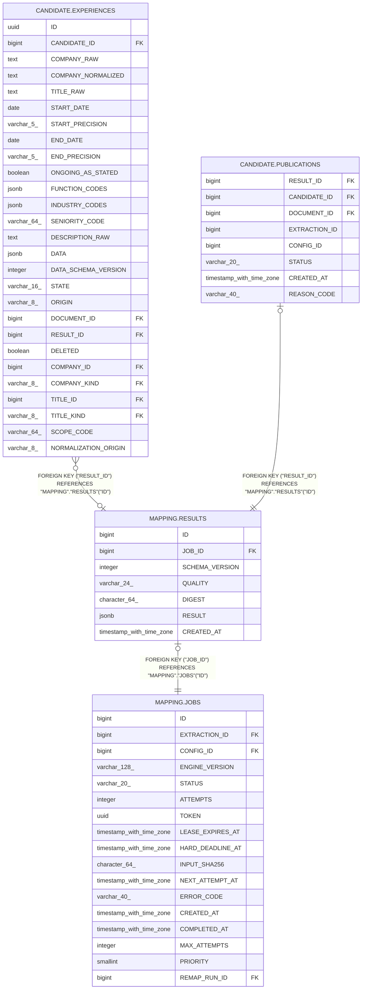

# MAPPING.RESULTS

## Description

Kết quả ánh xạ bất biến cùng phiên bản cấu trúc và chất lượng.

## Columns

| Name | Type | Default | Nullable | Children | Parents | Comment |
| ---- | ---- | ------- | -------- | -------- | ------- | ------- |
| ID | bigint |  | false | [CANDIDATE.EXPERIENCES](CANDIDATE.EXPERIENCES.md) [CANDIDATE.PUBLICATIONS](CANDIDATE.PUBLICATIONS.md) |  | Khóa chính của kết quả ánh xạ. |
| JOB_ID | bigint |  | false |  | [MAPPING.JOBS](MAPPING.JOBS.md) | Khóa ngoại tới công việc tạo kết quả ánh xạ. |
| SCHEMA_VERSION | integer |  | false |  |  |  |
| QUALITY | varchar(24) |  | false |  |  | Mức chất lượng của kết quả ánh xạ. |
| DIGEST | character(64) |  | false |  |  |  |
| RESULT | jsonb |  | false |  |  |  |
| CREATED_AT | timestamp with time zone | CURRENT_TIMESTAMP | false |  |  |  |

## Constraints

| Name | Type | Definition |
| ---- | ---- | ---------- |
| CK_MAPPING_RESULT_SCHEMA | CHECK | CHECK (("SCHEMA_VERSION" = ANY (ARRAY[1, 2, 3]))) |
| CV_MAPPING_RESULTS_DIGEST_check | CHECK | CHECK ((("DIGEST")::text ~ '^[0-9a-f]{64}$'::text)) |
| CV_MAPPING_RESULTS_QUALITY_check | CHECK | CHECK ((("QUALITY")::text = ANY ((ARRAY['NEEDS_REVIEW'::character varying, 'UNSUPPORTED_INPUT'::character varying])::text[]))) |
| CV_MAPPING_RESULTS_RESULT_check | CHECK | CHECK ((jsonb_typeof("RESULT") = 'object'::text)) |
| CV_MAPPING_RESULTS_JOB_ID_fkey | FOREIGN KEY | FOREIGN KEY ("JOB_ID") REFERENCES "MAPPING"."JOBS"("ID") |
| CV_MAPPING_RESULTS_pkey | PRIMARY KEY | PRIMARY KEY ("ID") |
| CV_MAPPING_RESULTS_JOB_ID_key | UNIQUE | UNIQUE ("JOB_ID") |

## Indexes

| Name | Definition |
| ---- | ---------- |
| CV_MAPPING_RESULTS_pkey | CREATE UNIQUE INDEX "CV_MAPPING_RESULTS_pkey" ON "MAPPING"."RESULTS" USING btree ("ID") |
| CV_MAPPING_RESULTS_JOB_ID_key | CREATE UNIQUE INDEX "CV_MAPPING_RESULTS_JOB_ID_key" ON "MAPPING"."RESULTS" USING btree ("JOB_ID") |

## Triggers

| Name | Definition |
| ---- | ---------- |
| TR_MAPPING_RESULT_IMMUTABLE | CREATE TRIGGER "TR_MAPPING_RESULT_IMMUTABLE" BEFORE DELETE OR UPDATE ON "MAPPING"."RESULTS" FOR EACH ROW EXECUTE FUNCTION protect_mapping_result() |

## Relations

---

> Generated by [tbls](https://github.com/k1LoW/tbls)
