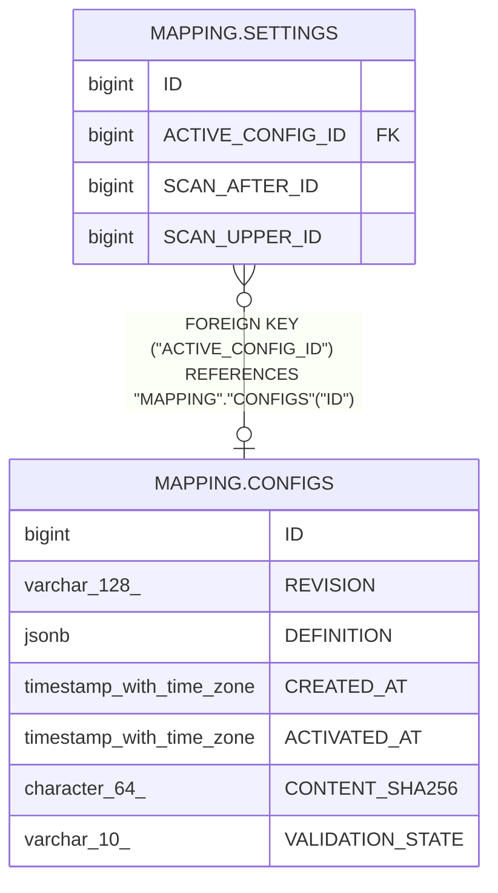

# MAPPING.SETTINGS

## Description

Cấu hình ánh xạ đang hoạt động và con trỏ quét bền vững.

## Columns

| Name | Type | Default | Nullable | Children | Parents | Comment |
| ---- | ---- | ------- | -------- | -------- | ------- | ------- |
| ID | bigint |  | false |  |  | Khóa chính cố định của thiết lập ánh xạ. |
| ACTIVE_CONFIG_ID | bigint |  | true |  | [MAPPING.CONFIGS](MAPPING.CONFIGS.md) | Khóa ngoại tới cấu hình ánh xạ đang hoạt động. |
| SCAN_AFTER_ID | bigint | 0 | false |  |  |  |
| SCAN_UPPER_ID | bigint |  | true |  |  |  |

## Constraints

| Name | Type | Definition |
| ---- | ---- | ---------- |
| CV_MAPPING_SETTINGS_ID_check | CHECK | CHECK (("ID" = 1)) |
| CV_MAPPING_SETTINGS_SCAN_AFTER_ID_check | CHECK | CHECK (("SCAN_AFTER_ID" >= 0)) |
| CV_MAPPING_SETTINGS_SCAN_UPPER_ID_check | CHECK | CHECK (("SCAN_UPPER_ID" >= 0)) |
| CV_MAPPING_SETTINGS_ACTIVE_CONFIG_ID_fkey | FOREIGN KEY | FOREIGN KEY ("ACTIVE_CONFIG_ID") REFERENCES "MAPPING"."CONFIGS"("ID") |
| CV_MAPPING_SETTINGS_pkey | PRIMARY KEY | PRIMARY KEY ("ID") |

## Indexes

| Name | Definition |
| ---- | ---------- |
| CV_MAPPING_SETTINGS_pkey | CREATE UNIQUE INDEX "CV_MAPPING_SETTINGS_pkey" ON "MAPPING"."SETTINGS" USING btree ("ID") |

## Relations

---

> Generated by [tbls](https://github.com/k1LoW/tbls)
