# CV Compass

## Tables

| Name | Columns | Comment | Type |
| ---- | ------- | ------- | ---- |
| [public.event_publication](public.event_publication.md) | 9 |  | BASE TABLE |
| [INGESTION.IMPORT_BATCHES](INGESTION.IMPORT_BATCHES.md) | 7 | Đợt nhập CV cùng số lượng và trạng thái tổng hợp. | BASE TABLE |
| [CANDIDATE.CANDIDATES](CANDIDATE.CANDIDATES.md) | 8 | Định danh ứng viên và thông tin cơ bản ban đầu. | BASE TABLE |
| [INGESTION.DOCUMENTS](INGESTION.DOCUMENTS.md) | 10 | Tài liệu CV gốc cùng thông tin lưu trữ và trạng thái xử lý. | BASE TABLE |
| [INGESTION.PROCESSING_JOBS](INGESTION.PROCESSING_JOBS.md) | 17 | Công việc xử lý tài liệu cùng trạng thái và lịch thử lại OCR. | BASE TABLE |
| [INGESTION.EXTRACTIONS](INGESTION.EXTRACTIONS.md) | 12 | Kết quả trích xuất văn bản và OCR được giữ nguyên từ tài liệu. | BASE TABLE |
| [INGESTION.IMPORT_ITEMS](INGESTION.IMPORT_ITEMS.md) | 7 | Kết quả nhập từng tệp trong một đợt nhập CV. | BASE TABLE |
| [INGESTION.DISK_OBSERVATIONS](INGESTION.DISK_OBSERVATIONS.md) | 11 | Thông tin quan sát tệp để xác định độ ổn định trước khi nhập. | BASE TABLE |
| [INGESTION.DISK_IMPORT_FILES](INGESTION.DISK_IMPORT_FILES.md) | 20 | Lịch sử nhập tệp từ thư mục và trạng thái di chuyển tệp. | BASE TABLE |
| [INGESTION.OCR_ATTEMPTS](INGESTION.OCR_ATTEMPTS.md) | 18 | Lần thực hiện OCR cùng thời hạn thuê và kết quả kết thúc. | BASE TABLE |
| [MAPPING.CONFIGS](MAPPING.CONFIGS.md) | 7 | Phiên bản cấu hình ánh xạ và trạng thái kiểm định. | BASE TABLE |
| [MAPPING.SETTINGS](MAPPING.SETTINGS.md) | 4 | Cấu hình ánh xạ đang hoạt động và con trỏ quét bền vững. | BASE TABLE |
| [MAPPING.JOBS](MAPPING.JOBS.md) | 15 | Công việc ánh xạ kết quả trích xuất theo cấu hình và phiên bản bộ máy. | BASE TABLE |
| [MAPPING.RESULTS](MAPPING.RESULTS.md) | 7 | Kết quả ánh xạ bất biến cùng phiên bản cấu trúc và chất lượng. | BASE TABLE |
| [CANDIDATE.PROFILES](CANDIDATE.PROFILES.md) | 13 | Hồ sơ ứng viên có phiên bản và trạng thái xác nhận thông tin. | BASE TABLE |
| [CANDIDATE.EXPERIENCES](CANDIDATE.EXPERIENCES.md) | 21 | Kinh nghiệm ứng viên cùng nguồn bằng chứng và trạng thái xác nhận. | BASE TABLE |
| [CANDIDATE.PUBLICATIONS](CANDIDATE.PUBLICATIONS.md) | 8 | Sổ công bố kết quả ánh xạ vào hồ sơ ứng viên. | BASE TABLE |
| [CANDIDATE.PROPOSALS](CANDIDATE.PROPOSALS.md) | 9 | Đề xuất cập nhật hồ sơ từ kết quả ánh xạ và quyết định xử lý. | BASE TABLE |
| [CANDIDATE.HISTORY](CANDIDATE.HISTORY.md) | 8 | Lịch sử thay đổi hồ sơ ứng viên theo phiên bản. | BASE TABLE |
| [CANDIDATE.PUBLICATION_SETTINGS](CANDIDATE.PUBLICATION_SETTINGS.md) | 3 | Con trỏ quét bền vững phục vụ công bố hồ sơ. | BASE TABLE |
| [IDENTITY.USERS](IDENTITY.USERS.md) | 4 | Tài khoản người dùng cùng vai trò và trạng thái hoạt động. | BASE TABLE |
| [MAPPING.ATTEMPTS](MAPPING.ATTEMPTS.md) | 19 | Lần thực hiện ánh xạ từ xa cùng thời hạn thuê và kết quả kết thúc. | BASE TABLE |

## Stored procedures and functions

| Name | ReturnType | Arguments | Type |
| ---- | ------- | ------- | ---- |
| public.protect_mapping_config | trigger |  | FUNCTION |
| public.protect_mapping_result | trigger |  | FUNCTION |

## Relations

```mermaid
erDiagram

"INGESTION.DOCUMENTS" }o--o| "INGESTION.IMPORT_BATCHES" : "FOREIGN KEY (#quot;BATCH_ID#quot;) REFERENCES #quot;INGESTION#quot;.#quot;IMPORT_BATCHES#quot;(#quot;ID#quot;)"
"INGESTION.DOCUMENTS" }o--o| "CANDIDATE.CANDIDATES" : "FOREIGN KEY (#quot;CANDIDATE_ID#quot;) REFERENCES #quot;CANDIDATE#quot;.#quot;CANDIDATES#quot;(#quot;ID#quot;)"
"INGESTION.PROCESSING_JOBS" }o--|| "INGESTION.DOCUMENTS" : "FOREIGN KEY (#quot;CV_DOCUMENT_ID#quot;) REFERENCES #quot;INGESTION#quot;.#quot;DOCUMENTS#quot;(#quot;ID#quot;)"
"INGESTION.PROCESSING_JOBS" }o--|| "INGESTION.OCR_ATTEMPTS" : "FOREIGN KEY (#quot;CURRENT_ATTEMPT_ID#quot;, #quot;ID#quot;) REFERENCES #quot;INGESTION#quot;.#quot;OCR_ATTEMPTS#quot;(#quot;ID#quot;, #quot;JOB_ID#quot;)"
"INGESTION.EXTRACTIONS" }o--|| "INGESTION.DOCUMENTS" : "FOREIGN KEY (#quot;CV_DOCUMENT_ID#quot;) REFERENCES #quot;INGESTION#quot;.#quot;DOCUMENTS#quot;(#quot;ID#quot;)"
"INGESTION.EXTRACTIONS" }o--|| "INGESTION.PROCESSING_JOBS" : "FOREIGN KEY (#quot;PROCESSING_JOB_ID#quot;, #quot;CV_DOCUMENT_ID#quot;) REFERENCES #quot;INGESTION#quot;.#quot;PROCESSING_JOBS#quot;(#quot;ID#quot;, #quot;CV_DOCUMENT_ID#quot;)"
"INGESTION.EXTRACTIONS" }o--|| "INGESTION.OCR_ATTEMPTS" : "FOREIGN KEY (#quot;ATTEMPT_ID#quot;, #quot;PROCESSING_JOB_ID#quot;) REFERENCES #quot;INGESTION#quot;.#quot;OCR_ATTEMPTS#quot;(#quot;ID#quot;, #quot;JOB_ID#quot;)"
"INGESTION.IMPORT_ITEMS" }o--|| "INGESTION.IMPORT_BATCHES" : "FOREIGN KEY (#quot;BATCH_ID#quot;) REFERENCES #quot;INGESTION#quot;.#quot;IMPORT_BATCHES#quot;(#quot;ID#quot;)"
"INGESTION.IMPORT_ITEMS" }o--o| "INGESTION.DOCUMENTS" : "FOREIGN KEY (#quot;DOCUMENT_ID#quot;) REFERENCES #quot;INGESTION#quot;.#quot;DOCUMENTS#quot;(#quot;ID#quot;)"
"INGESTION.DISK_IMPORT_FILES" }o--o| "INGESTION.IMPORT_BATCHES" : "FOREIGN KEY (#quot;BATCH_ID#quot;) REFERENCES #quot;INGESTION#quot;.#quot;IMPORT_BATCHES#quot;(#quot;ID#quot;)"
"INGESTION.DISK_IMPORT_FILES" }o--o| "INGESTION.DOCUMENTS" : "FOREIGN KEY (#quot;DOCUMENT_ID#quot;) REFERENCES #quot;INGESTION#quot;.#quot;DOCUMENTS#quot;(#quot;ID#quot;)"
"INGESTION.OCR_ATTEMPTS" }o--|| "INGESTION.PROCESSING_JOBS" : "FOREIGN KEY (#quot;JOB_ID#quot;) REFERENCES #quot;INGESTION#quot;.#quot;PROCESSING_JOBS#quot;(#quot;ID#quot;)"
"MAPPING.SETTINGS" }o--o| "MAPPING.CONFIGS" : "FOREIGN KEY (#quot;ACTIVE_CONFIG_ID#quot;) REFERENCES #quot;MAPPING#quot;.#quot;CONFIGS#quot;(#quot;ID#quot;)"
"MAPPING.JOBS" }o--|| "INGESTION.EXTRACTIONS" : "FOREIGN KEY (#quot;EXTRACTION_ID#quot;) REFERENCES #quot;INGESTION#quot;.#quot;EXTRACTIONS#quot;(#quot;ID#quot;)"
"MAPPING.JOBS" }o--|| "MAPPING.CONFIGS" : "FOREIGN KEY (#quot;CONFIG_ID#quot;) REFERENCES #quot;MAPPING#quot;.#quot;CONFIGS#quot;(#quot;ID#quot;)"
"MAPPING.RESULTS" |o--|| "MAPPING.JOBS" : "FOREIGN KEY (#quot;JOB_ID#quot;) REFERENCES #quot;MAPPING#quot;.#quot;JOBS#quot;(#quot;ID#quot;)"
"CANDIDATE.PROFILES" |o--|| "CANDIDATE.CANDIDATES" : "FOREIGN KEY (#quot;CANDIDATE_ID#quot;) REFERENCES #quot;CANDIDATE#quot;.#quot;CANDIDATES#quot;(#quot;ID#quot;)"
"CANDIDATE.EXPERIENCES" }o--o| "INGESTION.DOCUMENTS" : "FOREIGN KEY (#quot;DOCUMENT_ID#quot;) REFERENCES #quot;INGESTION#quot;.#quot;DOCUMENTS#quot;(#quot;ID#quot;)"
"CANDIDATE.EXPERIENCES" }o--o| "MAPPING.RESULTS" : "FOREIGN KEY (#quot;RESULT_ID#quot;) REFERENCES #quot;MAPPING#quot;.#quot;RESULTS#quot;(#quot;ID#quot;)"
"CANDIDATE.EXPERIENCES" }o--|| "CANDIDATE.PROFILES" : "FOREIGN KEY (#quot;CANDIDATE_ID#quot;) REFERENCES #quot;CANDIDATE#quot;.#quot;PROFILES#quot;(#quot;CANDIDATE_ID#quot;)"
"CANDIDATE.PUBLICATIONS" }o--|| "INGESTION.DOCUMENTS" : "FOREIGN KEY (#quot;DOCUMENT_ID#quot;) REFERENCES #quot;INGESTION#quot;.#quot;DOCUMENTS#quot;(#quot;ID#quot;)"
"CANDIDATE.PUBLICATIONS" |o--|| "MAPPING.RESULTS" : "FOREIGN KEY (#quot;RESULT_ID#quot;) REFERENCES #quot;MAPPING#quot;.#quot;RESULTS#quot;(#quot;ID#quot;)"
"CANDIDATE.PUBLICATIONS" }o--o| "CANDIDATE.PROFILES" : "FOREIGN KEY (#quot;CANDIDATE_ID#quot;) REFERENCES #quot;CANDIDATE#quot;.#quot;PROFILES#quot;(#quot;CANDIDATE_ID#quot;)"
"CANDIDATE.PROPOSALS" }o--|| "INGESTION.DOCUMENTS" : "FOREIGN KEY (#quot;DOCUMENT_ID#quot;) REFERENCES #quot;INGESTION#quot;.#quot;DOCUMENTS#quot;(#quot;ID#quot;)"
"CANDIDATE.PROPOSALS" }o--|| "CANDIDATE.PROFILES" : "FOREIGN KEY (#quot;CANDIDATE_ID#quot;) REFERENCES #quot;CANDIDATE#quot;.#quot;PROFILES#quot;(#quot;CANDIDATE_ID#quot;)"
"CANDIDATE.PROPOSALS" }o--|| "CANDIDATE.PUBLICATIONS" : "FOREIGN KEY (#quot;RESULT_ID#quot;) REFERENCES #quot;CANDIDATE#quot;.#quot;PUBLICATIONS#quot;(#quot;RESULT_ID#quot;)"
"CANDIDATE.HISTORY" }o--|| "CANDIDATE.PROFILES" : "FOREIGN KEY (#quot;CANDIDATE_ID#quot;) REFERENCES #quot;CANDIDATE#quot;.#quot;PROFILES#quot;(#quot;CANDIDATE_ID#quot;)"
"MAPPING.ATTEMPTS" }o--|| "MAPPING.JOBS" : "FOREIGN KEY (#quot;JOB_ID#quot;) REFERENCES #quot;MAPPING#quot;.#quot;JOBS#quot;(#quot;ID#quot;)"

"public.event_publication" {
  uuid id
  timestamp_with_time_zone publication_date
  varchar_255_ listener_id
  text serialized_event
  varchar_255_ event_type
  timestamp_with_time_zone completion_date
  timestamp_with_time_zone last_resubmission_date
  integer completion_attempts
  varchar_255_ status
}
"INGESTION.IMPORT_BATCHES" {
  bigint ID
  integer TOTAL_FILES
  integer SUCCESS_COUNT
  integer FAILED_COUNT
  varchar_20_ STATUS
  timestamp_with_time_zone CREATED_AT
  timestamp_with_time_zone COMPLETED_AT
}
"CANDIDATE.CANDIDATES" {
  bigint ID
  varchar_255_ FULL_NAME
  varchar_255_ EMAIL
  varchar_50_ PHONE
  varchar_255_ LOCATION
  text SUMMARY
  timestamp_with_time_zone CREATED_AT
  timestamp_with_time_zone UPDATED_AT
}
"INGESTION.DOCUMENTS" {
  bigint ID
  bigint BATCH_ID FK
  bigint CANDIDATE_ID FK
  varchar_255_ ORIGINAL_FILENAME
  text STORAGE_PATH
  bigint FILE_SIZE
  varchar_100_ MIME_TYPE
  character_64_ SHA256
  varchar_20_ STATUS
  timestamp_with_time_zone CREATED_AT
}
"INGESTION.PROCESSING_JOBS" {
  bigint ID FK
  bigint CV_DOCUMENT_ID FK
  varchar_20_ STATUS
  integer RETRY_COUNT
  text ERROR_MESSAGE
  timestamp_with_time_zone CREATED_AT
  timestamp_with_time_zone STARTED_AT
  timestamp_with_time_zone COMPLETED_AT
  varchar_128_ PROFILE_REVISION
  integer GENERATION
  integer MAX_ATTEMPTS
  integer ATTEMPTS_STARTED
  timestamp_with_time_zone NEXT_ATTEMPT_AT
  bigint CURRENT_ATTEMPT_ID FK
  jsonb ADMISSION_SNAPSHOT
  varchar_40_ END_REASON
  varchar_60_ ERROR_CODE
}
"INGESTION.EXTRACTIONS" {
  bigint ID
  bigint CV_DOCUMENT_ID FK
  bigint PROCESSING_JOB_ID FK
  text RAW_TEXT
  jsonb STRUCTURED_DATA
  varchar_30_ EXTRACTION_METHOD
  timestamp_with_time_zone CREATED_AT
  bigint ATTEMPT_ID FK
  jsonb OCR_RESULT
  varchar_20_ OCR_STATUS
  varchar_128_ PROFILE_REVISION
  jsonb PROVENANCE
}
"INGESTION.IMPORT_ITEMS" {
  bigint ID
  timestamp_with_time_zone CREATED_AT
  bigint BATCH_ID FK
  integer FILE_ORDER
  varchar_255_ DISPLAY_NAME
  bigint DOCUMENT_ID FK
  varchar_40_ ERROR_CODE
}
"INGESTION.DISK_OBSERVATIONS" {
  bigint ID
  character_64_ SOURCE_KEY
  text FILE_NAME
  bigint SIZE_BYTES
  varchar_40_ MODIFIED
  text FILE_KEY
  timestamp_with_time_zone OBSERVED_SINCE
  uuid LAST_SCAN
  integer READ_ATTEMPTS
  timestamp_with_time_zone NEXT_READ_AT
  varchar_40_ ERROR_CODE
}
"INGESTION.DISK_IMPORT_FILES" {
  bigint ID
  character_64_ SOURCE_KEY
  text FILE_NAME
  character_64_ SHA256
  bigint SIZE_BYTES
  varchar_40_ MODIFIED
  text FILE_KEY
  varchar_30_ STATE
  integer ATTEMPTS
  integer READ_FAILURES_APPLIED
  integer MOVE_ATTEMPTS
  timestamp_with_time_zone NEXT_ATTEMPT_AT
  timestamp_with_time_zone NEXT_MOVE_AT
  bigint BATCH_ID FK
  bigint DOCUMENT_ID FK
  varchar_40_ ERROR_CODE
  varchar_40_ MOVE_ERROR_CODE
  varchar_36_ TARGET_NAME
  timestamp_with_time_zone CREATED_AT
  timestamp_with_time_zone UPDATED_AT
}
"INGESTION.OCR_ATTEMPTS" {
  bigint ID
  timestamp_with_time_zone CREATED_AT
  uuid PUBLIC_ID
  bigint JOB_ID FK
  integer ATTEMPT_NO
  varchar_128_ WORKER_ID
  uuid CLAIM_REQUEST_ID
  character_64_ CLAIM_BODY_SHA256
  character_64_ LEASE_TOKEN_HASH
  timestamp_with_time_zone LEASE_EXPIRES_AT
  timestamp_with_time_zone HARD_DEADLINE_AT
  timestamp_with_time_zone RECLAIM_AFTER
  varchar_20_ STATUS
  timestamp_with_time_zone STARTED_AT
  timestamp_with_time_zone FINISHED_AT
  varchar_40_ END_REASON
  varchar_60_ ERROR_CODE
  character_64_ OUTCOME_SHA256
}
"MAPPING.CONFIGS" {
  bigint ID
  varchar_128_ REVISION
  jsonb DEFINITION
  timestamp_with_time_zone CREATED_AT
  timestamp_with_time_zone ACTIVATED_AT
  character_64_ CONTENT_SHA256
  varchar_10_ VALIDATION_STATE
}
"MAPPING.SETTINGS" {
  bigint ID
  bigint ACTIVE_CONFIG_ID FK
  bigint SCAN_AFTER_ID
  bigint SCAN_UPPER_ID
}
"MAPPING.JOBS" {
  bigint ID
  bigint EXTRACTION_ID FK
  bigint CONFIG_ID FK
  varchar_128_ ENGINE_VERSION
  varchar_20_ STATUS
  integer ATTEMPTS
  uuid TOKEN
  timestamp_with_time_zone LEASE_EXPIRES_AT
  timestamp_with_time_zone HARD_DEADLINE_AT
  character_64_ INPUT_SHA256
  timestamp_with_time_zone NEXT_ATTEMPT_AT
  varchar_40_ ERROR_CODE
  timestamp_with_time_zone CREATED_AT
  timestamp_with_time_zone COMPLETED_AT
  integer MAX_ATTEMPTS
}
"MAPPING.RESULTS" {
  bigint ID
  bigint JOB_ID FK
  integer SCHEMA_VERSION
  varchar_24_ QUALITY
  character_64_ DIGEST
  jsonb RESULT
  timestamp_with_time_zone CREATED_AT
}
"CANDIDATE.PROFILES" {
  bigint CANDIDATE_ID FK
  bigint VERSION
  varchar_255_ FULL_NAME
  varchar_255_ EMAIL
  varchar_50_ PHONE
  varchar_255_ LOCATION
  text SUMMARY
  jsonb BASIC
  varchar_16_ BASIC_STATE
  varchar_8_ BASIC_ORIGIN
  jsonb EXTENSIONS
  timestamp_with_time_zone CREATED_AT
  timestamp_with_time_zone UPDATED_AT
}
"CANDIDATE.EXPERIENCES" {
  uuid ID
  bigint CANDIDATE_ID FK
  text COMPANY_RAW
  text COMPANY_NORMALIZED
  text TITLE_RAW
  date START_DATE
  varchar_5_ START_PRECISION
  date END_DATE
  varchar_5_ END_PRECISION
  boolean ONGOING_AS_STATED
  jsonb FUNCTION_CODES
  jsonb INDUSTRY_CODES
  varchar_64_ SENIORITY_CODE
  text DESCRIPTION_RAW
  jsonb DATA
  integer DATA_SCHEMA_VERSION
  varchar_16_ STATE
  varchar_8_ ORIGIN
  bigint DOCUMENT_ID FK
  bigint RESULT_ID FK
  boolean DELETED
}
"CANDIDATE.PUBLICATIONS" {
  bigint RESULT_ID FK
  bigint CANDIDATE_ID FK
  bigint DOCUMENT_ID FK
  bigint EXTRACTION_ID
  bigint CONFIG_ID
  varchar_20_ STATUS
  timestamp_with_time_zone CREATED_AT
  varchar_40_ REASON_CODE
}
"CANDIDATE.PROPOSALS" {
  uuid ID
  bigint CANDIDATE_ID FK
  bigint RESULT_ID FK
  bigint DOCUMENT_ID FK
  jsonb DATA
  varchar_10_ STATUS
  varchar_100_ DECIDED_BY
  timestamp_with_time_zone DECIDED_AT
  varchar_20_ KIND
}
"CANDIDATE.HISTORY" {
  bigint ID
  bigint CANDIDATE_ID FK
  bigint VERSION
  varchar_100_ ACTOR
  varchar_40_ ACTION
  jsonb BEFORE
  jsonb AFTER
  timestamp_with_time_zone CREATED_AT
}
"CANDIDATE.PUBLICATION_SETTINGS" {
  integer ID
  bigint AFTER_ID
  bigint UPPER_ID
}
"IDENTITY.USERS" {
  varchar_100_ USERNAME
  varchar_100_ PASSWORD_HASH
  varchar_5_ ROLE
  boolean ENABLED
}
"MAPPING.ATTEMPTS" {
  bigint ID
  uuid PUBLIC_ID
  bigint JOB_ID FK
  integer ATTEMPT_NO
  varchar_128_ WORKER_ID
  uuid CLAIM_REQUEST_ID
  character_64_ CLAIM_BODY_SHA256
  character_64_ LEASE_TOKEN_HASH
  timestamp_with_time_zone LEASE_EXPIRES_AT
  timestamp_with_time_zone HARD_DEADLINE_AT
  timestamp_with_time_zone RECLAIM_AFTER
  varchar_20_ STATUS
  timestamp_with_time_zone STARTED_AT
  timestamp_with_time_zone FINISHED_AT
  varchar_40_ END_REASON
  varchar_60_ ERROR_CODE
  character_64_ OUTCOME_SHA256
  jsonb PROVENANCE
  timestamp_with_time_zone CREATED_AT
}
```

---

> Generated by [tbls](https://github.com/k1LoW/tbls)
