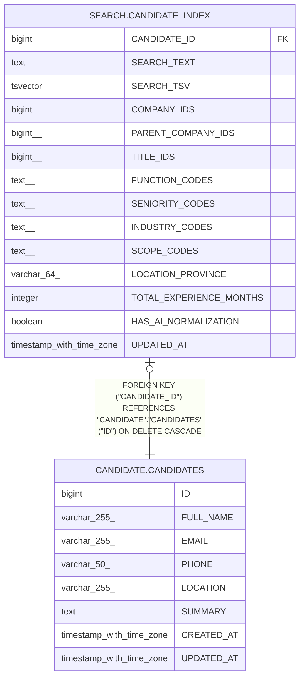

# SEARCH.CANDIDATE_INDEX

## Description

Bản chỉ mục tìm kiếm tổng hợp theo ứng viên.

## Columns

| Name | Type | Default | Nullable | Children | Parents | Comment |
| ---- | ---- | ------- | -------- | -------- | ------- | ------- |
| CANDIDATE_ID | bigint |  | false |  | [CANDIDATE.CANDIDATES](CANDIDATE.CANDIDATES.md) | Khóa chính chỉ mục và khóa ngoại tới ứng viên. |
| SEARCH_TEXT | text |  | false |  |  | Văn bản tìm kiếm đã bỏ dấu và chuyển chữ thường. |
| SEARCH_TSV | tsvector |  | false |  |  | Vector từ vựng phục vụ tìm kiếm toàn văn. |
| COMPANY_IDS | bigint[] | '{}'::bigint[] | false |  |  | Các công ty liên kết trực tiếp với kinh nghiệm ứng viên. |
| PARENT_COMPANY_IDS | bigint[] | '{}'::bigint[] | false |  |  | Các tập đoàn mẹ của công ty trong kinh nghiệm. |
| TITLE_IDS | bigint[] | '{}'::bigint[] | false |  |  | Các chức danh chuẩn hóa trong kinh nghiệm. |
| FUNCTION_CODES | text[] | '{}'::text[] | false |  |  | Các mã nhóm nghề phục vụ bộ lọc. |
| SENIORITY_CODES | text[] | '{}'::text[] | false |  |  | Các mã cấp bậc phục vụ bộ lọc. |
| INDUSTRY_CODES | text[] | '{}'::text[] | false |  |  | Các mã ngành phục vụ bộ lọc. |
| SCOPE_CODES | text[] | '{}'::text[] | false |  |  | Các mã phạm vi phục vụ bộ lọc. |
| LOCATION_PROVINCE | varchar(64) |  | true |  |  | Tên tỉnh thành chuẩn theo danh sách 63 tỉnh cũ. |
| TOTAL_EXPERIENCE_MONTHS | integer |  | true |  |  | Tổng số tháng kinh nghiệm đã tổng hợp. |
| HAS_AI_NORMALIZATION | boolean | false | false |  |  | Chỉ dấu ứng viên có dữ liệu chuẩn hóa do AI đề xuất. |
| UPDATED_AT | timestamp with time zone |  | false |  |  | Thời điểm cập nhật bản chỉ mục tìm kiếm. |

## Constraints

| Name | Type | Definition |
| ---- | ---- | ---------- |
| CANDIDATE_INDEX_CANDIDATE_ID_fkey | FOREIGN KEY | FOREIGN KEY ("CANDIDATE_ID") REFERENCES "CANDIDATE"."CANDIDATES"("ID") ON DELETE CASCADE |
| CANDIDATE_INDEX_pkey | PRIMARY KEY | PRIMARY KEY ("CANDIDATE_ID") |

## Indexes

| Name | Definition |
| ---- | ---------- |
| CANDIDATE_INDEX_pkey | CREATE UNIQUE INDEX "CANDIDATE_INDEX_pkey" ON "SEARCH"."CANDIDATE_INDEX" USING btree ("CANDIDATE_ID") |
| IDX_CANDIDATE_INDEX_SEARCH_TSV | CREATE INDEX "IDX_CANDIDATE_INDEX_SEARCH_TSV" ON "SEARCH"."CANDIDATE_INDEX" USING gin ("SEARCH_TSV") |
| IDX_CANDIDATE_INDEX_SEARCH_TEXT | CREATE INDEX "IDX_CANDIDATE_INDEX_SEARCH_TEXT" ON "SEARCH"."CANDIDATE_INDEX" USING gin ("SEARCH_TEXT" gin_trgm_ops) |
| IDX_CANDIDATE_INDEX_COMPANY_IDS | CREATE INDEX "IDX_CANDIDATE_INDEX_COMPANY_IDS" ON "SEARCH"."CANDIDATE_INDEX" USING gin ("COMPANY_IDS") |
| IDX_CANDIDATE_INDEX_PARENT_COMPANY_IDS | CREATE INDEX "IDX_CANDIDATE_INDEX_PARENT_COMPANY_IDS" ON "SEARCH"."CANDIDATE_INDEX" USING gin ("PARENT_COMPANY_IDS") |
| IDX_CANDIDATE_INDEX_TITLE_IDS | CREATE INDEX "IDX_CANDIDATE_INDEX_TITLE_IDS" ON "SEARCH"."CANDIDATE_INDEX" USING gin ("TITLE_IDS") |
| IDX_CANDIDATE_INDEX_FUNCTION_CODES | CREATE INDEX "IDX_CANDIDATE_INDEX_FUNCTION_CODES" ON "SEARCH"."CANDIDATE_INDEX" USING gin ("FUNCTION_CODES") |
| IDX_CANDIDATE_INDEX_SENIORITY_CODES | CREATE INDEX "IDX_CANDIDATE_INDEX_SENIORITY_CODES" ON "SEARCH"."CANDIDATE_INDEX" USING gin ("SENIORITY_CODES") |
| IDX_CANDIDATE_INDEX_INDUSTRY_CODES | CREATE INDEX "IDX_CANDIDATE_INDEX_INDUSTRY_CODES" ON "SEARCH"."CANDIDATE_INDEX" USING gin ("INDUSTRY_CODES") |
| IDX_CANDIDATE_INDEX_SCOPE_CODES | CREATE INDEX "IDX_CANDIDATE_INDEX_SCOPE_CODES" ON "SEARCH"."CANDIDATE_INDEX" USING gin ("SCOPE_CODES") |

## Relations

---

> Generated by [tbls](https://github.com/k1LoW/tbls)
