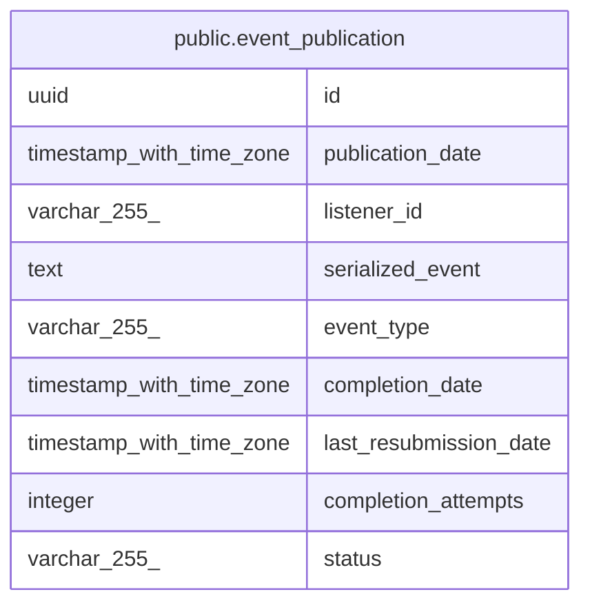

# public.event_publication

## Columns

| Name | Type | Default | Nullable | Children | Parents | Comment |
| ---- | ---- | ------- | -------- | -------- | ------- | ------- |
| id | uuid |  | false |  |  |  |
| publication_date | timestamp with time zone |  | false |  |  |  |
| listener_id | varchar(255) |  | false |  |  |  |
| serialized_event | text |  | false |  |  |  |
| event_type | varchar(255) |  | false |  |  |  |
| completion_date | timestamp with time zone |  | true |  |  |  |
| last_resubmission_date | timestamp with time zone |  | true |  |  |  |
| completion_attempts | integer | 0 | false |  |  |  |
| status | varchar(255) |  | true |  |  |  |

## Constraints

| Name | Type | Definition |
| ---- | ---- | ---------- |
| event_publication_pkey | PRIMARY KEY | PRIMARY KEY (id) |

## Indexes

| Name | Definition |
| ---- | ---------- |
| event_publication_pkey | CREATE UNIQUE INDEX event_publication_pkey ON public.event_publication USING btree (id) |
| event_publication_by_completion_date_idx | CREATE INDEX event_publication_by_completion_date_idx ON public.event_publication USING btree (completion_date) |

## Relations

---

> Generated by [tbls](https://github.com/k1LoW/tbls)
