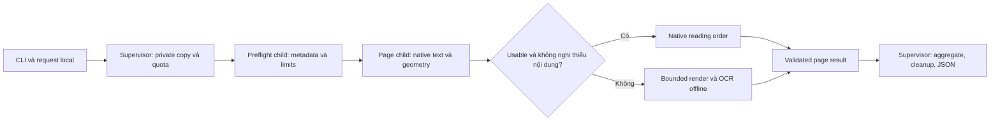

> LỊCH SỬ M6.1: không dùng như mô tả source/acceptance hiện tại. Xem [handoff hiện hành](M6_BASELINE_HANDOFF.md) và [PR9 revision](M6_PR9_REVISION.md). Target quality bên dưới là đề xuất lịch sử; OCR accuracy chưa đánh giá, GCC unresolved chặn production riêng.

# M6.1 — Thiết kế Python OCR worker độc lập

**DRAFT — chờ review trước M6.2**, khảo sát ngày2026-10-18. Nền main sau PR#8:
`5c06070955e2313f041be47ac313d97b2c079bea`. Branch `docs/m6-1-ocr-design`, worktree `E:/cv-compass-ocr-design`.
Đây là thiết kế/schema/examples, chưa có pipeline worker hoàn chỉnh. Sau quyết định review đã thực hiện spike component nhỏ với fixture tổng hợp; xem M6_1_STACK_SPIKE.md, không dùng kết quả đó làm OCR quality/resource safety gate.

## 1. Phạm vi và hiện trạng

| Bước | Ranh giới |
|---|---|
| M6.1 | Thiết kế local contract, stack, resource policy và kế hoạch đánh giá; chờ duyệt |
| M6.2 và các bước M6 được giao tiếp | Worker/CLI offline nhận một PDF, quyết định từng trang, trả text/method/warnings/errors và kiểm chứng độc lập |
| M7 chưa triển khai | Contract HTTP/auth/transfer PDF, claim/lease/retry jobs, gửi kết quả và backend persistence/migration |

Yêu cầu hiện tại thay cách gọi cũ “M6 OCR Worker Integration” bằng worker độc lập/M7 integration. Không tự sửa roadmap local hoặc bắt đầu integration. Backend sở hữu mọi DB write. Không OCR từ DiskImportScheduler, không candidate parsing/normalization/dedup/embedding/search, broker hay web framework.

Đã đọc đầy đủ AGENTS.md, hai workflow, database foundation và source liên quan tại main. /docs/ và AGENTS.md local bị ignore nên đọc tại E:/cv-compass, không force-add sang worktree. Hiện trạng:
- worker/ chưa có tracked Python source, manifest hoặc tests. Chỉ có worker.iml/.venv local: Python3.12.10, pip26.0.1; Tesseract không có trong PATH (không khẳng định chưa cài ở nơi khác).
- CvDocumentService/CvBatchService/DiskImportService lưu file/metadata/history, không tạo job/extraction. Upload success không có nghĩa OCR success.
- FileStorageService.read(StorageKey) thuộc backend; API metadata không phải API tải PDF cho worker. M6 không tự suy ra physical path từ storage key.
- CvProcessingJob/CvExtraction và bảng đã có, nhưng chưa có worker lifecycle API. ExtractionMethod và CHECK V2 chỉ cho TEXT_EXTRACTION/OCR ở mức document extraction: chưa thể hiện mixed methods từng trang, partial, engine/timings. STRUCTURED_DATA hiện dự kiến cho parser, không tự nhét envelope OCR vào đó. M7 phải chốt mapping/persistence và migration mới nếu cần; không sửa V1–V5.
- docs/POC_OCR_API_CONTRACT.md được AGENTS nhắc nhưng chưa tồn tại sau tìm kiếm. Không bịa nội dung. AGENTS yêu cầu duyệt nó trước Java–Python integration: M7 phải giải quyết. Local contract dưới đây là proposal mới, không phải HTTP contract đã duyệt.

## 2. Công cụ và phiên bản đề xuất

Các pin ban đầu là ứng viên khảo sát. Spike đã chạy exact pins trên Windows và Ubuntu cho hai fixture thông thường; chưa chứng minh chất lượng/độ bền hoặc production compatibility toàn pipeline. M6.2 phải resolve transitive lock/hashes trên Windows/Ubuntu, ghi SBOM/license notices. Không dùng latest/master hoặc tự download khi nhận CV.

| Thành phần | Pin đề xuất | Căn cứ |
|---|---|---|
| CPython chuẩn GIL | 3.14.8 | Release chính thức; không free-threaded. Python3.12.10 local không phải baseline đã nâng cấp [S1] |
| pdfplumber | 0.11.10 | Native text và word/char geometry, MIT [S2] |
| pdfminer.six | 20260107 | Đúng dependency pin của pdfplumber0.11.10, không tự nâng lệch [S3] |
| pypdfium2 | 5.14.0 | Render PDF, wheel Windows/Linux; ghi PDFium bundled build/flags thực tế [S4] |
| Pillow | 13.0.0 | Bitmap/preview/rotate, MIT-CMU, hợp constraint Pillow>=12.2.0; release mới nên phải smoke trước chốt [S3,S5] |
| Tesseract CLI | 5.5.3 | OCR offline, text+TSV; không cần pytesseract wrapper [S6,S7] |
| Models | tessdata_fast revision87416418657359cb625c412a48b6e1d6d41c29bd | vie + eng + osd; M6.2 phải hash từng file trước dùng, không bịa hash chưa tải [S8] |

Python3.12.15 là source-only security release, không có installer chính thức mới. Đề xuất3.14.8 để thuận parity binary Windows/Linux; compatibility vẫn phải thực thi. Không hướng dẫn cập nhật3.12.10 bằng installer không tồn tại [S1b]. apt mặc định Ubuntu có thể không có Tesseract5.5.3: cần provision binary có provenance/hash hoặc build exact tag, không coi các version khác là tương đương.

| Lựa chọn | Quality/layout | CPU/RAM, platform, offline | License/tradeoff |
|---|---|---|---|
| pdfplumber + PDFium + Tesseract fast | Native geometry kiểm tra được, OCR truyền thống; cột/font layer/scan mờ vẫn phải đo | CPU-only, tuần tự từng trang; parser Python có thể tốn CPU/RAM. Wheel renderer và executable trên Windows/Linux; offline sau provisioning | pdfplumber/pdfminer MIT; pypdfium2 Apache-2.0/BSD-3-Clause, PDFium BSD-style + bundled notices; Pillow MIT-CMU; Tesseract/models Apache-2.0. Baseline vì trách nhiệm rõ, timeout process và vận hành gọn [S2–S8] |
| PyMuPDF1.28.2 + Tesseract | Một native engine text/render, API gọn/geometry; vẫn cần test font/cột | Wheel Windows/Linux, offline. Có thể giảm parser overhead, chưa benchmark CV Compass | AGPLv3 hoặc commercial; cần quyết định license trước chọn. Không kết luận pháp lý từ deployment [S9] |
| PaddleOCR3.7.0 với model PP-OCRv5 multilingual cụ thể | Ứng viên scan/layout khó; model Latin liệt kê Vietnamese | CPU/GPU tùy runtime, thêm detector/recognizer weights và warm-up; phải khớp wheel/backend hai OS. Offline sau provision đủ và tắt auto-download | Project Apache-2.0, kiểm tra riêng weights/runtime. Dành A/B nếu baseline fail, chưa thêm Paddle/VLM [S10] |

Nhận định CPU/RAM là kiến trúc, không phải số đo. Không dùng benchmark marketing hoặc độ phổ biến để chọn. Tessdata_best là A/B nếu fast không đạt; cân latency/RAM bằng đo thực tế [S8b]. Language order cố định vie+eng, eng không thay vie. Không LLM/generative correction, không suy diễn chữ không quan sát được.

## 3. Kiến trúc và thư mục M6.2 đề xuất

Thiết kế ban đầu nằm design/. Yêu cầu tiếp theo cho phép spikes/m6_1/ để kiểm chứng component, không phải pipeline. Cấu trúc production dưới đây chưa implement:

```text
worker/
  pyproject.toml
  requirements.lock
  README.md
  src/cv_compass_worker/
    __main__.py       # argparse CLI
    config.py         # effective config + validation
    contracts.py      # DTO/schema + invariants
    pipeline.py       # supervisor/per-page selection/budgets
    pdf.py            # preflight/native geometry/PDFium render
    ocr.py            # Tesseract invocation/TSV/provision checks
    layout.py         # deterministic reading order
    sandbox.py        # process-tree/OS limits/private temp
    errors.py         # safe mapping
  tests/{unit,integration,quality}/
  design/
```

Stdlib argparse/pathlib/dataclasses/json/subprocess; không ORM/web/HTTP client. M6.2 mới pin pytest/lint/type-check; không bịa command check hiện chưa có. Interface nhỏ để inject failure, không plugin framework.



Supervisor không parse PDF/native DLL. Preflight và mỗi page là child mới, Tesseract là descendant; một page tại một thời điểm, portable spawn, không share PDF handles. PDFium không thread-safe; concurrency tương lai bằng process, không thread pool native [S11]. Reopen PDF mỗi page tốn startup nhưng cô lập crash/timeout và giữ trang đã xong; đo trước tối ưu long-lived process.

Child trả result file riêng bounded/atomic, không stdout/pickle untrusted. Parent chỉ giữ text/metadata trong cap, không tất cả ảnh.

## 4. Pipeline theo từng trang

1. Validate request/config và profile. Provision kiểm tra đầy đủ native/render/OCR/OSD, version/hashes trước xử lý; thiếu thì fail preflight kể cả input có native text. Không tự cài/model-download hoặc silently fallback eng.
2. input_ref là server-controlled UUID.pdf trong private workspace. Mở read-only, từ chối symlink/reparse/FIFO/device/URL/network source; streaming copy vào workdir với byte cap + expected SHA256, recheck descriptor/size/mtime. Không sửa source. Trusted workspace là điều kiện chống filesystem races.
3. Preflight child kiểm tra format/encryption/page count/dimensions. Reject mọi encrypted PDF kể cả empty password, không nhận password hoặc bypass permissions. Nếu API không xác định được encryption chắc chắn thì fail closed; exact API phải spike ở M6.2.
4. Native extraction + geometry từng trang. Ngưỡng khởi điểm versioned: >=40 nonwhite letter/digit, >=5 word-like tokens, printable>=98%, replacement/control/CID-unmapped<=1%, nhiều dòng/glyph hợp lệ trong page. Có warning nếu encoding/lặp chữ bất thường. Không ASCII-only; đếm sau NFC và giữ dấu. Ngưỡng không chứng minh text đúng/đủ.
5. Native đủ vẫn xét image regions ngoài text boxes; khởi điểm uncovered raster coverage>=25% hoặc visual/text bất đồng -> full-page OCR, warning NATIVE_TEXT_WITH_IMAGES. Logo/photo có thể OCR thừa: tradeoff ưu tiên tránh mất scan body; cần calibration. Không dựa duy nhất “có text”, số ký tự hoặc toàn document.
6. Native usable và không nghi thiếu -> native reading order. Hỏng/rỗng/sparse/parser fail/nghi thiếu -> render300DPI và OCR toàn trang. Nếu OCR thành công chọn OCR, không ghép mù native+OCR gây trùng. Chữ vài ký tự như footer không mặc nhiên native success.
7. Trang hợp lệ ít chữ có thể giữ OCR text kèm SPARSE_TEXT; exit0 không chứng minh có usable text. OCR rỗng trên trang có foreground -> failed/NO_USABLE_TEXT.
8. Blank chỉ khi native trống và preview/raster gần trắng không foreground đáng kể. Ink/dynamic-range heuristic bảo thủ, versioned. Nearblank/lowcontrast -> BLANK_PAGE_SUSPECTED, thử full render/OCR; nếu vẫn mơ hồ thì failed, không silent blank. Known blank giữ record status=blank/method=none.
9. Page-local render/OCR crash/timeout: record safe failure, giữ pages trước và child mới cho trang sau nếu còn budget. Global resource/output/temp/document timeout hoặc missing dependency/model giữa chừng: dừng lượt, remaining not_processed. Không gọi engine lỗi hệ thống lặp cho mọi trang.
10. Validate invariants, cleanup, publish output atomically không overwrite; chỉ safe logs, không text. Result là private artifact riêng.

### Layout/rotation/raw text

Native: words/lines -> full-width bands/header -> gutter rõ -> từng cột trái sang phải, trong cột từ trên xuống. Không sort toàn trang y/x làm xen hai cột. Sidebar/table/column ambiguity: deterministic geometry fallback + READING_ORDER_UNCERTAIN, không claim đúng.

OCR: --oem1 --psm3 vie+eng, text+TSV cùng invocation. Giữ block/paragraph/line IDs; chỉ reorder nếu gutter/band evidence rõ, không sort mọi words y/x. PSM6 chỉ thử single-column crop/profile được duyệt, không mặc định CV nhiều cột [S7].

Render áp dụng PDF rotation metadata; OSD preview quyết định scan90/180/270 khi confidence đạt ngưỡng calibration. Không chắc -> ROTATION_UNCERTAIN, giữ orientation theo metadata, không bốn lần OCR vô hạn. OSD invocation riêng dùng -l osd --psm0, không ép vie+eng/OEM1 của recognition vào OSD; M6.2 phải xác nhận build hỗ trợ OSD. Deskew nhỏ là experiment cần duyệt riêng; chưa thêm OpenCV. Preview100DPI đóng trước fullrender, không giữ tất cả raster. Background trắng, không aggressive denoise làm mất dấu [S12].

raw_text giữ output method đã chọn chưa sửa chính tả; text là reading order xác định, NFC và CRLF/CR->LF. Không NFKC/strip dấu/đoán nối từ/gỡ hyphen/email correction. Giữ whitespace có nghĩa. Failed page có thể giữ raw_text đã thu nhưng text rỗng, không quảng bá như thành công. Khi chọn OCR không giữ rejected native candidate riêng; có warning, PDF gốc vẫn làm nguồn kiểm tra.
## 5. Local contract v1.0 đề xuất

Artifacts: ocr-v1.schema.json (Draft2020-12), examples/request.json, result-success.json, result-mixed.json, result-failed.json, result-blank.json, result-partial-document-error.json, result-output-limit.json. Schema có discriminator type=request|result. Đây là ví dụ cấu trúc giả lập, không output OCR đã chạy; timings/confidence không phải số đo, model checksum placeholder không dùng provision.

CLI pipeline dự kiến M6.2, **chưa tồn tại** (khác CLI diagnostic stack_smoke.py):

```text
python -m cv_compass_worker --config <local-config> --workspace <private-root> --request <request.json> --output <new-result.json>
```

Request: schema_version=cv-compass.ocr/1.0; opaque ASCII request_id và document_id (string để không mất precision Long backend); input_ref chỉ UUID.pdf trong workspace, không physical path/URL/traversal; expected_sha256; profile=baseline-v1. Không arbitrary engine arguments, password hoặc caps caller tự tăng.

success chỉ phản ánh hoàn thành kỹ thuật và heuristic usable text; không chứng nhận accuracy hoặc đạt quality gate.

Result: cùng IDs/version; status=success|partial|failed; page_count hoặc null nếu chưa biết; pages theo thứ tự trang vật lý1-based; warnings/errors an toàn; timings và engines/config_fingerprint. Chưa phải contract M7, chưa đặt HTTP/auth. Breaking change tăng major, không đổi nghĩa ngầm.

| Page field | Quy tắc |
|---|---|
| page_number | 1..page_count, liên tục và duy nhất |
| status | ok, blank, failed, not_processed |
| method | native, ocr, none; chỉ phương pháp text cuối |
| text/raw_text | Private UTF-8 strings có cap, không log |
| warnings | Enum codes, không raw engine messages |
| error | null hoặc code+stage, không internal exception |
| timings_ms | native/render/preprocess/ocr/total; stage chưa chạy=null; đã chạy>=0, monotonic ms |
| confidence | null hoặc Tesseract mean_word_confidence(value0..100,sample_count) |

Confidence là arithmetic mean từ TSV word rows có text và conf>=0, loại sentinel-1. Không tự gán100 cho native, không xác suất OCR đúng/CER, không confidence document. Không có score hợp lệ -> null. Không so thẳng với Paddle hoặc khác model/config. Heuristic chọn native và acceptance không chỉ dựa confidence.

Invariants M6.2 phải validate ngoài schema:

- Page count biết và trong cap -> đúng một entry/trang, kể cả not_processed sau abort. Contract v1 page_count/page_number không vượt50. Khi preflight fail hoặc thực tế vượt cap: pages=[], page_count=null và mã PAGE_COUNT_LIMIT nếu do vượt giới hạn; không tạo placeholders vô hạn.
- ok -> native/ocr, text nonwhite, error=null. blank -> none, text/raw_text rỗng, error=null, BLANK_PAGE. failed/not_processed -> none, text rỗng, error khác null; raw_text trong cap nếu có attempt.
- success -> có >=1trang ok, còn lại ok/blank và không document error. partial -> có >=1trang ok và có failed/not_processed page HOẶC document error, vẫn xuất được JSON hợp lệ. Mọi trang có thể ok mà document vẫn partial. SUMMARY_PARTIAL không bắt buộc; ưu tiên mã lỗi nguyên nhân. failed -> không trang ok, bao gồm allblank/NO_USABLE_TEXT. Không đổi trạng thái trang thành công để khớp schema.
- Cleanup failure là document warning CLEANUP_FAILED, không mask kết quả chính; ngừng nhận document kế tiếp đến khi temp/quota an toàn. Không publish được result -> exit3/OUTPUT_WRITE_FAILED, không báo đã giao envelope.
- Total wall gồm startup/I/O/validation/cleanup; không bằng tổng stages. Stage không quan sát được sau crash=null. Document budget bao gồm preflight, reserve cleanup5s+publish2s.
- Engines ghi resolved worker package/build version, Python/Pillow/pdfplumber/pdfminer/PDFium wrapper+build/Tesseract+Leptonica và model revision/SHA256 thực tế; unavailable version=null. Không model directory/executable path. Config fingerprint SHA256 effective nonsecret config+model hashes, loại path/PII.
- Không concatenate pages làm mất boundary. M7 mới chốt aggregate raw_text và page separator.

CLI exit (developer-approved M6.2 hardening): 0=JSON success đã publish; 1=JSON partial đã publish; 2=JSON failed đã publish; 3=không giao result JSON hợp lệ, kể cả request/config bị reject trước envelope. Nếu đủ validated identity để tạo failed envelope đúng schema thì ưu tiên xuất failed và trả2; chưa giao thì3. Stderr receipt chỉ delivered/status/safe code, không thay OCR JSONv1. Exit không chứng minh accuracy OCR.


### Quyết định review đã chốt: output và nguồn giới hạn

`ocr-v1.limits.json` là nguồn authority trần v1: tối đa50trang, 50.000Unicode code points cho MỖI text/raw_text từng trang. Schema là projection được kiểm tra bằng verify_contract.py; reference config resolver đọc cùng manifest, không hardcode default khác. Config chỉ giảm; bool/float/zero/negative hoặc vượt trần bị từ chối trước callback mở/parse PDF. Đây là reference resolver có executable checks, chưa phải production pipeline/config loader; M6.2 phải tái sử dụng manifest và gate này, không copy constants lệch schema. Muốn tăng trần phải review contract/version trước, không nâng manifest để bypass. Tests đóng băng ceiling v1 và phát hiện drift manifest/schema/config. Code points khác UTF-8 bytes và UTF-16 code units; test dùng non-BMP và combining marks.

Vượt output: giữ nguyên từng page hoàn tất còn vừa budget theo thứ tự ưu tiên trang sớm; không cắt text/raw_text hoặc đổi ok thành failed để đạt schema. Page bị loại khỏi payload phải có placeholder not_processed/method none/text rỗng/error OUTPUT_LIMIT, giữ page_number; đây là entry thể hiện dữ liệu không được giao, không viết lại kết quả page đã xử lý nội bộ. Kết quả completed bị loại vẫn được ghi trong private attempt accounting, không giả vờ OCR thất bại. Dừng nhận page mới khi không còn budget, các page chưa chạy cũng đánh dấu OUTPUT_LIMIT. Có trang ok còn được giao -> partial; không có ok -> failed. Nếu cả envelope+placeholders+errors tối thiểu cũng không vừa effective byte cap thì exit3, không publish JSON cắt dở/không báo delivery. Resource caps cũng áp dụng cho từng trường; text vượt cap thì không được truyền như ok hoặc truncate. Giữ các trang trước đó và báo OUTPUT_LIMIT cho entry tương ứng.

Cleanup failure chỉ warning CLEANUP_FAILED, không tự tạo document error hay failed; halt intake vẫn áp dụng. Các ví dụ partial-document-error giữ nguyên mọi page ok từ success example; output-limit giữ nguyên page đã hoàn tất và chỉ thay entry không được giao.

## 6. Error taxonomy và logs

Stage enum: request, preflight, native, render, preprocess, ocr, supervisor, output, cleanup. Error chỉ code/stage, không message động. M6 không tự retry document; M7 mới chốt policy.

| Code | Ý nghĩa/hành vi |
|---|---|
| INVALID_REQUEST / INVALID_CONFIGURATION | Sai schema/version/ID/ref hoặc config/profile/cap |
| INPUT_NOT_FOUND / INPUT_ACCESS_DENIED / UNSAFE_INPUT | File thiếu/quyền/link/ref unsafe, không in path |
| INPUT_CHANGED / INPUT_HASH_MISMATCH | Thay đổi khi copy hoặc digest không khớp |
| FILE_CORRUPT | Không mở/parse PDF; không echo parser message |
| FILE_ENCRYPTED | Có mã hóa, baseline không nhận password |
| FILE_SIZE_LIMIT / PAGE_COUNT_LIMIT | Vượt bytes/pages, reject preflight |
| IMAGE_LIMIT / OUTPUT_LIMIT / TEMP_LIMIT / RESOURCE_LIMIT | Pixel/dimension/output/quota hoặc OS hard budget |
| PAGE_TIMEOUT / DOCUMENT_TIMEOUT | Parent watchdog, kill process tree, giữ kết quả trước |
| DEPENDENCY_MISSING / MODEL_MISSING / ENGINE_VERSION_UNSUPPORTED | Thiếu library/executable vs model/OSD vs version không hỗ trợ |
| NATIVE_EXTRACTION_FAILED | Native lỗi không recover bằng OCR; recover được thì chỉ warning |
| RENDER_FAILED / OCR_FAILED | Phân biệt render và OCR engine nonzero/failure |
| NO_USABLE_TEXT | Nonblank nhưng text không usable, hoặc allblank document |
| ENGINE_CRASH | Child chết không có result; chưa đủ chứng cứ gọi là OOM |
| SUMMARY_PARTIAL | Mã tổng hợp tùy chọn cho partial; không thay mã lỗi nguyên nhân |
| OUTPUT_WRITE_FAILED / INTERNAL_ERROR | Publish lỗi hoặc lỗi chưa phân loại; không traceback/path |

Warning allowlist: NATIVE_TEXT_UNUSABLE, NATIVE_EXTRACTION_FAILED, SPARSE_TEXT, NATIVE_TEXT_WITH_IMAGES, READING_ORDER_UNCERTAIN, ROTATION_UNCERTAIN, LOW_OCR_CONFIDENCE, BLANK_PAGE, BLANK_PAGE_SUSPECTED, LOW_RESOLUTION, CLEANUP_FAILED. Không raw engine strings.

Log allowlist: generated request correlation ID (không đặt ID bằng tên CV), page_number, stage/code, elapsed_ms, counters và engine versions. Không original filename/input_ref/storagekey/full path, CV text/email/phone, command line, exception.message/raw stderr hoặc full request/result. Child diagnostics bounded/private chỉ map known codes, không lưu raw mặc định. Core/Windows dumps có thể chứa CV: tắt core dump, hạn chế dump collection trong deployment profile.

## 7. Tài nguyên và isolation

Các defaults là mục tiêu cần duyệt/đo. Environment hoặc TOML ngoài repo, fail-fast config; paths ngoài Git, tách input/output/temp/models, model/executable read-only trusted. Không hardcode D: hoặc separators trong code.

| Cấu hình | Default/cap | Cơ chế |
|---|---|---|
| OCR_MAX_FILE_BYTES | 10,485,760 | Parent streaming copy, đồng bộ backend10MiB |
| OCR_MAX_PAGES | 50 | Preflight child, reject trước page loop |
| OCR_RENDER_DPI | 300, cấu hình150..400 | Pixel math trước allocate; không silently hạ DPI |
| OCR_MAX_IMAGE_PIXELS | 16,000,000/page | Tích width*height overflow-safe, preview/full/rotate |
| OCR_MAX_IMAGE_DIMENSION | 6000px/chiều | Reject giant MediaBox/CropBox trước render |
| OCR_PREVIEW_DPI | 100 | Cùng caps, blank/rotation check |
| OCR_PREFLIGHT_TIMEOUT | 10s | Parent watchdog |
| OCR_PAGE_TIMEOUT | 60s | native/render/OSD/OCR/startup cả trang |
| OCR_TESSERACT_TIMEOUT | 40s; OSD<=5s | Chặn thêm bằng page/document remaining budget |
| OCR_DOCUMENT_TIMEOUT | 600s | Monotonic từ nhận request tới cleanup/output; reserve5s+2s |
| OCR_MAX_TEXT_CHARS_PAGE | 50,000 cho mỗi text/raw_text | Vượt -> OUTPUT_LIMIT, không truncate rồi success |
| OCR_MAX_TEXT_CHARS_DOCUMENT | 500,000 tổng text+raw_text | Cumulative trước commit page result |
| OCR_MAX_RESULT_BYTES | 8MiB UTF-8 JSON | Gồm envelope, không chỉ text |
| OCR_MAX_ENGINE_OUTPUT_BYTES | 8MiB/page tổng .txt/TSV | Parent monitoring + quota hard, kill nếu vượt |
| OCR_MAX_TEMP_BYTES | 256MiB/document | Account file sizes; OS quota chống race overshoot |
| OCR_CONCURRENCY | 1 | M6.2 chỉ nhận1, future process pool phải có budget tổng |
| OCR_THREADS_PER_ENGINE | 1 | OMP_THREAD_LIMIT=1 + OS CPU quota |
| OCR_LANGUAGES/OEM/PSM | vie+eng/1/3 | Profile allowlist |
| Hard memory | 1GiB process tree | OS child768MiB+supervisor256MiB, không chỉ RSS polling |
| CPU/reference host | <=2cores; host2vCPU/4GiB | OS quota + wall watchdog, chưa benchmark |

A4 ở300DPI khoảng8.7Mpixel/~35MB một BGRA buffer; còn Pillow/copies/parser/Tesseract. Pixel cap không bảo đảm RAM tương ứng. PDF streams/objects có thể bung trước code checks: cần OS hard limits. Pillow image warning không thay cap PDF render. Không load tất cả pages/images.

- Ubuntu: supervisor giữ riêng; child tree trong cgroup/systemd scope được quản lý có MemoryMax/MemorySwapMax/CPUQuota/TasksMax, parent còn budget trả lỗi khi child OOM. Total cap phải tính cả hai groups; không mặc nhiên RSS là toàn bộ usage. Container là phương án triển khai sau: PDF read-only, tmp quota, network none; M6.1 không thêm service [S13].
- Windows: Job Object memory/process-tree limits, kill-on-job-close; child suspended -> assign Job -> resume để tránh race thoát quản lý; descendants không breakaway. Restricted account/ACL; Job Object không phải security sandbox hoặc deny-network tự thân [S14].
- Thiếu hard isolation: production profile fail INVALID_CONFIGURATION. Diagnostic not_enforced chỉ dùng synthetic fixture thông thường, KHÔNG CV thật/fixture độc hại/resource bomb. Ghi riêng báo cáo kiểm chứng: OS, adapter, requested_limits, applied_limits và status=enforced|not_enforced. Không thêm isolation field/warning tùy tiện vào OCR JSONv1. Không dựa diagnostic để kết luận resource safety. Production thiếu hard isolation từ chối trước PDF.
- PDFium thường không V8/XFA, không chạy JS/embedded attachment/launch actions hoặc URL trong PDF; no DB/cloud credentials ở child, OS/firewall/container deny network. Provision offline trước, không runtime downloads.
- Watchdog terminate -> kill tree -> wait/reap. POSIX process groups/cgroup, Windows Job Object; subprocess timeout riêng không đảm bảo kill descendants [S15]. Không reap được -> halt supervisor, không nhận document mới.

Cleanup: workdir random riêng mode0700/ACL owner, không tên CV. Đóng bitmap/page/textpage/handles ở child finally; parent finally cleanup sau kill/reap để Windows không giữ file. Cleanup lỗi giữ safe warning, dừng nhận tiếp, quyền riêng tư/quota vẫn áp dụng, operator xử lý. Startup chỉ cleanup owned stale dirs khi xác nhận không live lock, không recursive-delete arbitrary paths. Power loss/kill parent không đảm bảo finally chạy; phải thử orphan/temp recovery riêng, không tuyên bố crash-proof.
## 8. Test matrix và corpus

Tách hai tầng:

1. Technical tests dùng synthetic/minimal fixtures generate vào tmp, không CV thật. Unit inject timeout/crash/error; integration phải dùng PDF/render/Tesseract thật, không chỉ mocks.
2. Quality evaluation dùng local consented/licensed corpus giống CV mục tiêu, manual ground truth, không engine output đang đánh giá làm đáp án. Bộ100 synthetic không chứng minh chất lượng CV thật. M6.1 chưa đọc D: hoặc thu corpus.

Đề xuất>=60trang/30documents, >=20trang Việt/20Anh, >=10mixed/bilingual, >=12multi-column và >=8trang khó (strata có thể overlap), thêm10invalid/security fixtures ngoài quality metrics. Split document60/40 calibration/held-out; cùng người/template digital/scan không rò sang hai tập. Hai người chép/kiểm tra chéo từ bản hiển thị, phân xử bất đồng; ghi unreadable thay vì đoán. Text ground truth NFC/LF và block-order/contact annotations. CV/ground truth/output chứa PII giữ ngoài Git/log/cloud, chỉ được dùng khi có authorization riêng.

| Case | Technical assertion | Quality riêng |
|---|---|---|
| Native EN/VI dấu | Native method, pages/order/raw/text, source hash bất biến | CER/WER/dấu/contact |
| Scan EN/VI | OCR fallback, languages/model/timing thực | CER/WER từng ngôn ngữ |
| Mixed file và mixed ngay trong trang | Footer-only text không bypass scan body, không duplicate | Region recall/contact |
| Broken/empty/sparse text layer | Warning/fallback, vài chars không tự success | False native acceptance |
| Multi-column/sidebar/header/table | Deterministic grouping/warning ambiguity | Block precedence/inversions |
| Blank/nearblank/lowcontrast | Blank entry, allblank failed, không bỏ chữ nhạt | False blank và dấu nhỏ |
| Rotation90/180/270 và metadata rotation | Không double rotate, OSD budget/warning | CER/contact/order |
| Blur/noise/skew/chữ nhỏ | Bounded work, warning/failed khi unusable | CER/WER hard subset |
| Corrupt/truncated/nonPDF | FILE_CORRUPT, next valid document vẫn chạy | Không CER |
| Encrypted kể cả empty password | FILE_ENCRYPTED, không leak | Không CER |
| 10MiB/10MiB+1, pages50/51 | Đúng boundary, không placeholders vô hạn | Không CER |
| Giant MediaBox/pixel/decompression bomb | IMAGE_LIMIT trước allocation hoặc OS kill; parent sống | Peak tree RAM/CPU |
| Page/Tesseract/document timeout | Kill descendants, giữ pages trước, rest not_processed | Latency/no orphan |
| Missing lib/exe/vie/eng/osd/hash mismatch | Safe distinct error, không download/fallbackeng | Reproducibility |
| Native crash/OCR nonzero/malformed child result | ENGINE_CRASH/OCR_FAILED, next page/doc còn chạy | Không đồng nhất exit0/quality |
| Output/temp/diskfull/permission | Quota stop, không overwrite/false success | Resource accounting |
| Unsafe refs/link/path injection/Unicode workspace | Validation, shell=False, no PII logs | Không CER |
| Cleanup fail/kill parent/restart | Halt safe, own-stale cleanup only, source hash unchanged | Recovery observations |
| Offline | Block outbound, toàn fixture suite vẫn chạy | Không remote OCR |
| Windows và Ubuntu | Cùng pins/models/config, functional parity | Báo khác biệt output/timing, không giả định bit-identical |

Required real-engine tests thiếu engine/model phải FAIL/BLOCKED, không skip rồi kết luận đủ suite. Malformed inputs chỉ chạy trong child hard resource isolation, không native parser trong supervisor.

## 9. Metrics và nghiệm thu đề xuất

CER=(S+D+I)/ground-truth Unicode codepoints sau NFC. Kèm grapheme/diacritic breakdown; không strip dấu để tăng điểm. WER cùng công thức trên token whitespace + punctuation policy cố định; tiếng Việt là **syllable-token WER**, không mặc nhiên word segmentation. Trang ground truth rỗng không chia cho0: đánh giá false-positive/false-blank riêng; span unreadable được đánh dấu và loại khỏi CER/WER với số lượng/coverage công bố, không thay bằng chữ đoán. Report micro corpus và macro page, p50/p95/worst, strata/language; không chỉ một average.

Reading order: human block IDs/precedence edges, tỷ lệ edges đúng + inversions + số tài liệu trộn cột nghiêm trọng. CER/WER theo text ground truth đúng order cũng phạt đảo câu. Contact evaluation dùng annotated email/phone occurrences: exact string sau NFC và whitespace policy chốt trước; denominator toàn occurrences (kể cả missed), report precision/recall/mismatches. Đây là metric, không candidate normalization implementation.

Các ngưỡng là **mục tiêu xin duyệt, chưa có kết quả đạt**. Chốt trước held-out run; fail thì báo/experiment fast-vs-best/Paddle được giao, không tự đổi threshold theo output.

| Nhóm | Mục tiêu ban đầu |
|---|---|
| Technical | 0failure/error/skipped ở suite bắt buộc, Windows/Ubuntu real-engine smoke, timeout/cleanup/limits/source-hash verified |
| Native clean | microCER<=0.5%, WER<=1%, không mất page/region trong ground truth |
| Scan rõ300DPI EN/VI từng nhóm | microCER<=3%, WER<=10%, p95pageCER<=8% |
| Clean contact | exact occurrence recall và precision>=98%, audit từng mismatch |
| Multi-column | >=95%annotated edges đúng, 0 tài liệu clean held-out trộn cột nghiêm trọng |
| Vietnamese | CER riêng, diacritic mismatch<=2% annotated target chars clean scan |
| Blank | 0 false blank trên held-out có chữ và nearblank fixtures |
| Blur/skew khó | Report riêng, provisionalCER<=10%, WER<=25% và warning/review needs; nếu nhóm này cần dùng mà fail thì quality gate chưa đạt, không âm thầm loại |
| Reference performance | Host2vCPU/4GiB, tree hard cap1GiB: target p95native<=2s/page, scan<=15s/page warm, doc<=600s. Chưa phải SLA đã đo |

Căn cứ target: text/contact cần đối chiếu được, scan được phép kém native nhưng không silent mất nội dung. Business owner cần chốt tolerance, không dùng điểm này để tự tạo candidate. Sample nhỏ không chứng minh population98%; report numerator/denominator/uncertainty.

Mỗi config ghi engine/model hashes/config fingerprint, private corpus IDs, CPU/count/RAM/OS/storage, threads, bytes/pages/pixels, stage+wall time và **peak cả process tree** qua cgroup/Job Object accounting. Không chỉ parent RSS. Cold=fresh supervisor invocation đầu, warm=các document sau với OS caches; per-page child luôn mới, không claim models thường trú. >=3cold +5warm repetitions; provisioning/download tách khỏi OCR time. Giữ failures/timeouts/slow outliers, không benchmark CV thật bằng synthetic claims. Report không filenames/PII.

## 10. Quyết định cần chốt trước M6.2

| ID | Đề xuất | Cần duyệt |
|---|---|---|
| D1 | pdfplumber/PDFium/Tesseract fast offline CPU | Stack/pins; alternatives chỉ khi A/B được giao |
| D2 | Python3.14.8, Tesseract5.5.3 hai OS | Provision/provenance/hash, không mặc định apt cùng version |
| D3 | Reject encrypted, 10MiB/50pages | Có nhu cầu password/PDF dài hơn thì scope riêng |
| D4 | v1.0, raw_text/text, partial/blank/confidence | ĐÃ CHỐT status/output/caps theo review; retention và unusable thresholds vẫn cần duyệt |
| D5 | Resource caps, concurrency1, OS hard isolation | ĐÃ CHỐT diagnostic riêng, chỉ ordinary synthetic khi not_enforced, production thiếu hard isolation từ chối; mức caps khác và adapter implementation còn cần duyệt |
| D6 | Approved corpus/manual ground truth, held-out targets | Người cung cấp/kiểm tra ground truth, host và business tolerance; không đọc D: mặc định |
| D7 | Integration/persistence để M7 | Lập/duyệt POC_OCR_API_CONTRACT và page/mixed schema mapping trước M7 |

Chờ developer quyết định trước code. Không kế thừa ủy quyền commit/push M5.1 sang milestone này; M6.1 chưa commit/push/merge; spike nhỏ được giao riêng, không cho phép triển khai toàn pipeline/M7.

## 11. Workflow và verification evidence

Đã đọc requirement/workflow/source và trình bày plan, tạo dedicated branch/worktree từ5c06070; chỉ thay tài liệu trong worker/design/. Đã dùng Postman api-engineer/api-documentation để tách contract và evidence; không HTTP endpoint/workspace publication ở M6.1. Developer/Reviewer cùng một agent theo workflow, tối đa3passes; record trong M6_1_REVIEW.md sau kiểm tra.

Đã provision engine/model vào môi trường spike riêng và OCR hai fixture tự tạo; chưa đọc/thay đổi CV thật trên D:. Không cài Tesseract/Python global. Gradle check **NOT APPLICABLE** cho design-only (không sửa Java/build/migration), không dùng201tests M5.1 làm bằng chứng OCR. Pipeline technical/quality/production isolation và CI **NOT VERIFIED** vì chưa implement. Spike nhỏ Windows/Ubuntu được giao sau review chỉ dùng synthetic thông thường; xem báo cáo spike riêng, không đổi thành production gate. JSON artifact/schema check chỉ xác minh thiết kế parse/nhất quán, không chứng minh engine accuracy/safety/runtime. Bảng test và số mục tiêu không phải kết quả đã chạy.

## 12. Nguồn chính thức, khảo sát2026-10-18

- [S1 Python releases](https://www.python.org/downloads/); [S1b3.12.15 source-only](https://www.python.org/downloads/release/python-31215/).
- [S2 pdfplumber0.11.10](https://pypi.org/project/pdfplumber/0.11.10/); [native/layout docs](https://github.com/jsvine/pdfplumber).
- [S3 exact dependency constraints](https://github.com/jsvine/pdfplumber/blob/v0.11.10/requirements.txt); [pdfminer.six20260107](https://pypi.org/project/pdfminer.six/20260107/).
- [S4 pypdfium2/platform/license](https://pypi.org/project/pypdfium2/5.14.0/).
- [S5 Pillow13.0.0](https://pypi.org/project/pillow/13.0.0/).
- [S6 Tesseract5.5.3](https://github.com/tesseract-ocr/tesseract/releases/tag/5.5.3); [manual/license](https://tesseract-ocr.github.io/tessdoc/).
- [S7 Tesseract CLI/TSV/PSM/language order](https://tesseract-ocr.github.io/tessdoc/Command-Line-Usage.html).
- [S8 tessdata_fast immutable revision](https://github.com/tesseract-ocr/tessdata_fast/tree/87416418657359cb625c412a48b6e1d6d41c29bd); [S8b model tradeoffs](https://tesseract-ocr.github.io/tessdoc/Data-Files.html).
- [S9 PyMuPDF1.28.2](https://pypi.org/project/pymupdf/1.28.2/).
- [S10 PaddleOCR3.7.0](https://pypi.org/project/paddleocr/3.7.0/); [PP-OCRv5 multilingual, Vietnamese](https://www.paddleocr.ai/latest/en/version3.x/algorithm/PP-OCRv5/PP-OCRv5_multi_languages.html). Toolkit version khác model architecture name; không giả định default latest model là PP-OCRv5.
- [S11 PDFium threading/lifecycle](https://pypdfium2.readthedocs.io/en/stable/python_api.html).
- [S12 Tesseract DPI/rotation/quality](https://tesseract-ocr.github.io/tessdoc/ImproveQuality.html).
- [S13 systemd resource controls](https://www.freedesktop.org/software/systemd/man/latest/systemd.resource-control.html).
- [S14 Windows Job Objects](https://learn.microsoft.com/en-us/windows/win32/procthread/job-objects).
- [S15 Python subprocess timeout/kill](https://docs.python.org/3.14/library/subprocess.html).
